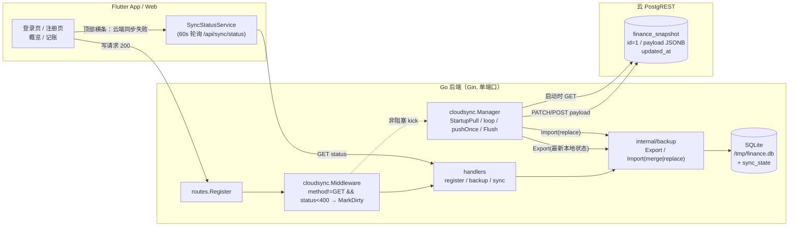
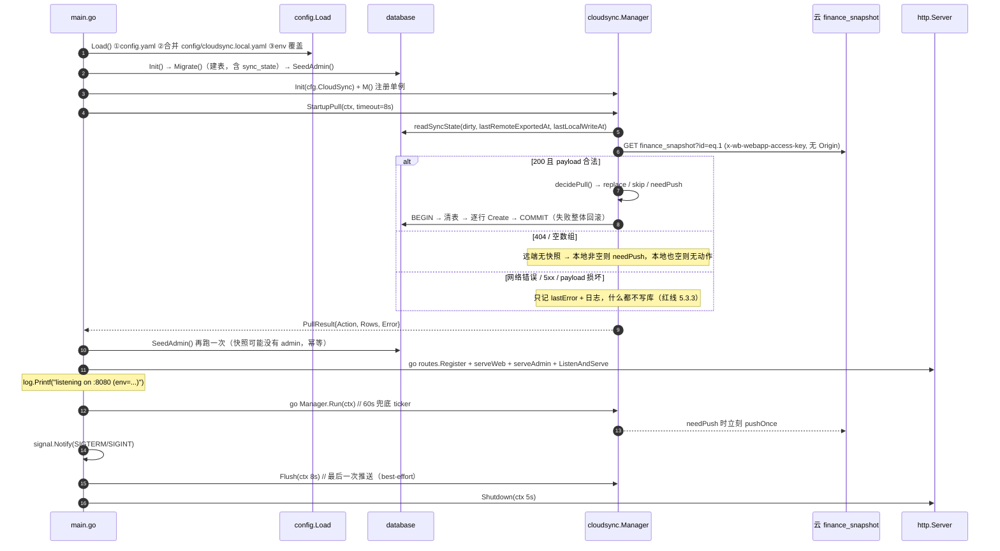
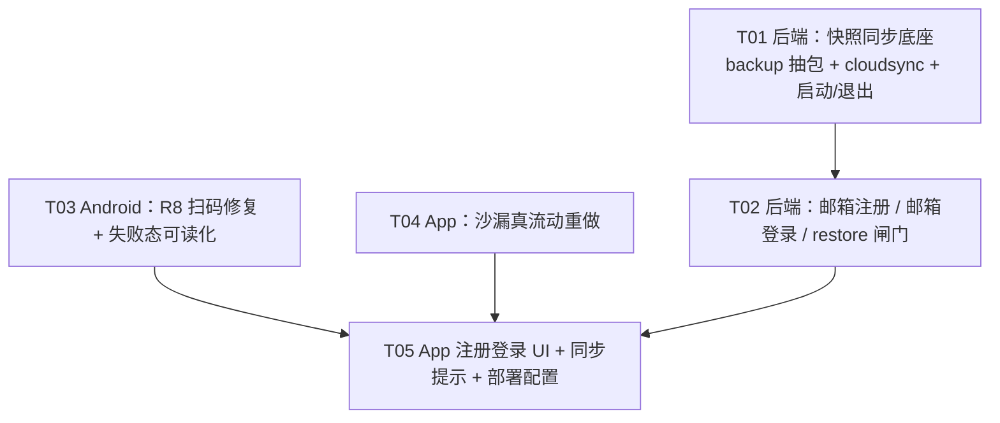

# 系统设计（增量）— 永远富裕 / KeepRich v0.4.0

| 项 | 内容 |
|---|---|
| 文档类型 | 增量设计（只描述 v0.4.0 相对 v0.3.1 的变更，存量设计不重复） |
| 基线 | v0.3.1（0.3.1+4）/ `main @ f1e481f` |
| 目标版本 | v0.4.0（0.4.0+5） |
| 上游文档 | `docs/prd/PRD_v0.4.0_incremental.md`、`docs/HANDOVER.md` |
| 云应用 | `wbapp_y6guj7h419fuquBPApQZYO` → `https://keeprich-finance.app.workbuddy.host` |
| 设计者 | 高见远（架构师） |

> 本文件是**唯一交付物**，工程师可照此直接落地。所有包名、文件路径、结构体字段、接口路径、状态机分支均已定稿；标注「待确认」的地方给出了默认取舍，**不得因此停工**。

---

## 0. 已核实的既有事实（不再重复验证）

| # | 事实 | 影响设计的地方 |
|---|---|---|
| F1 | Release 包开启了 R8，`app/android` 下无自定义 ProGuard 规则；`mapping.txt` 里 `com.google.mlkit.vision.barcode.internal.zzo` → `a`、`com.google.android.gms.internal.mlkit_vision_barcode*`（6669/7723/4007/573 个类）全部被改名 | §2.A 扫码修复 |
| F2 | `mobile_scanner 5.2.3` 自带的 consumer 规则是 `-keep class com.google.mlkit.* { *; }`（`configuration.txt:158`）——**单个 `*` 不跨包边界**，所以 `.vision.barcode.internal.**` 这些子包完全没被保护。这是崩溃的真正原因 | §2.A 规则必须写 `**` |
| F3 | 云库可被 Go 直接读写：Base `https://keeprich-finance.app.workbuddy.host/.cloud/database/rest/finance_snapshot`，头 `x-wb-webapp-access-key`；`GET 200 / POST 201 / PATCH 204`，202KB 载荷 PATCH 0.44s；`DELETE` 被网关 401 拒绝；**带不匹配 `Origin` 会 403**，Go 默认不发 Origin | §2.B 客户端只做 GET/POST/PATCH，绝不设 Origin、绝不做 DELETE |
| F4 | `updated_at` 无触发器，不会自动更新 | 时间闸门**不依赖** `updated_at`，只用 payload 内的 `exportedAt` |
| F5 | 沙箱单端口、无持久盘，SQLite 运行期副本在 `/tmp`；`cloud/finance-server/data/finance.db` 是**入库的部署快照库**（沙箱重启会回滚成它） | 启动拉取必须支持「本地有旧数据 → 被云端覆盖」这条路径，否则 bug ② 治不好 |
| F6 | `cloud/sync.sh` 会 `cp -R backend/config → DST/config`，且开头 `mv "$DST" "$OLD"` 把整个部署目录搬走 | 密钥 sidecar 必须放在**被 mv 走之前之外**的独立目录，由 sync.sh 事后注入 |
| F7 | 部署目录 `cloud/finance-server` 整体入库（3104 个 tracked 文件） | 密钥绝不能落在这个目录的受控文件里，只能是不入库的新文件 |
| F8 | 云部署 `go.mod` 被 `cloud/set_go.py` 降到 **1.22** | 新代码只用 Go ≤1.22 的标准库 API；禁用 `iter`、`slices`（1.21 有 `slices` 但 1.22 也有，安全）、禁 `for range func` |
| F9 | `User.Email` 是**普通索引**且历史数据有大量 `''` | 不能直接加唯一索引（多行 `''` 冲突），改用 `Username` 唯一索引承担唯一性 |
| F10 | `ReportErrorReq` 已有 `Extra string` 字段，`ErrorReport.Extra` 已入库 | 扫码错误上报**零后端改动**，App 传 `extra` JSON 即可 |
| F11 | **主理人已导出线上真实数据**：`docs/backups/finance-backup-20261109-live.json`（209,667 B，`{code,message,data:{exportedAt,counts,tables}}`，18 表，`exportedAt=1794193712`）。明细：transactions **160**、users **5**、audit_logs **428**、purchase_plans 19、housing_fund_loans 16、future_benefits 9、family_members 7、investment_records 6、borrowed_moneys 5、commercial_loans 4、families 4、financial_plans 4、family_join_requests 3、notifications 52、delete_family_requests 1、delete_family_votes 2、app_versions 0、error_reports 0 | **PRD 1.3「不迁移旧云应用数据」作废**：本版必须把这批真实数据接续到新云应用（§2.F） |
| F12 | 实测 live 备份：5 个用户（admin/alice/bob/test/webuser）**`passwordHash` 全为空**（v0.3.1 的 `json:"-"` 所致，与 R5 同源）；`mfaEnabled` 全 false；`bob` 为 `disabled=true`；family `永远富裕之家`(id=4, code `V7K3BFZL`) 有 admin+webuser 两个 active 成员 | 若直接用 live 备份接续，账号存在但登不进 |
| F14 | **主理人已产出合并后的接续包**：`docs/backups/finance-migration-restore.json`（225,775 B，顶层 `{tables, exportedAt, counts}`，**无 `data` 外层**；`exportedAt=1794193712` 与 live 一致，`counts` 与 live 逐表相同）。其中 `tables.users` 的 **admin/alice/bob/test 四行已带真实 `passwordHash`**（`$2a$10$…`，60 字符），**只有 `webuser` 为空** | §2.F 改用这个文件做接续；接续后只需对 `webuser` 单独 reset 一次，其余 4 个账号密码不变 |
| F13 | 实测该 live 备份：`transactions` 行**不含 `deletedAt` 字段**（`models.Base.DeletedAt` 是 `json:"-"`） | 软删除的行一旦备份/恢复就会**复活**（"我删的东西又回来了"）。本版必须修：把 `Base.DeletedAt` 的 tag 改为 `json:"deletedAt"`（详见 §2.B.2 第 6 条） |

---

## Part A：系统设计

### 1. 实现方案总览

#### 1.1 核心难点与取舍

| 难点 | 本质 | 本设计的解法 |
|---|---|---|
| **D1 数据被"还原成旧数据"** | 沙箱每次重启把 SQLite 回滚到**入库的部署快照库**，而这个库里有旧数据；只要有任何路径把旧数据写回去，用户的新数据就"消失" | ① 把云端快照升格为**唯一事实源**；② 启动时用 `exportedAt` + `dirty` 标记做**单向闸门**（本地有未推送写 → 绝不导入）；③ 导入模式从「查-插跳过」改成「事务内先清后插」——否则旧行"跳过"就永远治不好 |
| **D2 推送不能拖慢请求** | 200KB 全量序列化 + 0.44s 网络 | 中间件只打一个非阻塞标记；独立 goroutine 做 1.5s 防抖合并 + 指数退避 |
| **D3 无法删云行** | `DELETE` 401 | 只需要单行 `id=1` 的 upsert（POST 首建 / PATCH 后续），永不删除；历史版本（P2）只能追加到另一张表 |
| **D4 密钥不能入库** | 公开仓库 + sync.sh 会搬走目录 | 三级来源：环境变量 > `config/cloudsync.local.yaml` sidecar（不入库）> `config.yaml`（只有 `enabled:false`）；sidecar 母本存 `cloud/secrets/`（`.gitignore`），由 sync.sh 注入到部署目录 |
| **D5 R8 把反射用的类改名** | MLKit 靠反射实例化内部类 | 补 `**` 通配的 keep 规则；用 `proguardFile(...)` **追加**（不能用 `proguardFiles(...)` 覆盖 AGP 默认列表）；保留"关 minify"作为兜底 |
| **D6 沙漏"放平就不动 / 只有倾斜才动"** | 旧实现把流动完全绑定在传感器上（`tiltMag` 驱动 `_flow`），静置时 `active=false` 直接不重绘 | 流体由**恒定排沙率**驱动（与传感器无关），传感器只作用于"表面倾角 + 束流横向漂移 + 坡面滑落"，永不中断流动 |
| **D7 线上真实数据必须接续到新云应用** | 新云快照是空的，真实数据只在一份离线 JSON 里；口令哈希与业务数据分处两个来源 | ① 主理人已把 live 业务数据 + 旧运行库里的 bcrypt 哈希按 username 合并成一个接续包；② 部署目录 db **强制置空**（否则旧行会"跳过"掉真实数据）；③ 一次性 `restore`（`force=true` + 硬行数断言 + 幂等可重跑）；④ 只对唯一无哈希的 `webuser` 重置一次口令。全部写成可执行步骤（§2.F） |

#### 1.2 框架与库选择

| 用途 | 选择 | 理由 |
|---|---|---|
| HTTP 客户端（Go） | **标准库 `net/http`** | 只有一个 REST 端点、三个动词；不引入重试库。`http.Client{Timeout:5s}` + 手写退避 |
| 序列化复用 | **现有 `internal/backup`（新抽包）** | 复用 `backupTables()` 的 18 表清单与 `reflect` 查-插逻辑，保证与 `/api/admin/backup` **同一套格式**，避免双份漂移（PRD 5.1） |
| 状态持久化 | **SQLite 新表 `sync_state`（key-value）** | 跨重启（部署快照库）保留 `dirty` / `lastRemoteExportedAt`，是"不覆盖用户数据"的关键；不进快照 payload |
| 优雅退出 | **`http.Server` + `signal.Notify`** | `r.Run()` 无法在退出前 flush；换成显式 `Server` 保留 `listening on` 日志格式 |
| App 沙漏 | **Flutter `CustomPainter` + `drawRawPoints` + `ImageShader`** | 零逐帧分配；Web(CanvasKit) 与 Android 渲染一致；不引视频/3D 引擎（PRD 1.3） |
| App 扫码错误码 | **mobile_scanner 自带 `MobileScannerErrorCode`** | 无需新增依赖；不引 `permission_handler`（评估见 §2.A.5） |

#### 1.3 架构模式

沿用现有分层，不引入新模式：

```
App(Flutter) ──HTTP──> Gin(routes) ──> handlers ──> backup(纯数据) ──> GORM/SQLite
                                        │                              │
                                        └── cloudsync.Manager ─────────┘
                                                  │  HTTP(no Origin)
                                                  ▼
                                    云 PostgREST finance_snapshot(id=1)
```

- `handlers` = 薄协议层（只做参数校验 + 调 backup/cloudsync + 包 `utils.OK/Fail`）
- `backup` = 纯数据层（无 gin 依赖，可被 handler 和 cloudsync 同时用）
- `cloudsync` = 有状态服务（单例 Manager + 1 个后台 goroutine，内存状态 + `sync_state` 落盘）

#### 1.4 数据闭环（架构图）



#### 1.5 启动 / 退出时序



---

### 2. 模块设计

---

#### 2.A 扫码修复（R-01 / R-10）

##### A.1 根因（已锁定，写进代码注释）

`mobile_scanner 5.2.3` 的 consumer 规则是 `-keep class com.google.mlkit.* { *; }`。

ProGuard 的 `*` **不匹配包分隔符**，所以它只 keep 了 `com.google.mlkit.*` 这一层的类，
`com.google.mlkit.vision.barcode.internal.**`（32 个类）与
`com.google.android.gms.internal.mlkit_vision_barcode{,_bundled}`（14392 个类）
全部被 R8 改名 → MLKit 运行时用反射按**原始类名**加载 → `ClassNotFoundException` 被内部 catch 成
`MobileScannerException(genericError)`，桩栈 `x5.d.a(t5.b)` 就是改名后的帧。

##### A.2 新增 `app/android/app/proguard-rules.pro`

```proguard
# ============================================================================
# R8 keep 规则 — 为什么需要这个文件
#
# mobile_scanner 5.2.3 自带规则是 `-keep class com.google.mlkit.* { *; }`，
# ProGuard 的单个 `*` 不跨包边界，因此 com.google.mlkit.vision.barcode.internal.**
# 与 com.google.android.gms.internal.mlkit_vision_barcode{,_bundled}.** 全被改名，
# MLKit 反射加载失败 → MobileScannerException: genericError（v0.3.1 线上问题）。
# 必须用 `**`（跨包）重新 keep。
# ============================================================================

# ---- ML Kit 对外 API + 内部反射类 ----
-keep class com.google.mlkit.** { *; }
-keepclassmembers class com.google.mlkit.** { <fields>; <methods>; <init>(...); }

# ---- ML Kit 的 GMS 内部实现（barhopper / 条码/文字识别内核）----
-keep class com.google.android.gms.internal.mlkit_vision_barcode.** { *; }
-keep class com.google.android.gms.internal.mlkit_vision_barcode_bundled.** { *; }
-keep class com.google.android.gms.internal.mlkit_vision_common.** { *; }
-keep class com.google.android.gms.internal.mlkit_common.** { *; }

# ---- mobile_scanner 其余可选后端（视觉搜索 / 照片）----
-keep class com.google.android.libraries.barhopper.** { *; }
-keep class com.google.photos.vision.** { *; }

# ---- 反射/序列化/注解元数据：R8 默认会丢，丢了解析就炸 ----
-keepattributes Signature,InnerClasses,EnclosingMethod,*Annotation*,Exceptions

# ---- 兜底：不要为缺依赖的 MLKit 可选模块报错（否则 R8 直接构建失败）----
-dontwarn com.google.mlkit.**
-dontwarn com.google.android.gms.**
-dontwarn com.google.android.libraries.barhopper.**
-dontwarn com.google.photos.vision.**

# ---- CameraX：默认无反射，仅在"仍崩溃"的兜底方案里打开（见 A.4）----
# -keep class androidx.camera.** { *; }
# -dontwarn androidx.camera.**

# ---- Flutter embedding（插件注册走反射表）----
-keep class io.flutter.** { *; }
-keep class io.flutter.plugins.** { *; }
```

##### A.3 `app/android/app/build.gradle.kts` 的挂法（**关键细节**）

只改 `buildTypes.release`，其余不动：

```kotlin
buildTypes {
    release {
        signingConfig = if (keystorePropertiesFile.exists()) {
            signingConfigs.getByName("release")
        } else {
            signingConfigs.getByName("debug")
        }

        // ⚠️ 必须用 proguardFile(...)（追加成员），
        //    不能用 proguardFiles(...)（赋值会整体覆盖 AGP/Flutter 注入的
        //    proguard-android-optimize.txt 与各插件 consumer 规则）。
        isMinifyEnabled = true
        isShrinkResources = true
        proguardFile("proguard-rules.pro")
    }
}
```

**取舍：为什么不直接 `isMinifyEnabled = false`？**

| 方案 | 优点 | 缺点 | 结论 |
|---|---|---|---|
| A. 补 keep 规则（**采用**） | 保留裁剪（包体小 ~20%）、保留性能优化、符合 Google/Play 建议 | keep 范围宽，dex 中保留更多类名/成员，预计包体 +0.5–2MB（需实测记录） | **主方案** |
| B. release 关 minify | 100% 不会再有此类问题 | 包体明显变大、失去 R8 优化、`mapping.txt` 消失导致未来线上崩溃栈无法还原 | 仅作 **A 失败时的兜底**，且必须在 PRD R-01 验收口径内说明 |
| C. 两者都做 | 最保险 | 浪费 A 的收益 | ❌ |

**增量成本**：`proguardFile` 追加不覆盖默认列表，AGP 会自动合并 `proguard-android-optimize.txt`；R8 构建时间 +10~20s（可接受）。

##### A.4 验收方法（**按主理人口径改为等价验收**）

> **口径修正**：PRD R-01 原写「Android 真机 ≥2 台」，但团队只有 **1 台真机 + 模拟器**，
> 该条不可执行。改为下面 4 项等价验收，覆盖同样的风险面（R8 规则是否真的保住类名 +
> 运行时是否真的能出帧），且全部可复现。

```bash
cd app && flutter build apk --release --split-per-abi --no-pub
M=build/app/outputs/mapping/release/mapping.txt

# ===== 验收 ①【静态、最硬】mapping.txt 中不再有 mlkit 内部类被映射成 a/b/c =====
# 正向：名字必须原样保留
grep -E "^com\.google\.mlkit\.vision\.barcode\.internal\." "$M" | head -3
#   期望形如：com.google.mlkit.vision.barcode.internal.zzo -> com.google.mlkit.vision.barcode.internal.zzo
# 负向断言：以下两类**必须零命中**
! grep -qE "^com\.google\.mlkit\.(vision|common)\..* -> [a-zA-Z]{1,2}$" "$M"
! grep -qE "^com\.google\.android\.gms\.internal\.mlkit_[a-z_]+(\.[a-zA-Z0-9_$]+)? -> [a-zA-Z]{1,2}$" "$M"
echo "① mapping OK"

# ===== 验收 ②【运行时】release APK 装机后进扫码页，无 genericError =====
adb install -r build/app/outputs/flutter-apk/app-arm64-v8a-release.apk
adb logcat -c && adb shell am start -n com.yourname.family_finance_app/.MainActivity
#   手动：登录页 → 服务端地址 → 扫码（或直接进扫码页）
adb logcat -d | grep -Ei "MobileScannerException|genericError|mlkit" && echo "❌ 有报错" || echo "② 无 genericError OK"

# ===== 验收 ③【模拟器】CameraX 虚拟场景能出预览帧（不依赖真机摄像头） =====
# 启动带虚拟相机的 AVD（Emulator 内置 "VirtualScene" 后置摄像头 + 可注入的动画场景）
emulator -avd Pixel_7 -camera-back virtualscene -no-snapshot-load &
flutter run -d emulator-5554 --release
#   → 进扫码页 3s 内必须出现取景画面（灰度虚拟场景），且无异常弹层
#   → 用 `adb emu` 无摄像头时，至少证明"MLKit 初始化 + CameraX 绑定"链路没被 R8 破坏

# ===== 验收 ④【对照】debug 包本来就正常，必须仍然正常 =====
flutter build apk --debug --no-pub
adb install -r build/app/outputs/flutter-apk/app-debug.apk
#   → 进扫码页出画面、能扫到 Web 端二维码（证明问题只与 R8 有关，不是业务代码回归）
```

**四条缺一不可**：① 证明"规则生效"，② 证明"运行时不再炸"，③ 证明"在没有第二台真机的条件下仍能验证相机链路"，④ 证明"不是把业务改坏了"。若 ① 通过但 ②/③ 仍失败 → 启用 A.2 里注释掉的 CameraX 兜底 → 仍失败 → 走方案 B（`isMinifyEnabled = false`），并在 `docs/RELEASE.md` 记录「v0.4.0 临时关闭 minify 的原因与恢复条件」。

##### A.5 `AndroidManifest.xml`：补 `uses-feature`

在 `<uses-permission android:name="android.permission.CAMERA"/>` 之后加：

```xml
<!-- 相机是可选硬件：R-10 要求"设备不支持"时给出可读文案而不是崩溃。
     不加 required="false" 时，CAMERA 权限会隐含 required=true，
     无相机设备会被商店过滤，且 hasSystemFeature 判断形同虚设。 -->
<uses-feature android:name="android.hardware.camera" android:required="false"/>
<uses-feature android:name="android.hardware.camera.autofocus" android:required="false"/>
```

##### A.6 失败态可读化（R-10）

重写 `app/lib/pages/qr_scan_mobile.dart`，引入错误分级（**不新增依赖**）：

```dart
enum ScanFailure {
  permissionDenied, // 权限被拒
  unsupported,      // 设备不支持 / 无相机
  cameraInUse,      // 相机被占用（Android 常见：另一个 App 持有 CameraDevice）
  initFailed,       // 未知初始化异常（含 R8 类问题兜底）
}

/// MobileScannerErrorCode → ScanFailure 的映射（唯一出口，禁止在 UI 里散落 switch）
ScanFailure mapScanError(MobileScannerException e) {
  switch (e.errorCode) {
    case MobileScannerErrorCode.permissionDenied:
      return ScanFailure.permissionDenied;
    case MobileScannerErrorCode.unsupported:
      return ScanFailure.unsupported;
    case MobileScannerErrorCode.controllerInitializationError:
      // CameraX 在 "相机被占用" 时抛的也是初始化错误，靠 message 细分
      final msg = (e.errorDetails?.toString() ?? '').toLowerCase();
      if (msg.contains('in use') || msg.contains('disconnected') ||
          msg.contains('camerasource')) {
        return ScanFailure.cameraInUse;
      }
      return ScanFailure.initFailed;
    default:
      return ScanFailure.initFailed;
  }
}
```

| 分级 | 文案（中文，**不得出现任何 exception 类名/堆栈**） | 图标 | 主按钮 | 次按钮 |
|---|---|---|---|---|
| permissionDenied | 相机权限未开启。请在「系统设置 → 应用 → 永远富裕 → 权限」中允许使用相机。 | `Icons.no_photography_outlined` | 重新申请权限 | 手动输入服务端地址 |
| unsupported | 当前设备不支持相机扫码，请手动输入服务端地址。 | `Icons.videocam_off_outlined` | 手动输入服务端地址 | 返回 |
| cameraInUse | 相机被其他应用占用，请关闭后重试。 | `Icons.phonelink_erase_outlined` | 重试 | 手动输入服务端地址 |
| initFailed | 相机启动失败，请重试或手动输入服务端地址。 | `Icons.error_outline` | 重试 | 手动输入服务端地址 |

- 失败时 `if (!_cameraError)` 隐藏取景框装饰层（已有逻辑保留）。
- 「手动输入服务端地址」→ `Navigator.pop(context)` 回上一页，由调用方（`server_address_dialog`）保持输入框焦点。
- 失败时上报一次（`_reported` 去重，同一页面生命周期只报一次）：

```dart
ApiClient.instance.reportError(
  message: 'scan_failed:${failure.name}',
  extra: jsonEncode({
    'errorCode': e.errorCode.name,
    'detail': e.errorDetails?.toString() ?? '',
    'model': await _deviceModel(),   // device_info_plus，已有依赖
    'sdkInt': (await DeviceInfoPlugin().androidInfo).version.sdkInt,
  }),
  platform: 'android',
  app: 'client',
  version: AppConfig.appVersion,
);
```

后端无需改动（`ReportErrorReq.Extra` 已存在，`GET /api/admin/errors` 已能查）。

##### A.7 「一键去系统设置」入口：**本版不做**

| 方案 | 成本 | 结论 |
|---|---|---|
| 引 `app_settings`（^5.1.1） | 新依赖 + 重新走 release 构建链（含 R8 复验）+ Web 端需条件导入 | ❌ 本版不做 |
| 引 `permission_handler` | 需改 Manifest/Info.plist、Android 12+ 需额外权限声明、与 `mobile_scanner` 自带的权限请求可能双弹窗 | ❌ 更差 |
| 用 `MethodChannel` 自写 `Intent(Settings.ACTION_APPLICATION_DETAILS_SETTINGS)` | 需改 `MainActivity.kt` + 10 行 Kotlin | ⚠️ 成本最低的可行解，但**放 P2**（R-13 档期） |

**本版取舍**：文案里写清"系统设置 → 应用 → 永远富裕 → 权限"的路径（Android 通用），P2 再补一键跳转。理由：新增依赖会牵动 R8 keep 规则的复验成本，与本版"扫码必须稳"的核心目标冲突。

---

#### 2.B 云端快照同步（R-02 / R-03 / R-04 / R-11）——核心模块

##### B.1 职责边界

> **⚠️ Go 1.22 硬约束（部署目录 `go.mod` 会被 `cloud/set_go.py` 降到 1.22）**
>
> 本地 `backend/go.mod` 是 `go 1.26.0`，所以 IDE 与 `go vet` 都会放行新 API，**但云部署会编译失败**。
> `internal/backup` 与 `internal/cloudsync` **只允许使用 Go ≤1.22 的标准库 API**。禁用清单：
>
> | 禁用 | 引入版本 | 替代 |
> |---|---|---|
> | `for range` 迭代器函数 / `iter` 包 | 1.23 | 普通 `for` 循环 |
> | `slices.Clone/Concat/Repeat`、`maps.Clone` 以外的新泛型助手 | 1.23+ | 手写 copy |
> | `math/rand/v2` | 1.22 ✅ 可用，但**不用**（无必要） | `math/rand` |
> | `sync.WaitGroup.Go` | 1.25 | `wg.Add(1); go func(){ defer wg.Done() ... }()` |
> | `os.Root`、`http.Server.Protocols`、`http.CrossOriginProtection` | 1.24+ | 不用 |
> | `unique` / `weak` / `structs` 包 | 1.23+ | 不用 |
> | `errors.AsType` | 1.26 | `errors.As` |
>
> 唯一强制的验证方式：**写完 T01 立刻在部署目录验编译**（IDE 绿不算）：
> ```bash
> bash cloud/sync.sh          # 内部会 set_go.py 降到 1.22 再 go build 双架构
> # 必须输出 SYNC_OK；失败会直接报 undefined: xxx（那就是用了新 API）
> ```


```
internal/backup/        ← 纯数据层（无 gin / 无网络）
    snapshot.go         Table 清单、Snapshot 结构、Export()
    import.go           Import(mode=merge|replace)、Result
internal/cloudsync/     ← 有状态服务层
    client.go           PostgREST 客户端（GET/POST/PATCH，永不发 Origin，永不 DELETE）
    state.go            sync_state 读写（dirty / lastPullAt / lastPushAt / lastRemoteExportedAt / lastLocalWriteAt / lastError）
    manager.go          Manager：单例、StartupPull、Run 循环、防抖、退避、Status、Flush
    middleware.go       gin 中间件：捕获写操作 → MarkDirty
internal/handlers/
    backup.go           只做协议适配（调 backup.Export / backup.Import）+ restore 时间闸门
    sync.go             GET /api/sync/status、POST /api/admin/sync/push|pull
```

`handlers/backup.go` 现有 130 行里的 `backupTables()` / `newSlicePtr()` / 导出循环 / 查-插导入循环，**整体搬迁**到 `internal/backup`，handler 改成 20 行薄壳。这样 `cloudsync` 可以直接复用，两套格式不会漂移（PRD 5.1 硬要求）。

##### B.2 `internal/backup/snapshot.go`（定稿结构）

```go
package backup

type Table struct {
    Name  string
    Model any
}

// Tables 返回 18 张表的清单（顺序 = 插入顺序，users → families → ... → app_versions）
func Tables() []Table

type Snapshot struct {
    SchemaVersion int                        `json:"schemaVersion"`      // 2（v0.3.1 导出无此字段，视为 1）
    AppVersion    string                     `json:"appVersion,omitempty"` // "0.4.0"
    ExportedAt    int64                      `json:"exportedAt"`         // Unix 秒，**唯一时间闸门依据**
    Counts        map[string]int64           `json:"counts"`
    Tables        map[string]json.RawMessage `json:"tables"`
}

type ExportOptions struct {
    Exclude      []string // 默认 ["audit_logs","error_reports"]
    IncludeAudit bool     // /api/admin/backup 传 true 导出全部
    AppVersion   string
}

func Export(db *gorm.DB, opt ExportOptions) (*Snapshot, error)
```

**关键实现约束：**

1. 每张表必须 `Unscoped().Order("id ASC").Find(rows)` —— 保证 `payload` 字节级稳定（便于人工 diff / 未来做 hash 校验），且软删除的行要一起带走（否则导入后"删除"会复活）。
2. `json.RawMessage` 直接透传 `[]*T` 的 marshal 结果，`/api/admin/backup` 的输出与 v0.3.1 **逐字节同构**（只是多了 `schemaVersion`/`appVersion` 两个字段，旧客户端忽略）。
3. **payload 默认排除 `audit_logs` 与 `error_reports`**：这两张表是只增日志，每次写操作都会加行；若进快照，payload 会单调膨胀（每次推 200KB 且越来越大），且它们对"账目数据完整"毫无贡献。
   - `/api/admin/backup` 仍导出全表（`IncludeAudit:true`），保持备份语义不变。
   - 这是对 PRD 5.1「与现有导出同构」的**唯一有意偏差**，已列入 §7 待确认（Q-D1）。
4. `ExportedAt = time.Now().Unix()`（与现有字段一致，秒级）。

**⚠️ 5. `users` 表必须用专门的导出行/导入行类型（否则账号会永久丢失）**

`models.User.PasswordHash` / `MFASecret` / `MFABackupCodes` 都带 `json:"-"`。
**导出与导入两侧都必须显式映射这三个字段，缺一侧就前功尽弃**：

- 只补导出侧 → 快照里有哈希，但导入时 `json.Unmarshal` 进 `models.User` 会因为 `json:"-"` **静默丢弃** `passwordHash`，重启后所有人仍然登不进（且不报错，极难发现）。
- 只补导入侧 → 快照里压根没有哈希。

因此定义**对称的两个类型**，`Export` 与 `Import` 都不得直接对 `models.User` 做 JSON 编解码：

```go
// backend/internal/backup/snapshot.go
// userExportRow / userImportRow 只用于 users 表的 JSON 往返：
// 把 json:"-" 的三个敏感字段显式提升为可序列化字段。
// 外层同名字段（深度 0）会遮蔽 models.User 里被提升的同名字段（深度 1），
// encoding/json 按"深度浅者优先"取值 → 输出/读回 passwordHash 而不是丢弃。
type userExportRow struct {
    models.User
    PasswordHash   string `json:"passwordHash"`
    MFASecret      string `json:"mfaSecret,omitempty"`
    MFABackupCodes string `json:"mfaBackupCodes,omitempty"`
}

// userImportRow 与 userExportRow 字段一一对称（三个字段的 json tag 必须完全一致，
// 否则哈希进不来）。导入侧禁止直接 Unmarshal 到 models.User。
type userImportRow struct {
    models.User
    PasswordHash   string `json:"passwordHash"`
    MFASecret      string `json:"mfaSecret,omitempty"`
    MFABackupCodes string `json:"mfaBackupCodes,omitempty"`
}

// 导入时在 Create 之前必须把三个字段回填到内嵌结构：
func (r *userImportRow) toModel() models.User {
    u := r.User               // 内嵌结构里的 PasswordHash 仍是 ""（被 json:"-" 丢弃）
    u.PasswordHash   = r.PasswordHash
    u.MFASecret      = r.MFASecret
    u.MFABackupCodes = r.MFABackupCodes
    return u
}
```

- 落地要求：`Import` 里对 `users` 表**禁止** `newSlicePtr(&models.User{})`，必须走 `userImportRow` + `toModel()`。这是本设计里最容易"看起来写对了、其实哈希被丢了"的一处，**必须在代码里留注释，并在 T01 验收里用真实账号登录验证**（见下方验收 ⑧）。
- `Export` 对 `users` 表走 `userExportRow`，其余表维持 `[]*T` 原样。
- `GET /api/auth/me`、`GET /api/admin/users` 等**所有对客户端暴露的接口仍然不含哈希**（它们不走这条路径）。
- 代价与风险：云端 `finance_snapshot.payload` 里会含 bcrypt 哈希。缓解：① key 只在后端配置、不进 App/Web 产物；② bcrypt cost 已足够慢，离线爆破成本高；③ 列入 §7.1 R12 跟踪。

**⚠️ 6. 软删除行必须能往返（否则"删掉的东西又回来"）**

`models.Base.DeletedAt` 当前是 `json:"-"`（`backend/internal/models/base.go`），
所以软删除的行导出后**丢掉 deletedAt**，再导入就变成"未删除"——
用户删掉的账目/家庭会在每次沙箱重启后复活，直接违背"数据不能被乱动"（F13）。

```go
// backend/internal/models/base.go   （唯一改动：JSON tag）
DeletedAt gorm.DeletedAt `gorm:"index" json:"deletedAt"`   // 原为 json:"-"
```

- `gorm.DeletedAt` 自带 `MarshalJSON`（`Valid=false` → `null`）与 `UnmarshalJSON`，
  所以非删除行会多出一个 `"deletedAt": null` 字段 —— **纯增量，向后兼容**，旧客户端忽略。
  （`omitempty` 对 struct 无效，无法省略，接受这个 null。）
- 已验证该 live 备份当前**没有**软删除行，所以这次接续不会踩到；但云端快照机制是长期的，
  不修的话未来任何一次"删除"都会在重启后失效。
- 该改动影响全部 18 个模型的 API 输出（各多一个 `deletedAt: null`），是本版**唯一**触及存量
  模型定义的改动，需在 T01 的代码走查里单独确认。

##### B.3 `internal/backup/import.go`（定稿）

```go
type ImportMode int
const (
    ImportMerge   ImportMode = iota // 查-插，已存在则跳过（= v0.3.1 行为，保留给 restore 默认）
    ImportReplace                   // 事务内先清后插（云端快照覆盖本地，= 唯一事实源语义）
)

type ImportOptions struct {
    Mode ImportMode
    // KeepTables：Replace 模式下**不清空**的表。默认空 = 全表替换（users 也必须替换，
    // 否则沙箱重启后账号丢失；见 B.2 第 5 条：users 行已带口令哈希，可安全替换）。
    KeepTables []string
}

type ImportResult struct {
    Inserted map[string]int64 `json:"inserted"`
    Skipped  map[string]int64 `json:"skipped"`
    Deleted  map[string]int64 `json:"deleted"`
    Replaced bool             `json:"replaced"`
}

func Import(db *gorm.DB, tables map[string]json.RawMessage, opt ImportOptions) (ImportResult, error)
```

`ImportReplace` 的实现顺序（**必须严格按此顺序，否则主键/引用会错**）：

```
1. 预解析：把所有 raw 反序列化成 []*T，任一表 JSON 非法 → 直接返回错误（不写库）
   ⚠️ users 表必须反序列化成 userImportRow，并在 Create 前调 toModel() 回填哈希
      （merge 与 replace 两种模式都要，别只在 replace 分支里做）
2. 安全校验（红线 5.3.3）：
   - tables 为空 或 len(tables) == 0 → 拒绝
   - 若 tables["users"] 存在但解析后 0 行 → 保留本地 users（不删不插），并记 warn
3. BEGIN（gorm Transaction）
4. 按 Tables() 的**逆序** DELETE：Unscoped().Where("1 = 1").Delete(&models.X{})
   - 跳过 KeepTables（默认空 → users 也清空重建，因为 users 行自带口令哈希）
5. 按 Tables() 的**正序**逐行 Create（显式带 ID / CreatedAt / UpdatedAt / DeletedAt；
   users 行走 usertoModel()，PasswordHash / MFASecret / MFABackupCodes 必须已回填）
6. COMMIT（任一步出错 → 整体回滚，本地数据保持原样）
```

> ⚠️ **为什么必须 replace 而不能只用 merge**：`cloud/finance-server/data/finance.db` 是入库的部署快照库，沙箱重启后本地就有旧数据。用 v0.3.1 的"主键已存在就跳过"逻辑，云端的新数据会被**全部跳过**，用户看到的永远是旧数据 —— 这正是 bug ② 的技术根因之一。`ImportMerge` 只为 `POST /api/admin/backup/restore` 保持向后兼容而保留。

##### B.4 `internal/cloudsync/client.go`（PostgREST 客户端）

```go
type Client struct {
    endpoint string       // .../rest/finance_snapshot（**已含表名**，不含 query）
    apiKey   string
    http     *http.Client // Timeout: 5s
}

type Row struct {
    ID        int64           `json:"id"`
    Payload   json.RawMessage `json:"payload"`
    UpdatedAt string          `json:"updated_at,omitempty"`
}

// Get 读单行。返回 (nil, nil) 表示远端不存在（404 / 空数组）。
func (c *Client) Get(ctx context.Context) (*Row, []byte, error)

// Create POST（首建）。已存在时 PostgREST 返回 409。
func (c *Client) Create(ctx context.Context, payload []byte, now time.Time) error

// Update PATCH ?id=eq.1，成功返回 204（无 body）。
func (c *Client) Update(ctx context.Context, payload []byte, now time.Time) error
```

**必须遵守的 5 条硬约束（写进代码注释）：**

| # | 约束 | 原因 |
|---|---|---|
| C1 | 只设两个头：`x-wb-webapp-access-key: <key>`、`Content-Type: application/json` | `apikey` / `Authorization` 实测 401 |
| C2 | **绝不设置 `Origin` / `Referer`** | 带不匹配 Origin → 网关 403。Go 默认不发，别手贱 |
| C3 | **绝不做 `DELETE`** | 网关拒绝（401）。逻辑上是 upsert 模型（`id=1` 单行） |
| C4 | `updated_at` 由客户端显式写入 `time.Now().UTC().Format(time.RFC3339)` | 无触发器，不写就永远是旧值（F4） |
| C5 | PATCH 后不解析 body（204 无 body），只看状态码 | 避免 EOF 误判为失败 |

URL 拼装（B.4 唯一允许的形式）：
```
GET   {endpoint}?id=eq.1&select=id,payload,updated_at
POST  {endpoint}
PATCH {endpoint}?id=eq.1
```

##### B.5 `internal/cloudsync/state.go` + 新模型

```go
// backend/internal/models/syncstate.go
package models

// SyncState 同步状态（key-value，**不进快照 payload**）
type SyncState struct {
    Key   string `gorm:"primaryKey;size:64"`
    Value string `gorm:"size:512"`
}
```
`database.Migrate()` 追加 `&models.SyncState{}`。

固定 Key（常量，别散落字符串）：

| Key | 含义 | 写入时机 |
|---|---|---|
| `last_pull_at` | 上次成功拉取的 Unix 秒 | 拉取成功后 |
| `last_push_at` | 上次成功推送的 Unix 秒 | 推送成功后 |
| `last_remote_exported_at` | 上次成功拉取/推送时 **payload 里的 `exportedAt`** | 同上 |
| `last_local_write_at` | 上次**业务写操作**成功的 Unix 秒（中间件打） | `MarkDirty` 时同步落盘 |
| `dirty` | `1` = 本地有未推送的写 | `MarkDirty` 置 1；推送成功置 0 |
| `last_error` | 最近一次失败的简短原因（≤256B） | 失败时 |
| `last_error_at` | 失败时间 | 失败时 |

> **为什么 `dirty` 必须落盘而不是只在内存**：沙箱可能在用户刚写完账就被重启（部署/超时），重启后进程内 `dirty` 丢失，就会误判"本地无新写"从而被云端旧快照覆盖 —— 直接违反红线 5.3.4。落盘后，重启第一件事就是"先推再比"。

##### B.6 `internal/cloudsync/manager.go`（状态机定稿）

```go
type Manager struct {
    cfg     config.CloudSyncConfig
    cli     *Client
    kick    chan struct{}   // 缓冲 1，非阻塞
    mu      sync.Mutex
    st      Status          // 内存镜像（payloadBytes / consecutiveFailures 等）
    started bool
}

func Init(cfg config.CloudSyncConfig) *Manager
func M() *Manager                     // 单例（未 Init 返回 disabled 空壳，所有方法安全 no-op）

func (m *Manager) Enabled() bool
func (m *Manager) StartupPull(ctx context.Context) Result   // 阻塞，调用方给 8s 超时
func (m *Manager) MarkDirty(reason string)                  // 非阻塞，中间件调用
func (m *Manager) Run(ctx context.Context)                  // 后台循环（go 起）
func (m *Manager) PushNow(ctx context.Context) Result       // 强制推送（admin 用）
func (m *Manager) PullNow(ctx context.Context, force bool) Result
func (m *Manager) Flush(ctx context.Context) error          // 退出前最后一次
func (m *Manager) Status() Status
```

**B.6.1 拉取判定（这是整个模块最关键的 15 行逻辑，必须逐条实现）**

```go
type PullAction int
const (
    PullSkipped  PullAction = iota // 不动本地
    PullReplaced                   // 云端覆盖本地
    PullNeedPush                   // 不导入，改为把本地推上去
)
```

按**顺序**判定，命中即返回：

| # | 条件 | 动作 | 说明 / 对应 PRD |
|---|---|---|---|
| P0 | `!Enabled()`（endpoint 或 key 为空） | `PullSkipped` | 未配置就完全静默，服务照常启动 |
| P1 | GET 网络错误 / 超时 / 5xx | `PullSkipped` + `lastError` | **不推送**（红线 5.3.3：拉不到 ≠ 可以拿本地覆盖云端） |
| P2 | 远端不存在（404/空数组） | `localHasBusiness ? PullNeedPush : PullSkipped` | PRD 5.4「云端为空、本地有数据 → 立即推送」 |
| P3 | `payload` 非法 JSON / `tables` 为空 / 所有表 0 行 | `PullSkipped` + `lastError="snapshot corrupt"` | 红线 5.3.3：损坏快照不得写库、不得回写 |
| P4 | `payload.tables["users"]` 解析后 0 行 | `PullSkipped` + `lastError="snapshot has no users"` | 防御：没有 users 的快照导入后谁都登不进 |
| P5 | 本地 `dirty == 1` | `PullNeedPush` | **最高优先级闸门**：本地有未推送写，绝不被覆盖（红线 5.3.4） |
| P6 | `!localHasBusiness`（18 张业务表总行数 == 0） | `PullReplaced` | PRD 5.2「首次部署/空库启动」 |
| P7 | `remote.exportedAt == last_remote_exported_at`（且 dirty==0） | `PullSkipped` | 已同步，无变化 |
| P8 | `remote.exportedAt < last_local_write_at` | `PullNeedPush` | 云端比本地写更旧 → 本地为准并推送（PRD 5.4） |
| P9 | 其余（`remote.exportedAt >= last_local_write_at`，含 `last_local_write_at==0`） | `PullReplaced` | PRD 5.4「云端更新 → 覆盖本地」。`last_local_write_at==0` 表示本地是部署快照库、从未被本进程写过 → 云端为真源 |

> **P9 的 `last_local_write_at == 0` 是关键**：`cloud/finance-server/data/finance.db` 里带着 v0.3.1 的旧数据且没有 `sync_state` 行，此时"云端更新"必须成立，否则 bug ② 治不好。

`PullReplaced` 之后：
```go
backup.Import(database.DB, snap.Tables, backup.ImportOptions{
    Mode: backup.ImportReplace,   // 全表替换；users 行已带 passwordHash，可安全替换
})
// 成功后
stateSet("dirty", "0")
stateSet("last_remote_exported_at", remoteExportedAt)
stateSet("last_pull_at", now)
```
> 替换 `users` 后 JWT 仍然有效（`id` 被完整保留），不会把在线用户踢下线。若担心，可在替换后
> `database.SeedAdmin(...)` 再跑一次（幂等）—— `main.go` 已经这么做了。

`PullNeedPush` 之后：立刻 `go m.PushNow(ctx)`（异步，不阻塞启动）；`main` 里 `SeedAdmin` 再跑一遍。

**B.6.2 写操作触发推送（Gin 中间件）**

```go
// backend/internal/cloudsync/middleware.go
func (m *Manager) Middleware() gin.HandlerFunc {
    return func(c *gin.Context) {
        c.Next()
        if !m.Enabled() { return }
        if c.Request.Method == http.MethodGet ||
           c.Request.Method == http.MethodHead ||
           c.Request.Method == http.MethodOptions { return }
        if c.Writer.Status() >= 400 { return }
        if !strings.HasPrefix(c.Request.URL.Path, "/api/") { return }
        for _, p := range excludedWritePushPaths {
            if strings.HasPrefix(c.Request.URL.Path, p) { return }
        }
        m.MarkDirty(c.Request.Method + " " + c.Request.URL.Path)
    }
}

var excludedWritePushPaths = []string{
    "/api/errors",            // 纯日志上报
    "/api/auth/login",        // 只更新 last_login_at，不必为它推 200KB
    "/api/auth/refresh",
    "/api/notifications",     // 已读状态，丢了无所谓；避免"读一条通知推一次全量"
    "/api/admin/sync",        // 防自激（sync/push、sync/pull 自己会管）
}
// 注意：/api/admin/backup/restore 是**真正的数据写入**，必须触发推送，不能排除。
// （/api/admin/backup 的导出是 GET，已被上面的 method 判断挡掉，不需要在这里列。）
```

挂载位置：`routes.Register()` 里 `api := r.Group("/api")` 之后、各子组之前 `api.Use(cloudsync.M().Middleware())`。
`/healthz` 不在 `/api` 下 → 天然不触发。

**B.6.3 防抖 + 退避（`Run` 循环）**

```go
const (
    debounceWindow   = 1500 * time.Millisecond  // 可配 cfg.DebounceMS
    fallbackInterval = 60 * time.Second         // 兜底扫描
    maxAttempts      = 8
)
var backoff = []time.Duration{1, 2, 4, 8, 16, 32, 60, 60} // 秒，封顶 60s

func (m *Manager) Run(ctx context.Context) {
    ticker := time.NewTicker(fallbackInterval)
    defer ticker.Stop()
    for {
        select {
        case <-ctx.Done():
            return
        case <-m.kick:
            // 收集 debounce 窗口内的所有 kick 合并为一次推送
            timer := time.NewTimer(m.debounce())
        drain:
            for {
                select {
                case <-m.kick:
                    // 窗口内有新写：重置计时（最多延长到 5s，防止持续写入饿死推送）
                case <-timer.C:
                    break drain
                case <-ctx.Done():
                    timer.Stop()
                    return
                }
            }
            m.pushWithRetry(ctx)
        case <-ticker.C:
            if m.st.Pending || m.st.ConsecutiveFailures > 0 {
                m.pushWithRetry(ctx)
            }
        }
    }
}
```

`pushWithRetry`：
```go
for attempt := 0; attempt < maxAttempts; attempt++ {
    err := m.pushOnce(ctx)
    if err == nil { m.st.ConsecutiveFailures = 0; m.st.LastError = ""; return }
    m.st.ConsecutiveFailures++
    m.st.LastError = truncate(err.Error(), 256)
    stateSet("last_error", m.st.LastError)
    select {
    case <-time.After(backoff[attempt]):
    case <-ctx.Done(): return
    }
}
// 8 次都失败：置 Pending=true 交给 60s 兜底 ticker
```

**B.6.4 `pushOnce`（红线 5.3.4 的落实点）**

```go
func (m *Manager) pushOnce(ctx context.Context) error {
    // ① 推送前必须重新导出**最新**本地状态 —— 绝不复用上一次的 payload
    snap, err := backup.Export(database.DB, backup.ExportOptions{Exclude: m.cfg.ExcludeTables, AppVersion: version.App})
    if err != nil { return err }
    body, err := json.Marshal(snap)
    if err != nil { return err }

    // ② 判定 POST 还是 PATCH
    if !m.st.RowExists {
        err = m.cli.Create(ctx, body, now)
        if isConflict(err) { m.st.RowExists = true; err = m.cli.Update(ctx, body, now) }
        if err == nil { m.st.RowExists = true }
    } else {
        err = m.cli.Update(ctx, body, now)
        if isNotFound(err) { m.st.RowExists = false; err = m.cli.Create(ctx, body, now) }
    }
    if err != nil { return err }

    // ③ 成功后落状态
    stateSet("dirty", "0")
    stateSet("last_push_at", itoa(now.Unix()))
    stateSet("last_remote_exported_at", itoa(snap.ExportedAt))
    m.st.PayloadBytes = len(body)
    m.st.LastPushAt = now.Unix()
    m.st.Pending = false
    return nil
}
```

`RowExists` 初值来自 `StartupPull` 的 GET 结果（200 → true，404 → false）；重启后由 `stateSet("row_exists", ...)` 持久化，避免每次都先 POST 撞 409。

**B.6.5 退出前最后一次推送**

`main.go` 改造（**保留原有日志格式，验收依赖它**）：

```go
addr := ":" + strconv.Itoa(config.C.App.Port)
srv := &http.Server{Addr: addr, Handler: r}

go func() {
    log.Printf("listening on %s (env=%s)", addr, config.C.App.Env)  // 保持原格式
    if err := srv.ListenAndServe(); err != nil && !errors.Is(err, http.ErrServerClosed) {
        log.Fatalf("server: %v", err)
    }
}()

sigCh := make(chan os.Signal, 1)
signal.Notify(sigCh, syscall.SIGTERM, syscall.SIGINT)
<-sigCh

log.Println("[shutdown] flushing cloud snapshot ...")
flushCtx, cancel := context.WithTimeout(context.Background(), 8*time.Second)
_ = cloudsync.M().Flush(flushCtx)   // best-effort：内部只在 dirty==1 时推
cancel()

shutCtx, cancel2 := context.WithTimeout(context.Background(), 5*time.Second)
_ = srv.Shutdown(shutCtx)
cancel2()
```

> **但真正的兜底不是这个**：沙箱可能直接 SIGKILL。所以真正的保障是 **debounce 只有 1.5s** —— 写完 1.5s 内就已推送，丢失窗口极小。`Flush` 只是补最后一刀。

##### B.7 可观测性（R-11）

新增 `backend/internal/handlers/sync.go`：

```go
// GET /api/sync/status  （登录用户即可读，字段不含密钥）
type SyncStatusResp struct {
    Enabled            bool   `json:"enabled"`
    EndpointHost       string `json:"endpointHost"`        // 只回主机名，不回完整 URL/key
    LastPullAt         int64  `json:"lastPullAt"`
    LastPushAt         int64  `json:"lastPushAt"`
    RemoteExportedAt   int64  `json:"remoteExportedAt"`
    PayloadBytes       int    `json:"payloadBytes"`
    Pending            bool   `json:"pending"`             // 有未推送的写
    ConsecutiveFailures int   `json:"consecutiveFailures"`
    LastError          string `json:"lastError"`
    LastErrorAt        int64  `json:"lastErrorAt"`
}
```

- `POST /api/admin/sync/push`（管理员）→ `PushNow`，返回 `{ok, payloadBytes, exportedAt}`；HTTP 502 是"云不可达"。
- `POST /api/admin/sync/pull?force=true`（管理员）→ `PullNow(force)`；`force=false` 时走与启动完全相同的判定表；`force=true` 无视 P5/P8 强制覆盖（**只允许管理员显式调用**，仍拒绝 P3/P4 损坏快照）。

App 侧（`app/lib/services/sync_status.dart`）：
- 登录后每 **60s** 轮询 `GET /api/sync/status`（复用 `ApiClient`，失败静默）；
- `consecutiveFailures >= 3` → `SyncStatusService.failing == true` → `/overview` 顶部出现轻提示横条：「云端同步失败，本地数据已保留，恢复网络后自动重试」；
- 恢复（`consecutiveFailures == 0 && !pending`）→ 横条自动消失（`AnimatedSwitcher` 200ms）。
- 退出登录 / 未登录时不轮询。

##### B.8 现有 `handlers/backup.go` 的改造 + restore 时间闸门（R-04）

改造后 `AdminExportBackup`（20 行薄壳，输出与 v0.3.1 同构）：

```go
func AdminExportBackup(c *gin.Context) {
    snap, err := backup.Export(database.DB, backup.ExportOptions{IncludeAudit: true, AppVersion: version.App})
    if err != nil { utils.Fail(c, 500, utils.CodeServer, "export: "+err.Error()); return }
    c.Header("Content-Disposition", "attachment; filename=finance-backup-"+time.Now().Format("20060102-150405")+".json")
    utils.OK(c, snap)   // 字段：schemaVersion/appVersion/exportedAt/counts/tables
}
```

`AdminRestoreBackup` 加闸门（**R-04 核心**，且与 §2.F 首次接续**共用同一个函数**）：

```go
type restoreReq struct {
    Tables     map[string]json.RawMessage `json:"tables"`
    ExportedAt int64                      `json:"exportedAt"` // 备份文件顶层的 exportedAt，必须回传
    Force      bool                       `json:"force"`      // 管理员二次确认：唯一能越过闸门的开关
}

// ---- 闸门：唯一实现，pull / restore / 首次接续三条路径都调它 ----
// 返回 (allowed bool, decision string, reason string)
func gateExportTs(reqExportedAt, remoteExportedAt int64, force bool) (bool, string, string) {
    switch {
    case force:
        return true, "forced", ""                                        // 显式强制：放行并标记
    case reqExportedAt == 0:
        return false, "rejected_no_ts", "备份缺少 exportedAt 时间戳，已拒绝覆盖；如确需覆盖请携带 force=true"
    case remoteExportedAt > 0 && reqExportedAt < remoteExportedAt:
        return false, "rejected_older",
            fmt.Sprintf("备份较旧（exportedAt=%d < 云端 %d），已拒绝覆盖；如确需覆盖请携带 force=true",
                reqExportedAt, remoteExportedAt)
    }
    return true, "allowed", ""                                           // 同等或更新：放行
}
```

**响应必须回显闸门判定与覆盖计数**（主理人要求，避免"以后又被误触发"却查不出原因）：

```json
{
  "code": 0,
  "message": "ok",
  "data": {
    "inserted": { "users": 4, "transactions": 160, "audit_logs": 428, "purchase_plans": 19, "...": 0 },
    "skipped":  { "users": 1, "families": 4, "family_members": 7, "...": 0 },
    "deleted":  {},
    "replaced": false,
    "overwritten": 0,
    "gate": {
      "decision": "forced",
      "forced": true,
      "requestExportedAt": 1794193712,
      "remoteExportedAt": 0,
      "at": 1794200000
    }
  }
}
```

字段语义（**运维靠这张表判断"到底动了什么"**）：

| 字段 | 含义 |
|---|---|
| `inserted` | 本次新插入的行数（按表） |
| `skipped` | 已存在主键、被跳过的行数（`ImportMerge` 语义，**这是"没被破坏"的证据**） |
| `deleted` | 被删除的行数（只有 `ImportReplace` 才非空；restore 恒为空） |
| `overwritten` | 被**覆盖**的行数（只有 replace 模式会 > 0；restore 恒为 0） |
| `replaced` | 是否走了全表替换（restore 恒 `false`） |
| `gate.decision` | `forced` / `allowed` / `rejected_no_ts` / `rejected_older` —— 落审计日志，事后可查 |
| `gate.forced` | 本次是否由 `force=true` 放行 |

> **为什么 restore 用 `ImportMerge` 而不是 `ImportReplace`**：restore 是"人工兜底"动作，语义应当是"把缺的补进去"，绝不该清库；而云端快照拉取才需要 `ImportReplace`（本地是丢弃型缓存）。两者共用闸门，但导入模式不同 —— 这一点必须在代码注释里写清楚，否则很容易被后人"统一"成一个。
>
> **为什么闸门比的是"云端 exportedAt"而不是"行级 updated_at"**：F4 说明 `updated_at` 无触发器、格式/时区不可靠；`payload.exportedAt` 是业务自己写的唯一权威时间戳，而且备份文件里本来就有这个字段（v0.3.1 的 `AdminExportBackup` 一直输出 `exportedAt`），运维脚本只需多传一个字段。
>
> **兼容性**：老脚本不带 `exportedAt` → 返回 409 而不是静默执行 —— 这是**故意变严**（红线 5.3.1）。要保留老的"无脑导入"行为，必须显式 `force=true`。
>
> **审计**：`restore` 已在 `middleware/audit.go` 的 `rules` 里（`/api/admin/backup` 前缀命中 `admin.create_user`? —— 实际未命中，T02 需补一条规则 `{"/api/admin/backup", "/restore", "admin.restore_backup"}`，并把 `gate.decision` 写进审计 `Detail`）。

---

#### 2.C 邮箱注册（R-05 / R-06）

##### C.1 `POST /api/auth/register`

**请求**（`application/json`，`?sharecode=` 与登录一致）：

```json
{
  "email": "Zhang.San@Example.com",
  "password": "abc12345",
  "nickname": "小明"
}
```

| 字段 | 必填 | 约束 | 归一化 |
|---|---|---|---|
| `email` | ✅ | `trim` 后长度 5–128；正则 `^[A-Za-z0-9._%+\-]+@[A-Za-z0-9\-]+(\.[A-Za-z0-9\-]+)*\.[A-Za-z]{2,}$` | `strings.ToLower(strings.TrimSpace(email))` |
| `password` | ✅ | 复用 `validatePasswordStrength`（≥8 且含字母与数字） | 不 trim（密码里空格合法） |
| `nickname` | ❌ | ≤32 个字符（按 rune 计）；留空 → 取 email `@` 前部分，再截断 32 rune | `strings.TrimSpace` |

**成功响应 200**（复用 `LoginResp`，**直接签发 token**，不需要二次登录 —— R-05 ①）：

```json
{
  "code": 0,
  "message": "ok",
  "data": {
    "accessToken": "eyJ...",
    "refreshToken": "eyJ...",
    "expiresIn": 900,
    "uid": 12,
    "role": "user",
    "nickname": "小明",
    "avatar": "",
    "familyId": null
  }
}
```

**错误码表**

| HTTP | code | message（中文，前端直接展示） | 触发条件 |
|---|---|---|---|
| 400 | 40000 | `请输入邮箱` | email 空 |
| 400 | 40000 | `邮箱格式不正确` | 正则不匹配 |
| 400 | 40000 | `邮箱长度不能超过 128 个字符` | 超长 |
| 400 | 40000 | `密码至少 8 位` | 密码过短 |
| 400 | 40000 | `密码需同时包含字母和数字` | 无字母/数字 |
| 409 | 40900 | `该邮箱已注册` | `username` 或 `email` 命中 |
| 429 | 40300 | `注册过于频繁，请稍后再试` | 限流 |
| 500 | 50000 | `注册失败，请稍后重试` | DB/签发失败 |

##### C.2 唯一性方案（**关键取舍，不改唯一索引**）

`User.Email` 现在是 `size:128;index`（普通索引），历史数据里大量 `''`。

| 方案 | 能否直接用 | 原因 |
|---|---|---|
| 给 `email` 加 `uniqueIndex` | ❌ | SQLite/MySQL 的唯一索引把多行 `''` 视为重复 → `AutoMigrate` 直接失败，生产起不来 |
| 迁移时 `UPDATE users SET email=NULL WHERE email=''` 再建唯一索引 | ⚠️ 可行但压力大 | 需把 `Email string` 改成 `*string`（否则 GORM 把 nil 扫描成 `''` 又写回空串）；牵动 `UpdateProfile`、admin 建用户、备份导入的全链路，回归面大 |
| **让唯一性由 `username` 承担（✅ 采用）** | ✅ | 注册时 `Username = email`（小写归一化），`username` 已有 `uniqueIndex`，天然唯一，并发下也由 DB 兜底 |

**因此本版实现：**
- 注册写 `Username = email`、`Email = email`、`Nickname = 默认昵称`、`Role = user`。
- 应用层查重：`WHERE username = ? OR (email <> '' AND email = ?)` 用小写入参（新数据已归一化）。
- DB 层兜底：`Create` 返回 `UNIQUE constraint failed: users.username` → 409「该邮箱已注册」。
- **R-14（P2）** 的正式做法留给后续：`Email` 改 `*string` + SQLite partial index `CREATE UNIQUE INDEX ... ON users(email) WHERE email IS NOT NULL AND email <> ''`（MySQL 用生成列 `email_lower` 替代）。

##### C.3 与 `SeedAdmin` / admin 建用户的关系

| 交互 | 处理 |
|---|---|
| `SeedAdmin`（启动时建 `admin/admin123456`） | 不变。注册用户 `role=user`，`username` 是邮箱，**不可能**与 `admin` 撞名（邮箱必含 `@`） |
| admin 手动建用户（`POST /api/admin/users`，`username` 任意） | 不变。若 admin 建的 `username` 恰好等于某邮箱字符串，注册时 409 —— 正确行为 |
| 快照拉取覆盖 `users` 表 | `ImportReplace` 全表替换（`KeepTables` 为空）；`users` 行自带 `passwordHash`/`mfaSecret` 可完整还原。P4 已拒绝 `users` 为空的快照，防止把库洗成"谁都登不进"。替换后 `main.go` 会再跑一次幂等 `SeedAdmin` 兜底 |
| 注册后 `familyId` | `null`，不自建家庭（PRD Q2 默认） |

##### C.4 登录改为「用户名或邮箱」（R-06）

改 `handlers/auth.go` 的 `Login` 里的单行查询（**索引友好**）：

```go
// 归一化输入（邮箱大小写混输 → 小写）
ident := strings.TrimSpace(req.Username)
lower := strings.ToLower(ident)

var u models.User
// ① 先打唯一索引（覆盖：所有老用户名 + 所有新注册的邮箱账号）
err := database.DB.Where("username = ?", ident).First(&u).Error
if errors.Is(err, gorm.ErrRecordNotFound) {
    // ② 再按 email 精确查（命中的是"注册后又用 admin 改了 email"或历史 email 账号）
    err = database.DB.Where("email = ? AND email <> ''", lower).First(&u).Error
}
if err != nil { → 401 "账号或密码错误" }   // 不区分"账号不存在"/"密码错"，防账号枚举
```

- **索引影响**：路径 ① 走 `users.username` 唯一索引（O(log n)）；路径 ② 走 `users.email` 普通索引。**不使用 `LOWER(email)` 函数**，因为函数包住列会放弃索引（表大了会全表扫）。
- **已知限制**：v0.3.1 及更早由 admin 手动录入的 `email` 若含大写，邮箱登录需原样大小写才能命中路径 ②。列入 §7 待确认（Q-C1），可在一次数据修正 SQL 里统一 `UPDATE users SET email = lower(email)` 解决（不阻塞本版）。
- **登录限流**：`middleware.Allow("login-acct:"+ident, ...)` 与 `loginFailKey(ident, ip)` 用**归一化后的 ident**，避免 `A@B.com` 与 `a@b.com` 各占一个额度绕过锁定。
- **MFA**：`u.MFAEnabled` 分支完全不动。

##### C.5 限流（防注册滥用）

| 维度 | 窗口 / 上限 | 实现 |
|---|---|---|
| IP | 5 分钟 30 次 | 复用 `authLimiter`（`middleware.RateLimit(5*time.Minute, 30, "auth-ip")`，路由上挂） |
| IP（注册专用） | **1 小时 20 次** | `middleware.Allow("register-ip:"+c.ClientIP(), time.Hour, 20)` → 429「注册过于频繁，请稍后再试」 |
| 邮箱维度 | 无需 | 邮箱唯一性已天然限流（同一邮箱只能注册一次） |

> **为什么注册比登录宽松**：注册是低频、且没有"账号枚举"风险（邮箱存在即 409，本来就是公开信息）。20/小时/IP 足够家庭场景，也能挡住脚本批量建号。

---

#### 2.D 沙漏背景重做（R-08）

##### D.1 载体决策（PRD Q5）

**新建 3 个文件，`gold_sand.dart` 保留不动**：

| 文件 | 职责 |
|---|---|
| `app/lib/widgets/hourglass_physics.dart` | 几何常量 + 体积反解表 + 粒子池 + `step(dt)`（纯计算，无 Canvas） |
| `app/lib/widgets/hourglass_painter.dart` | 只做绘制 + 纹理预渲染（`ui.Image` 复用）+ 调色板 |
| `app/lib/widgets/hourglass_sand.dart` | Widget 外壳：Ticker、传感器订阅、生命周期、遮罩层、`dimmed` 动画 |

理由：① `gold_sand.dart` 是"整屏沙丘"，与"沙漏"是两种完全不同的视觉，改造等于重写，但要背上"把现有正常背景搞坏"的风险；② 保留旧文件 = 保留一键回退能力（`main.dart` 只改一行）；③ 拆 3 文件让"物理/绘制/外壳"可分别验收与调优。

##### D.2 几何模型（三段结构）

```dart
// 全部以 size 归一化，随屏幕自适应
const double bulbTopRatio    = 0.06;  // 上腔顶
const double neckTopRatio    = 0.44;  // 细颈顶
const double neckBottomRatio = 0.56;  // 细颈底
const double bulbBotRatio    = 0.94;  // 下腔底

final double cx      = size.width * 0.5;
final double glassW  = min(size.width * 0.62, size.height * 0.55);
final double neckW   = (size.width * 0.006).clamp(2.0, 4.0); // PRD 4.4：2–4px
```

- **上腔**：`y ∈ [0.06H, 0.44H]`，半宽 `halfW(y)` 从 `glassW/2` 按 `pow(1 - t, 1.35)` 收到 `neckW/2`；
- **细颈**：`y ∈ [0.44H, 0.56H]`，恒定 `neckW`；
- **下腔**：`y ∈ [0.56H, 0.94H]`，半宽按 `pow(t, 1.35)` 从 `neckW/2` 张开到 `glassW/2`；
- 上下腔**中心对称**（绕 `(cx, 0.5H)` 旋转 180° 自映射）→ 翻转循环时视觉无缝。

##### D.3 数据结构（零逐帧分配）

```dart
class HourglassPhysics extends ChangeNotifier {
  // ── 体积 / 高度场 ──
  late Float32List _cumTop;    // 上腔累积横截面积表，N=96 段，构造时一次算好
  late Float32List _cumBot;
  late Float32List _surface;   // 当前帧的表面高度场（上腔 N 列 / 下腔 N 列复用）
  late Float32List _bottomCols;// 下腔锥形列高，N=96

  double sTop = 1.0;           // 上腔剩余沙量 0..1
  double sBottom = 0.0;        // 恒有 sTop + sBottom == 1  ← 守恒靠恒等式，不靠粒子计数

  // ── 粒子池（SoA，全部预分配）──
  static const int kStream   = 260; // 细颈束流
  static const int kSlope    = 160; // 下腔坡面滑落
  static const int kSurface  = 120; // 上腔表面碎粒
  static const int kSpark    = 90;  // 闪光
  final Float32List _px, _py, _vx, _vy, _size, _phase; // 长度 = kStream+kSlope+kSurface
  final Uint8List   _tone;
  final Uint8List   _alive;    // 0=空闲槽位，1=在用
  final Float32List _points;   // 绘制用扁平缓冲 [x0,y0,x1,y1,...]

  // ── 时序 ──
  double _t = 0;               // 全局时间（驱动表面波纹，**与传感器无关**）
  double _flip = 0;            // 0..1 翻转进度
  bool   _flipping = false;
  double tiltX = 0, tiltY = 0; // 平滑后的传感器值（-1..1）
}
```

**绘制调用预算（PRD 要求"避免逐帧创建对象"）**

| # | draw call | 数量 |
|---|---|---|
| 1 | 背景竖向渐变 | 1 |
| 2–3 | 上腔填充 + 砂粒纹理（`ImageShader`） | 2 |
| 4–5 | 上腔沙脊（宽+细两条 stroke） | 2 |
| 6–8 | 束流粒子 `drawRawPoints`（按 3 个色调分批） | 3 |
| 9–10 | 下腔锥形填充 + 纹理 | 2 |
| 11 | 下腔锥面高光 | 1 |
| 12–14 | 坡面/表面碎粒 `drawRawPoints`（3 批） | 3 |
| 15 | 闪光 `drawRawPoints` | 1 |
| 16 | 玻璃轮廓 + 金边（2 条 path） | 2 |
| 17 | 细颈内壁高光 | 1 |
| 合计 | | **≈18** |

`_points` 是预分配 `Float32List`，用 `canvas.drawRawPoints(PointMode.points, _points, paint)` —— **零 `List<Offset>` 分配**。
纹理只在 `rebuild()` 里生成一次（`_renderSandNoise(256)` + `_renderSandBed(320)`，可直接复用 `gold_sand.dart` 里已有的两个生成函数，搬迁到 `hourglass_painter.dart`）。

##### D.4 每帧步进（`step(dt)`，O(N + 粒子数)）

```dart
void step(double dt) {
  dt = dt.clamp(0.0, 1 / 24);          // 掉帧保护：不允许一次积分太远
  _t += dt;
  _smoothTilt(dt);                      // 传感器值一阶平滑（沙子有惯性）

  if (_flipping) { _advanceFlip(dt); return; }

  // ① 排沙率：**与传感器无关** → 放平也在流（这是 v0.3.1 的根因）
  final rate = 1.0 / kCycleSeconds;     // kCycleSeconds = 48
  final tail = sTop < 0.08 ? 1.6 : 1.0; // 尾声加速收口
  sTop = (sTop - rate * tail * dt).clamp(0.0, 1.0);
  sBottom = 1.0 - sTop;                 // ← 守恒（PRD 4.4「上腔减少量 = 下腔增加量」）

  // ② 高度场：体积 → 液位（二分查累积面积表，2 次）
  final topLevel = _levelFor(sTop, _cumTop, bulbTopRatio * h, neckTopRatio * h);
  final coneH    = _levelFor(sBottom, _cumBot, bulbBotRatio * h, neckBottomRatio * h);

  _buildTopSurface(topLevel);   // 96 列：基准液位 + 倾斜项 + 2 组低频正弦(_t)
  _buildBottomCone(coneH);      // 96 列：锥形 + 扰动

  // ③ 束流：从颈口出生，落到下腔表面即回收（视觉层，不参与守恒计算）
  _spawnAcc += kSpawnPerSec * density * dt;
  while (_spawnAcc >= 1) { _spawnAcc -= 1; _emitStreamParticle(); }
  _integrateParticles(dt);      // vy += 520*dt；y += vy*dt；越界回收

  // ④ 循环：上腔见底 → 翻转
  if (sTop <= 0.0005) { _flipping = true; _flip = 0; }

  notifyListeners();            // 恒真：永远在动，不需要 active 判据
}
```

**关键点解释（对着 PRD R-08 逐条）：**

| PRD 要求 | 实现 |
|---|---|
| 静置也流动（①上腔单调减少、②细颈有向下颗粒束、③下腔单调增加） | ①②③ 全部由 `rate` 常量驱动，`tiltX/tiltY` 完全不参与 `sTop`/`sBottom` 的计算 |
| 60s 内至少 1 次循环 | `kCycleSeconds = 48` → 48s 走完一轮，+0.9s 翻转，安全满足 |
| 倾斜时方向变化但流动不中断 | 倾斜只加在 `_buildTopSurface` 的倾斜项、束流的 `vx`（限幅 `±0.6*neckW`）、坡面滑落概率 `0.02 + |tiltX|*0.15`；**不改变 rate** |
| 守恒，不流干不溢出 | `sBottom = 1 - sTop` 恒等式；`sTop` clamp 到 `[0,1]` |
| 用自绘 Canvas + 预渲染 sprite | `ImageShader` 复用 `ui.Image`；`drawRawPoints` 零分配 |
| Web 与 Android 一致 | 只用 CanvasKit 支持的原语（`ImageShader`/`drawRawPoints`/`Gradient.linear`）；`flutter build web --release` 默认 CanvasKit 渲染器 |

##### D.5 循环复位策略

```
sTop <= 0.0005  →  _flipping = true, _flip = 0
翻转阶段（0.9s，Curves.easeInOutCubic）：
    - 停止出生新粒子、暂停 sTop 递减
    - painter 里对整体 canvas 做：
        canvas.translate(cx, h*0.5); canvas.rotate(pi * ease(_flip)); canvas.translate(-cx, -h*0.5);
      因为几何中心对称，旋转 180° 后"下腔的沙堆"正好出现在上方
    - _flip 期间叠一层 0→0.35→0 的暗场（掩盖颗粒在旋转时的失真）
_flip >= 1  →  sTop = 1.0, sBottom = 0.0, _flipping = false, 清空全部粒子槽位
```

**为什么用"旋转 canvas"而不是真做两套上下腔状态交换**：真交换要重算两套累积面积表与粒子坐标，容易出 bug（比如粒子落点穿越）；旋转是纯绘制期变换，物理状态只重置一次，可测性最好。且 180° 对称几何让视觉上完全说得通（沙漏本来就是翻过来用）。

##### D.6 倾斜传感器的角色（`sensors_plus`，已有依赖）

```dart
// 与 v0.3.1 的区别：这里**只更新目标值**，不再驱动"是否流动"
_accSub = accelerometerEventStream(samplingPeriod: SensorInterval.gameInterval).listen(
  (e) {
    _phys.tiltTargetX = (-e.x / 9.81).clamp(-1.0, 1.0);
    _phys.tiltTargetY = (-e.y / 9.81).clamp(-1.0, 1.0);
    _phys.hasSensor = true;
  },
  onError: (Object _) { _phys.hasSensor = false; },  // Web / 模拟器无传感器 → tilt 保持 0，仍流动
  cancelOnError: false,
);
```
- 传感器不可用（Web、部分模拟器）：`tilt` 恒 0，**沙漏照样从满流到空**（PRD 4.4「不依赖传感器」）。
- 不再有 `_shake()` 的"甩一甩"逻辑（v0.3.1 的 `_lastKick`/`mag>20` 分支删掉）—— 沙漏不需要摇。

##### D.7 性能预算与降级

| 指标 | 目标 | 手段 |
|---|---|---|
| 帧率（中端机骁龙 6 系） | ≥50fps | 18 draw call + 无分配 + `RepaintBoundary` 包住 `CustomPaint` |
| 每帧 CPU | <4ms | 96×2 列高度场 + ~540 粒子积分 ≈ 2 万次浮点运算 |
| 内存 | 10 分钟内 RSS 波动 <10% | 粒子池固定容量、`ui.Image` 只生成一次、`dispose` 里 `image.dispose()` |
| 后台不耗电 | — | `WidgetsBindingObserver.didChangeAppLifecycleState` → `paused` 时 `_ticker.muted = true`；`Resumed` 恢复 |
| 低端降级（R-13，P2 预留） | ≥30fps | `density = clamp(screenArea / 900000, 0.45, 1.0)`；`kStream` 按 density 缩到 ≥140 |

`CustomPainter` 写法与 v0.3.1 一致（重要，已被验证可用）：
```dart
class _HourglassPainter extends CustomPainter {
  _HourglassPainter(this.p) : super(repaint: p);   // repaint: ChangeNotifier
  @override bool shouldRepaint(covariant _HourglassPainter old) => false;
}
```

##### D.8 `main.dart` 接入（只改一行 + 传参）

```dart
// 原：GoldSandBackground(dimmed: auth.isLoggedIn)
HourglassSandBackground(
  dimmed: auth.isLoggedIn,
  density: 1.0,
)
```

---

#### 2.E 部署与配置（R-07）

##### E.1 `cloudSync` 配置段（**永不入库**）

**新增 `config.CloudSyncConfig`**（`backend/config/config.go`）：

```go
type CloudSyncConfig struct {
    Enabled        bool     `mapstructure:"enabled"`
    Endpoint       string   `mapstructure:"endpoint"`        // 含表名的完整 REST URL
    APIKey         string   `mapstructure:"apiKey"`
    DebounceMS     int      `mapstructure:"debounceMs"`      // 默认 1500
    PushTimeoutSec int      `mapstructure:"pushTimeoutSec"`  // 默认 5
    ExcludeTables  []string `mapstructure:"excludeTables"`   // 默认 ["audit_logs","error_reports"]
}
// Config 追加字段： CloudSync CloudSyncConfig `mapstructure:"cloudSync"`
```

`Load()` 里在 `viper.ReadInConfig()` **之后**合并 sidecar（用 `MergeConfig(io.Reader)`，**不要**用 `SetConfigFile`，避免污染已读到的 config.yaml）：

```go
// sidecar：本地不入库的密钥文件（cloud/sync.sh 注入到部署目录的 config/ 下）
for _, p := range []string{"./config/cloudsync.local.yaml", "./cloudsync.local.yaml"} {
    f, err := os.Open(p)
    if err != nil { continue }
    _ = viper.MergeConfig(f)   // SetConfigType("yaml") 已在上面设过
    _ = f.Close()
    log.Printf("[config] merged sidecar %s", p)
    break
}
```

环境变量优先级最高（应急覆盖，不用改文件）：
```go
_ = viper.BindEnv("cloudSync.enabled",  "CLOUD_SYNC_ENABLED")
_ = viper.BindEnv("cloudSync.endpoint", "CLOUD_SYNC_ENDPOINT")
_ = viper.BindEnv("cloudSync.apiKey",   "CLOUD_SYNC_API_KEY")
```

`Validate()` 追加（**降级而不是 fatal**，避免配错密钥导致服务起不来 → 违反 R-02 ②）：
```go
if c.CloudSync.Enabled && (c.CloudSync.Endpoint == "" || c.CloudSync.APIKey == "") {
    fmt.Println("[config][WARN] cloudSync 已启用但 endpoint/apiKey 缺失 → 自动降级为 disabled（数据不会持久化）")
    c.CloudSync.Enabled = false
}
if c.CloudSync.DebounceMS <= 0 { c.CloudSync.DebounceMS = 1500 }
if c.CloudSync.PushTimeoutSec <= 0 { c.CloudSync.PushTimeoutSec = 5 }
if len(c.CloudSync.ExcludeTables) == 0 { c.CloudSync.ExcludeTables = []string{"audit_logs", "error_reports"} }
```

##### E.2 sidecar 文件的三处落地

| 位置 | 是否入库 | 说明 |
|---|---|---|
| `cloud/secrets/cloudsync.local.yaml` | ❌ **不入库（母本）** | 运维手工创建的唯一权威副本；`.gitignore` 忽略整个 `cloud/secrets/` |
| `cloud/secrets/cloudsync.local.yaml.example` | ✅ 入库 | 模板，只有占位符，给接手者抄 |
| `cloud/finance-server/config/cloudsync.local.yaml` | ❌ **不入库** | 由 `sync.sh` 从母本复制；随发布上传，但不进 git |

`cloud/secrets/cloudsync.local.yaml.example`：
```yaml
# 复制为 cloud/secrets/cloudsync.local.yaml 并填入真实值（该文件已被 .gitignore 忽略）
cloudSync:
  enabled: true
  endpoint: "https://keeprich-finance.app.workbuddy.host/.cloud/database/rest/finance_snapshot"
  apiKey: "<publishableKey，从云应用控制台复制>"
  debounceMs: 1500
  pushTimeoutSec: 5
  excludeTables: ["audit_logs", "error_reports"]
```

`.gitignore` 追加：
```gitignore
# 云端快照密钥 sidecar（严禁入库 —— 仓库是公开的）
cloud/secrets/
cloud/finance-server/config/cloudsync.local.yaml
cloud/finance-server/config/*.local.yaml
```

##### E.3 `cloud/sync.sh` 的注入（**必须放在 `cp -R "$SRC/config"` 之后**）

```bash
# ---- 云端快照 sidecar 注入（密钥永不进 git）----
# 母本放在 cloud/secrets/（不入库），因为它不在 $DST 里，
# 不会被执行开头的 `mv "$DST" "$OLD"` 搬走。
SIDECAR_SRC="$ROOT/cloud/secrets/cloudsync.local.yaml"
SIDECAR_DST="$DST/config/cloudsync.local.yaml"
if [ -f "$SIDECAR_SRC" ]; then
  cp "$SIDECAR_SRC" "$SIDECAR_DST"
  echo "cloudsync sidecar: installed ($(grep -c apiKey "$SIDECAR_DST") apiKey line)"
else
  echo "WARN: $SIDECAR_SRC 不存在 → 云端快照同步将 disabled，沙箱重启后新增数据会丢"
  echo "      修复：cp cloud/secrets/cloudsync.local.yaml.example cloud/secrets/cloudsync.local.yaml 并填 key"
fi
```

并在脚本末尾的 `SYNC_OK` 之前加一道**硬校验**（避免漏注入就打发布）：
```bash
if grep -q "apiKey: \"<publishableKey" "$DST/config/cloudsync.local.yaml" 2>/dev/null; then
  echo "FAIL: cloudsync.local.yaml 仍是模板占位符"; exit 1
fi
```

##### E.4 新云应用 ID 的落地清单

| 文件 | 内容 |
|---|---|
| `app/lib/config.dart` | `appVersion` 默认值 `0.4.0`（顺手清 HANDOVER 待办 #1） |
| `.workbuddy/applications.yaml` | 已含 `wbapp_y6guj7h419fuquBPApQZYO`（无需改） |
| 本地 `.genie` | 已是新 appId（无需改） |
| 后端 `healthz` 验收 | `curl https://keeprich-finance.app.workbuddy.host/healthz` → 200 |
| publish 参数 | `directory=cloud/finance-server`，`startCmd` 不变（双架构 `uname -m` 分支） |

**发布流程改造（对应红线 5.3.2：取消"先导出→发布→再导入"）**：

```bash
# 旧流程（作废，仅 v0.4.0 之前的历史口径）：备份 → 发布 → restore
# 新流程（数据持久化已自动化，发布不再需要手工备份/恢复）：
1) bash cloud/sync.sh                    # 必须 SYNC_OK；自动注入 sidecar、把 data/finance.db 置空
2) 发布 cloud/finance-server             # 平台面板 / 发布能力
3) curl -s https://<域名>/healthz        # 200
4) curl -s "https://<域名>/api/sync/status?sharecode=XXX" -H "X-Finance-Token: $T"
   # 期望 lastPushAt>0 且 lastError 为空（启动拉取已把云端快照灌回本地）
5) 重启沙箱再验一次：/healthz 200 且新增账目仍在（= 启动拉取生效）
```

> ⚠️ **唯一的例外是 v0.4.0 首次上线**：旧云应用的真实数据需要一次性接续，见 §2.F。

---

#### 2.F 部署与数据接续（一次性迁移线上真实数据）

> **口径修正**：PRD 1.3 的「不迁移旧云应用数据」**作废**。主理人已产出**合并后的接续包**
> `docs/backups/finance-migration-restore.json`（F14）：线上 live 备份按 username 合并了
> 仓库里那份被误提交的 `cloud/finance-server/data/finance.db` 的 bcrypt 哈希，
> **admin/alice/bob/test 四个账号的口令哈希已恢复**（60 字符 `$2a$10$…`），仅 `webuser` 为空。
> 160 笔账目 / 19 个大件计划 / 16 笔公积金贷款等业务数据与 live 完全一致。
> 本节把接续写成可执行、可重跑、可校验的部署步骤，不留给人随意操作。

##### F.1 权威输入与为什么不能靠"云端快照自动拉取"完成接续

| 文件 | 用途 | 是否用作接续输入 |
|---|---|---|
| `docs/backups/finance-migration-restore.json` | **合并包**：业务数据（= live）+ 4 个用户的真实口令哈希 | ✅ **唯一输入**（默认值） |
| `docs/backups/finance-backup-20261109-live.json` | 线上 live 原文（用户无哈希） | ❌ 仅作交叉核对，不做接续 |
| `cloud/finance-server/data/finance.db` | 被误提交的旧运行库（含哈希） | ❌ 已从 git 索引移除、已置空，只作为哈希来源（已合并进上面的文件） |

两个文件的**外层结构不同**，脚本必须兼容：

| 文件 | 顶层 | 取 `tables`/`exportedAt` 的方式 |
|---|---|---|
| `finance-migration-restore.json` | `{tables, exportedAt, counts}` | 直接取顶层 |
| `finance-backup-20261109-live.json` | `{code, message, data:{tables, exportedAt, counts}}` | 取 `data.tables` / `data.exportedAt` |

自动拉取解决不了这件事：自动拉取的数据源是**新云应用的 `finance_snapshot`**，而它一开始是空的。
接续包在本地文件里，不在云端，所以必须先用一次 `POST /api/admin/backup/restore` 把它灌进
本地库 → 触发写操作 → 第一次推送把快照写到云端 `finance_snapshot` → 从此闭环成立。

##### F.2 三项前置改造（不做就会出现"新旧数据混在一起"）

| # | 改造 | 位置 | 不做会怎样 |
|---|---|---|---|
| P-1 | **部署目录的 `data/finance.db` 必须置空**（0 字节） | `cloud/sync.sh`：删掉现在的"从 `$OLD` 保留旧 db"逻辑，改为 `: > "$DST/data/finance.db"` | 旧 db 里带着 v0.3.1 的历史数据；冷启动时 P9 会判"云端更新"→ 但云端为空 → 改走 `PullNeedPush` 把**旧数据推到新云**；随后 restore 走 `ImportMerge`（主键已存在就跳过）→ **live 数据被全部跳过**，接续彻底失效 |
| P-2 | `cloud/finance-server/data/finance.db` **停止被 git 跟踪** | `git rm --cached cloud/finance-server/data/finance.db` + `.gitignore` 加一行 | 公开仓库里长期躺着真实用户数据（R8/§7.1） |
| P-3 | 0 字节文件仍然要**随包发布** | 保留文件本身（只是内容为空） | 沙箱部署目录可能只读；`database_sqlite.go` 的逻辑是"文件存在但不可写 → 拷到 `/tmp` 再打开"。0 字节是合法的空 SQLite 库，拷到 `/tmp` 后 `Migrate()` 会建好全部表 |

`cloud/sync.sh` 的改法（替换原来第 12–22 行那段"旧目录整个搬走 + 拿回 finance.db"）：

```bash
# 旧数据文件不再继承：云端快照才是唯一事实源（PRD 5.1）。
# 这里写一个 0 字节文件占位，保证沙箱只读目录下也能正常起服务。
if [ -d "$DST" ]; then
  OLD=/tmp/finance-server-old-$(date +%s)
  mv "$DST" "$OLD"
fi
mkdir -p "$DST/data"
: > "$DST/data/finance.db"          # ← 置空（0 字节 = 合法空库）
echo "[data] data/finance.db reset to empty (云端快照为唯一事实源)"
```

##### F.3 接续脚本 `scripts/migrate-live-data.sh`（新增，**幂等、可重跑**）

> 默认输入是**合并包** `docs/backups/finance-migration-restore.json`（顶层扁平 `{tables,exportedAt,counts}`）；
> 脚本兼容 `{code,message,data:{…}}` 外层（若把 `LIVE` 指向 live 原文）。

```bash
#!/bin/bash
# v0.4.0 一次性数据接续：把线上的真实数据灌进新云应用
# 幂等：restore 走 ImportMerge（已存在主键跳过），重复执行不会产生重复行，
#       第二次跑的结果应是 inserted≈0 / skipped=全部 → 正好作为"接续已完成"的判定。
set -euo pipefail

BASE="${BASE:-https://keeprich-finance.app.workbuddy.host}"
SC="${SC:?需要 sharecode，如 SC=VAUEWKAZSR}"
ADMIN_USER="${ADMIN_USER:-admin}"
ADMIN_PASS="${ADMIN_PASS:?需要管理员口令}"
# 默认用"合并包"（4 个用户已带真实口令哈希，见 F.14）；
# 如需用线上 live 原文，设 LIVE=docs/backups/finance-backup-20261109-live.json（外层多一层 data）
LIVE="${LIVE:-docs/backups/finance-migration-restore.json}"

# 1) 登录拿 token（双头：X-Finance-Token 必须，网关会覆盖 Authorization）
LOGIN=$(curl -sf -X POST "$BASE/api/auth/login?sharecode=$SC" \
          -H 'Content-Type: application/json' \
          -d "{\"username\":\"$ADMIN_USER\",\"password\":\"$ADMIN_PASS\"}")
T=$(printf '%s' "$LOGIN" | python3 -c "import json,sys;print(json.load(sys.stdin)['data']['accessToken'])")
[ -n "$T" ] || { echo "FAIL: 登录失败：$LOGIN"; exit 1; }

# 2) 造 restore body：{tables, exportedAt, force:true}
#    兼容两种外层：{tables,...} 与 {code,message,data:{tables,...}}
python3 - "$LIVE" /tmp/restore-body.json <<'PY'
import json, sys
src, out = sys.argv[1], sys.argv[2]
d = json.load(open(src, encoding='utf-8'))
data = d['data'] if 'data' in d and isinstance(d['data'], dict) else d
tables, ts = data['tables'], data['exportedAt']
users   = tables.get('users') or []
hashed  = [u.get('username', '?') for u in users if len(u.get('passwordHash') or '') >= 50]
nohash  = [u.get('username', '?') for u in users if len(u.get('passwordHash') or '') <  50]
print('body: tables=%d exportedAt=%s force=true' % (len(tables), ts))
print('users=%d | 带口令哈希: %s | 无哈希: %s'
      % (len(users), ','.join(hashed) or '-', ','.join(nohash) or '-'))
assert hashed, '接续包里一个口令哈希都没有，检查是否误用了 live 原文'
json.dump({'tables': tables, 'exportedAt': ts, 'force': True},
          open(out, 'w', encoding='utf-8'), ensure_ascii=False)
PY

# 3) 执行接续（force=true：首次接续显式越过时间闸门，这是唯一允许的用法）
RESP=$(curl -sf -X POST "$BASE/api/admin/backup/restore?sharecode=$SC" \
         -H "X-Finance-Token: $T" -H 'Content-Type: application/json' \
         --data-binary @/tmp/restore-body.json)
echo "$RESP" | python3 -m json.tool

# 4) 硬校验：关键表必须达到预期行数（否则立刻失败，别继续往下走）
echo "$RESP" | python3 - <<'PY'
import json, sys
d = json.load(sys.stdin)
assert d['code'] == 0, 'restore 失败: %s' % d.get('message')
ins, skp = d['data']['inserted'], d['data']['skipped']
gate = d['data']['gate']
print('gate: decision=%s forced=%s req_ts=%s remote_ts=%s'
      % (gate['decision'], gate['forced'], gate['requestExportedAt'], gate['remoteExportedAt']))
assert gate['forced'] is True, 'gate 未按 force 放行'
for t, want in {'transactions': 160, 'purchase_plans': 19, 'housing_fund_loans': 16}.items():
    got = ins.get(t, 0) + skp.get(t, 0)
    assert got >= want, '%s 行数不足：%d < %d' % (t, got, want)
print('✅ 接续行数校验通过')
PY

# 5) 第一次推送：把快照写到新云 finance_snapshot（不依赖 1.5s 防抖，立刻推）
curl -sf -X POST "$BASE/api/admin/sync/push?sharecode=$SC" -H "X-Finance-Token: $T" \
  | python3 -m json.tool
```

##### F.4 执行顺序（含 `webuser` 单点口令重置 —— F14 口径）

| 步 | 动作 | 命令 / 判定 |
|---|---|---|
| 0 | 本地确认接续包可用（**合并包**，含 4 个哈希） | `python3 -c "import json;d=json.load(open('docs/backups/finance-migration-restore.json'));u=d['tables']['users'];print(d['counts']);print([(x['username'],len(x.get('passwordHash') or '')) for x in u])"` → 期望 `admin/alice/bob/test` 均为 60，`webuser` 为 0 |
| 1 | 构建 + 同步部署目录（含 sidecar 注入、db 置空） | `bash cloud/sync.sh` → 必须 `SYNC_OK` 且日志有 `cloudsync sidecar: installed`、`data/finance.db reset to empty` |
| 2 | 发布 | `cloud/finance-server` → 新 appId，`startCmd` 不变 |
| 3 | 冷启动健康检查 | `curl -s $BASE/healthz` → `{"ok":true}`；日志应有 `[db] migration done` + `[seed] admin user admin created` |
| 4 | 执行接续（默认读合并包） | `BASE=$BASE SC=$SC ADMIN_PASS=xxx bash scripts/migrate-live-data.sh` → 输出 `users=5 \| 带口令哈希: admin,alice,bob,test \| 无哈希: webuser` + `✅ 接续行数校验通过` + `sync/push` 返回 `ok:true` |
| 5 | **只为 `webuser`（id=5）重置一次口令** | 合并包里只有它没有哈希。见下方脚本（单条 curl，不再批量） |
| 6 | 校验云端快照确实落地 | `curl -s "$BASE/api/sync/status?sharecode=$SC" -H "X-Finance-Token: $T"` → `payloadBytes > 0`、`lastError` 为空、`lastPushAt > 0` |
| 7 | 重启沙箱复验（最关键一步） | 重启后 `/healthz` 200 → **用 `alice` 的原有口令登录成功**（证明 `userImportRow` 真的把哈希读回来了）→ 账目 **160 笔**、家庭 `永远富裕之家`(码 `V7K3BFZL`)、大件计划 19 条仍在 |
| 8 | 三端验收 | Web 注册新账号 → 记账 → 刷新仍在；App 登录 `alice` 成功；`/api/sync/status` 无 error |

第 5 步的脚本（走审计过的管理员接口，不直连数据库）：

```bash
# 只重置 webuser（uid=5）：它是唯一在接续包里没有口令哈希的账号。
# 其余 4 个账号（admin/alice/bob/test）的密码与线上完全一致，不需要也不应该重置。
read -r -p "给 webuser 的新临时口令（≥8位含字母数字）: " TMPPW
curl -sf -X POST "$BASE/api/admin/users/5/reset-password?sharecode=$SC" \
  -H "X-Finance-Token: $T" -H 'Content-Type: application/json' \
  -d "{\"newPassword\":\"$TMPPW\"}" | python3 -m json.tool
# 验收：webuser 用 TMPPW 能登录
```

**`admin` 的口令以 `SeedAdmin` 为准（重要，不是 bug）**：
冷启动时 `Migrate → SeedAdmin` 会先建好 `id=1 / admin / <ADMIN_PASSWORD 或 admin123456>`。
随后 restore 走 `ImportMerge`，`users.id=1` 已存在 → **该行被 `skipped`**，
所以接续包里的 admin 哈希**不会**生效，admin 仍是部署时那份口令。
这是**预期行为**，不要为此特殊处理；如果确实想用接续包里的 admin 哈希，
只能在无 `SeedAdmin` 的空库上先 restore（本流程不采用）。

> `reset-password` 会 `token_version + 1`（webuser 的旧 token 失效），符合预期。
> 口令属于敏感信息，交接时走安全通道，**不要写进仓库或文档**。

##### F.5 幂等性与可重跑（三条保证）

| 保证 | 机制 |
|---|---|
| **不会重复插入** | `restore` 走 `ImportMerge`：按主键"查-插"，已存在就 `skipped++`。重复执行第二次的结果是 `inserted≈{users:0,...}` / `skipped=全量` |
| **不会半途而废** | `Import` 全程在单个 GORM 事务里，任一行失败整体回滚，不会留下"灌了一半"的库 |
| **不会静默覆盖** | 只有 `force=true` 才越过时间闸门；响应里 `gate.decision` 明确回显 `forced`，`overwritten` 恒为 0（merge 模式不覆盖任何已存在行） |

**判定"接续已完成"的方法**：重跑脚本，若输出 `inserted` 的所有值之和为 0 且 `skipped` 覆盖全量，
说明已经接续过，无需重复操作。

##### F.6 回滚

| 场景 | 回滚动作 |
|---|---|
| 接续后发现数据不对 | 云端快照可被下一次推送覆盖（`POST /api/admin/sync/pull?force=true` 需要云端是好数据；否则改用**空库冷启动**：置空 `data/finance.db` 重新发布 → 启动不拉取（云端无快照则跳过）→ 重跑接续脚本） |
| sidecar 配错导致同步关闭 | 服务不受影响（降级 disabled）；修好 sidecar → `bash cloud/sync.sh` → 重新发布 → 数据仍在云端，启动即拉回 |
| 想彻底重来 | ① 置空 `data/finance.db` ② 重新发布 ③ 此时云端快照仍在 → 启动会自动拉回旧快照。**要真正重来必须先让云端没有可用快照**，而 `DELETE` 被网关拒绝（F3）→ **所以「重来」只能靠 `PATCH` 写入一份"干净"的 payload，或换 `id` 值**。这条限制必须写在运维手册里 |

##### F.7 明确不做

- 不做旧云应用（`wbapp_Wb18t2EDvXDMyVcNeOC4nZ`，已无法访问）的在线迁移：只认 `docs/backups/finance-migration-restore.json`（合并包）这一份离线数据。
- 不迁移 `audit_logs`（428 条）与 `error_reports` 到云端快照（Q-D1）：restore 会把它们灌进本地库，
  但推送时被排除，**重启后不再保留**。这是日志，不是业务数据，已在 Q-D1 里说明。
- **不再批量重置口令**：合并包已恢复 admin/alice/bob/test 四人的真实 bcrypt 哈希（F14），
  只对 `webuser`（唯一无哈希）做一次重置。admin 的口令以 `SeedAdmin` 为准（见 F.4 说明）。
- 不改 `cloud/finance-server/data/finance.db` 里那份旧库的用途：它已被 `git rm --cached` 并置空，
  哈希值已合并进接续包，之后不再作为数据来源。

---

### 3. 文件清单

#### 3.1 后端（Go）

| 相对路径 | 新增/改 | 一句话说明 |
|---|---|---|
| `backend/internal/backup/snapshot.go` | 新增 | `Table` 清单（从 `handlers/backup.go` 搬迁）、`Snapshot`、`Export()`、`userExportRow`（users 行导出带口令哈希） |
| `backend/internal/backup/import.go` | 新增 | `Import(mode=merge/replace)`；**users 表必须走 `userImportRow.toModel()` 回填哈希**；replace 走事务先清后插 |
| `backend/internal/models/syncstate.go` | 新增 | `SyncState{Key,Value}`（只用于同步元数据，不进快照） |
| `backend/internal/cloudsync/client.go` | 新增 | PostgREST 客户端：GET/POST/PATCH，只发 `x-wb-webapp-access-key`，**不发 Origin、不 DELETE** |
| `backend/internal/cloudsync/state.go` | 新增 | `sync_state` 的读写封装（key 常量 + `stateGet/stateSet`） |
| `backend/internal/cloudsync/manager.go` | 新增 | 单例 Manager：`StartupPull` / `Run` / `MarkDirty` / `pushOnce` / `Flush` / `Status` |
| `backend/internal/cloudsync/middleware.go` | 新增 | Gin 中间件：`method != GET && status < 400` → `MarkDirty` |
| `backend/internal/handlers/sync.go` | 新增 | `GET /api/sync/status`、`POST /api/admin/sync/push`、`POST /api/admin/sync/pull` |
| `backend/internal/handlers/register.go` | 新增 | `POST /api/auth/register` 全套校验 + 签发 token |
| `backend/internal/utils/validate.go` | 新增 | `NormalizeEmail` / `IsValidEmail` / `ValidatePasswordStrength`（从 `user.go` 抽出，供注册与改密共用） |
| `backend/internal/models/base.go` | 改 | `DeletedAt` 的 tag 由 `json:"-"` 改为 `json:"deletedAt"`（软删除行才能往返，见 §2.B.2 第 6 条） |
| `backend/internal/handlers/backup.go` | 改 | 变薄壳（调 `backup.Export/Import`）+ 共用 `gateExportTs` 时间闸门 + `force` + 响应回显覆盖计数 |
| `backend/internal/middleware/audit.go` | 改 | 补审计规则 `{"/api/admin/backup", "/restore", "admin.restore_backup"}` |
| `backend/internal/handlers/auth.go` | 改 | 登录查询改「username → email」两段式；抽出 `issueTokens()` 供注册复用 |
| `backend/internal/handlers/user.go` | 改 | 改密校验改为调 `utils.ValidatePasswordStrength`（去重复实现） |
| `backend/internal/routes/routes.go` | 改 | 挂 `cloudsync.Middleware()`；新增 `POST /api/auth/register`；新增 `GET /api/sync/status`、`POST /api/admin/sync/push|pull` |
| `backend/config/config.go` | 改 | 新增 `CloudSyncConfig` + sidecar 合并 + env 覆盖 + 降级式 `Validate` |
| `backend/internal/database/migrate.go` | 改 | `AutoMigrate(&models.SyncState{})` |
| `backend/main.go` | 改 | 启动时序（Migrate→Seed→Pull→Routes→Listen）、`http.Server` + 优雅退出 + `Flush` |
| `backend/go.mod` | 不改 | 不引新依赖 |

#### 3.2 App（Flutter）

| 相对路径 | 新增/改 | 一句话说明 |
|---|---|---|
| `app/android/app/proguard-rules.pro` | 新增 | ML Kit / GMS 内部包 / Flutter embedding 的 keep 规则（`**` 通配） |
| `app/android/app/build.gradle.kts` | 改 | `release` 里 `proguardFile("proguard-rules.pro")` **追加**规则（不可用 `proguardFiles`） |
| `app/android/app/src/main/AndroidManifest.xml` | 改 | 补 `uses-feature camera required=false`（autofocus 同） |
| `app/lib/pages/qr_scan_mobile.dart` | 改 | 失败态四级分类 + 中文文案 + 上报 + 手动输入入口，移除"仅倾斜才动"无关逻辑 |
| `app/lib/pages/register_page.dart` | 新增 | 注册页（邮箱/密码/确认密码/昵称 + 服务端地址入口，无验证码） |
| `app/lib/pages/login_page.dart` | 改 | 账号框改「邮箱」（email 键盘、自动小写）+「还没有账号？立即注册」 |
| `app/lib/widgets/hourglass_physics.dart` | 新增 | 沙漏物理：累积面积表、体积→液位、粒子池 SoA、`step(dt)` |
| `app/lib/widgets/hourglass_painter.dart` | 新增 | 沙漏绘制 + 纹理预渲染（迁移 `gold_sand.dart` 的两个纹理生成函数） |
| `app/lib/widgets/hourglass_sand.dart` | 新增 | 沙漏 Widget 外壳（Ticker / 传感器 / 生命周期 / 遮罩） |
| `app/lib/services/sync_status.dart` | 新增 | `SyncStatusService`：60s 轮询 `/api/sync/status`，`failing` 驱动顶部横条 |
| `app/lib/services/api.dart` | 改 | 新增 `register()` / `syncStatus()`；`reportError` 支持 `extra`/`errorCode` |
| `app/lib/main.dart` | 改 | 背景换 `HourglassSandBackground`；新增 `/register` 路由；redirect 放行 `/register`；注入 `SyncStatusService` |
| `app/lib/config.dart` | 改 | `appVersion` 默认值 → `0.4.0` |
| `app/pubspec.yaml` | 改 | `version: 0.4.0+5` |
| `app/lib/widgets/gold_sand.dart` | 不改 | 保留作回退（不再被 `main.dart` 引用） |

#### 3.3 部署与文档

| 相对路径 | 新增/改 | 一句话说明 |
|---|---|---|
| `cloud/secrets/cloudsync.local.yaml.example` | 新增 | sidecar 模板（占位符，可入库） |
| `cloud/secrets/cloudsync.local.yaml` | 新增（**不入库**） | 真实密钥母本，运维手工创建 |
| `cloud/sync.sh` | 改 | ① 注入 sidecar + 模板占位符硬校验；② **`data/finance.db` 置空**（不再继承旧 db） |
| `scripts/migrate-live-data.sh` | 新增 | 一次性数据接续脚本（幂等可重跑，§2.F.3） |
| `docs/backups/finance-migration-restore.json` | 数据接续输入（**合并包**：live 业务数据 + 4 个用户真实哈希），**只读引用，不改内容** |
| `docs/backups/finance-backup-20261109-live.json` | 仅作交叉核对（无口令哈希），不作为接续输入 |
| `.gitignore` | 改 | 忽略 `cloud/secrets/`、`cloud/finance-server/config/*.local.yaml`、`cloud/finance-server/data/finance.db` |
| `cloud/finance-server/data/finance.db` | **停止跟踪** | `git rm --cached`，文件保留但内容置为 0 字节（§2.F.2 P-2/P-3） |
| `docs/design/DESIGN_v0.4.0_incremental.md` | 新增 | 本文件 |
| `docs/design/sequence-diagram.mermaid` | 新增 | 数据闭环主时序 |
| `docs/design/class-diagram.mermaid` | 新增 | 类图 |
| `docs/RELEASE.md` | 改 | 记录 v0.4.0 发布流程变更（取消"先导出后恢复"、新增 §2.F 接续步骤）、R8 规则恢复条件、**"云端快照无法 DELETE，重来只能 PATCH 覆盖"这条运维限制** |

---

### 4. 接口契约

#### 4.1 新增接口

| 方法 | 路径 | 鉴权 | 请求体 | 成功响应 | 主要错误 |
|---|---|---|---|---|---|
| POST | `/api/auth/register` | 公开 + `authLimiter` + `register-ip` | `{email, password, nickname?}` | 200 `{code:0,data:LoginResp}` | 400 输入非法(40000) / 409 已注册(40900) / 429(40300) |
| GET | `/api/sync/status` | JWT | — | 200 `{code:0,data:SyncStatusResp}` | 401 |
| POST | `/api/admin/sync/push` | JWT+Admin | `{}` | 200 `{code:0,data:{ok,payloadBytes,exportedAt}}` | 502 云不可达(50000) / 503 未启用(50000) |
| POST | `/api/admin/sync/pull` | JWT+Admin | `{force?:bool}` | 200 `{code:0,data:{action,inserted,deleted,remoteExportedAt}}` | 409 快照损坏(40900) / 502(50000) |

#### 4.2 变更接口

| 方法 | 路径 | 变更 | 向后兼容性 |
|---|---|---|---|
| POST | `/api/auth/login` | `username` 字段语义扩为「用户名 **或** 邮箱」（大小写不敏感）；请求/响应结构不变 | ✅ 老客户端零改动 |
| GET | `/api/admin/backup` | 响应新增 `schemaVersion`/`appVersion` 两个顶层字段；`tables` 仍含全部 18 表 | ✅ 多字段不影响旧解析 |
| POST | `/api/admin/backup/restore` | 新增可选 `exportedAt`、`force`；**缺少 `exportedAt` 且无 `force` → 409**；响应新增 `deleted`/`replaced`/`overwritten`/`gate{decision,forced,requestExportedAt,remoteExportedAt,at}` | ⚠️ 有意变严（红线 5.3.1）。运维脚本需多传 `exportedAt`（值就在备份文件顶层）；`gate.decision` 会回显本次判定，便于事后排查"谁用 force 覆盖过" |

#### 4.3 JSON Schema（注册）

```json
{
  "$schema": "https://json-schema.org/draft/2020-12/schema",
  "title": "RegisterRequest",
  "type": "object",
  "required": ["email", "password"],
  "additionalProperties": false,
  "properties": {
    "email":    { "type": "string", "minLength": 5, "maxLength": 128,
                  "pattern": "^[A-Za-z0-9._%+\\-]+@[A-Za-z0-9\\-]+(\\.[A-Za-z0-9\\-]+)*\\.[A-Za-z]{2,}$" },
    "password": { "type": "string", "minLength": 8, "maxLength": 72,
                  "pattern": "^(?=.*[A-Za-z])(?=.*[0-9]).+$" },
    "nickname": { "type": "string", "maxLength": 32 }
  }
}
```

#### 4.4 云快照 payload（`finance_snapshot.payload`）

```json
{
  "schemaVersion": 2,
  "appVersion": "0.4.0",
  "exportedAt": 1762766400,
  "counts": { "users": 2, "families": 1, "transactions": 725, "...": 0 },
  "tables": {
    "users": [ { "id": 1, "createdAt": "...", "updatedAt": "...", "username": "admin", "...": "..." } ],
    "families": [],
    "transactions": []
  }
}
```

字段约束：
- `exportedAt`：Unix **秒**，int64，**唯一时间闸门依据**；
- `tables` 的 key 固定为 `internal/backup.Tables()` 的 18 个名字（`audit_logs`/`error_reports` 默认不出现）；
- 行对象是 `models.*` 的原样 JSON；**两个例外**：
  1. `users` **导出走 `userExportRow`、导入走 `userImportRow.toModel()`**，额外带
     `passwordHash` / `mfaSecret` / `mfaBackupCodes`（§2.B.2 第 5 条）。**两侧缺一不可**：
     只补导出不补导入，哈希会被 `Unmarshal` 静默丢弃，快照/接续包里的真实哈希白导一次。
  2. `deletedAt` 由 `json:"-"` 改为 `json:"deletedAt"`（§2.B.2 第 6 条），让软删除能往返。
- 安全边界：`GET /api/auth/me`、`GET /api/admin/users`、`GET /api/admin/audit` 等**所有对外接口仍然返回
  `json:"-"` 语义（无哈希）**；只有"备份导出 + 云端快照"这条内部通路含哈希。

---

### 5. 任务列表（5 个，按依赖排序）

> 硬约束：≤5 个任务；每个 ≥3 个文件；基础设施集中在一个任务里。

#### T01 — 后端：快照同步底座（`backup` 抽包 + `cloudsync` + 启动/退出）

| 项 | 内容 |
|---|---|
| **归属** | 后端 |
| **依赖** | 无 |
| **优先级** | P0 |
| **源文件** | `backend/internal/backup/snapshot.go`(新)、`backend/internal/backup/import.go`(新)、`backend/internal/models/syncstate.go`(新)、`backend/internal/models/base.go`(改：`deletedAt` tag)、`backend/internal/cloudsync/{client,state,manager,middleware}.go`(新)、`backend/internal/handlers/sync.go`(新)、`backend/internal/handlers/backup.go`(改)、`backend/internal/routes/routes.go`(改)、`backend/config/config.go`(改)、`backend/internal/database/migrate.go`(改)、`backend/main.go`(改) |
| **范围** | ① 把 `handlers/backup.go` 的表清单与导出/导入逻辑整体迁到 `internal/backup`（含 `users` 的 `userExportRow`、`deletedAt` 往返），`Import` 支持 `merge`/`replace`；② 实现 `cloudsync` 全部（客户端、状态、Manager 判定表 P0–P9、防抖退避、中间件、Flush）；③ `config` 加 `cloudSync` 段 + sidecar 合并 + 降级 `Validate`；④ `main.go` 换 `http.Server` + 信号处理 + 启动拉取时序；⑤ `migrate.go` 加 `SyncState` |
| **验收** | ① 清空 `/tmp/finance.db` 后重启：`/healthz` 200 且登录后账目数 = 云端 `counts`；② 云端无快照时服务仍 200（库为空表）；③ 拉取失败（改错 key）只打日志，服务照起；④ 新增一笔支出 → ≤10s 云 `GET` 到该笔，`updated_at` 更新；⑤ 连续 100 次写 → 实际推送次数 < 20（看日志 `[cloudsync] push #n`）；⑥ 断网写 3 次全 200，恢复后 ≤30s 自动补推；⑦ `SIGTERM` 后日志出现 `[shutdown] flushing cloud snapshot`；⑧ **注册一个新用户 → 新增一笔账 → 清空本地库重启 → 该用户仍能登录且账目在**（验证 `userExportRow`）；⑨ **哈希往返（哈希侧）**：直接用 `docs/backups/finance-migration-restore.json` 里的 `users` 行跑一次 `Import(merge)` 到空库，再 `utils.CheckPassword(库里的 hash, "alice 的原口令")` 必须为 true（验证 `userImportRow` 没把哈希丢掉）；⑩ **软删除往返**：删一笔账 → 推送 → 清库重启 → 该笔仍为已删除（验证 `deletedAt` tag）；⑪ **`bash cloud/sync.sh` 必须 `SYNC_OK`**（Go 1.22 编译验证）。 |
| **注意** | 只用 Go ≤1.22 API（禁用清单见 §2.B.1）；客户端绝不发 `Origin`；`pushOnce` 必须重新 `Export`（不复用旧 payload）；`models/base.go` 的 tag 改动是唯一触及存量模型的改动，需走查确认。 |

#### T02 — 后端：邮箱注册 + 邮箱登录 + restore 时间闸门

| 项 | 内容 |
|---|---|
| **归属** | 后端 |
| **依赖** | T01（restore 闸门要读 `cloudsync.Status().RemoteExportedAt`） |
| **优先级** | P0 |
| **源文件** | `backend/internal/handlers/register.go`(新)、`backend/internal/utils/validate.go`(新)、`backend/internal/handlers/auth.go`(改)、`backend/internal/handlers/user.go`(改)、`backend/internal/handlers/backup.go`(改)、`backend/internal/middleware/audit.go`(改)、`backend/internal/routes/routes.go`(改) |
| **范围** | ① 抽出 `utils.ValidatePasswordStrength` / `NormalizeEmail` / `IsValidEmail`；② 实现 `POST /api/auth/register`（校验顺序、`username=email` 小写归一、默认昵称、409/400/429 文案、直接签发 token）；③ `Login` 改两段式查询（`username` → `email`）+ 归一化限流键；④ restore 加 `gateExportTs()` 闸门（**唯一实现，与 §2.F 首次接续共用**）+ 响应回显 `gate`/`overwritten`；⑤ 补审计规则 `admin.restore_backup` |
| **验收** | ① 新邮箱注册 → 200 带 token，直接 `GET /api/auth/me`、`/api/overview` 正常；② 同邮箱再注册 → 409「该邮箱已注册」；③ 密码 7 位 / 纯数字 → 400 中文文案；④ `abc@` → 400「邮箱格式不正确」；⑤ 用邮箱登录成功；⑥ `A@B.com` 大小写混输登录成功；⑦ 老账号 `admin`/`webuser` 照常登录；⑧ 用 1 小时前的备份 restore（带 `exportedAt`、无 force）→ 409 且库不变，响应含 `gate.decision=rejected_older`；⑨ 同请求加 `force=true` → 200，响应 `gate.decision=forced`、`overwritten=0`、`skipped` 计数正确；⑩ 同一请求**重复执行两次** → 第二次 `inserted` 全 0、`skipped` 全量（幂等）；⑪ `/api/admin/audit` 能查到 `admin.restore_backup` 记录。 |
| **注意** | 不改 `User.Email` 索引（历史空串会炸）；不区分「账号不存在/密码错」；`restore` 用 `ImportMerge`（**不得**改成 replace，否则人工导入会清库）。 |

#### T03 — Android：release 扫码修复 + 失败态可读化

| 项 | 内容 |
|---|---|
| **归属** | 构建 + App |
| **依赖** | 无 |
| **优先级** | P0 |
| **源文件** | `app/android/app/proguard-rules.pro`(新)、`app/android/app/build.gradle.kts`(改)、`app/android/app/src/main/AndroidManifest.xml`(改)、`app/lib/pages/qr_scan_mobile.dart`(改)、`app/lib/services/api.dart`(改) |
| **范围** | ① 写 keep 规则（`**` 通配 ML Kit 4 个 GMS 内部包）；② `proguardFile(...)` 追加（禁止 `proguardFiles` 覆盖）；③ Manifest 补 `uses-feature required=false`；④ 重写扫码页为四级失败态 + 中文文案 + `POST /api/errors` 上报（带机型/SDK/errorCode）；⑤ `reportError` 支持 `extra`/`errorCode` |
| **验收** | ① `flutter build apk --release --split-per-abi --no-pub` 成功；② **`mapping.txt` 中 `com.google.mlkit.vision.barcode.internal.*` 与 `com.google.android.gms.internal.mlkit_*` 不再有 `-> a` / `-> b` 这类单字母映射**（§2.A.4 验收① 的两条 `! grep` 断言零命中）；③ **release APK 装机后进扫码页无 `genericError`**（`logcat -d \| grep -Ei "MobileScannerException\|genericError"` 无输出）；④ **模拟器（`-camera-back virtualscene`）进扫码页 3s 内出预览帧**，证明 CameraX+MLKit 初始化链路未被 R8 破坏；⑤ debug 包对照正常；⑥ 拒绝相机权限 → 中文文案 + 重试 + 手动输入，无异常类名；⑦ `/api/admin/errors` 能查到 `scan_failed:*` 记录（含 `extra`）；⑧ 记录包体变化（对比 v0.3.1 同 ABI，如 +2MB 以上需说明）。 |
| **注意** | **验收口径已按主理人修正**：团队只有 1 台真机 + 模拟器，"真机 ≥2 台"不可执行，改用 ①静态 mapping 断言 + ②真机运行时 + ③模拟器出帧 + ④debug 对照 四项等价验收（见 §2.A.4）。若 keep 后仍崩 → 启用 CameraX 兜底 → 仍崩才关 minify，并在 `docs/RELEASE.md` 记录恢复条件。 |

#### T04 — App：沙漏真流动重做

| 项 | 内容 |
|---|---|
| **归属** | App |
| **依赖** | 无 |
| **优先级** | P1（R-08 为 P1，但为本版卖点，建议同批完成） |
| **源文件** | `app/lib/widgets/hourglass_physics.dart`(新)、`app/lib/widgets/hourglass_painter.dart`(新)、`app/lib/widgets/hourglass_sand.dart`(新)、`app/lib/main.dart`(改：背景替换) |
| **范围** | ① 三段几何 + 累积面积表反解液位；② `sTop + sBottom == 1` 恒等式守恒；③ 恒定排沙率驱动（48s/轮），传感器只加倾角/漂移/滑落；④ 束流粒子池（SoA + `drawRawPoints` 零分配）；⑤ 下腔锥形堆高单调上升；⑥ 翻转复位动画（0.9s 旋转 canvas）；⑦ 生命周期 mute + 低端密度降级 |
| **验收** | ① 静置 30s 录屏：上腔单调减少、细颈有向下颗粒束、下腔锥高单调增加；② 60s 内 ≥1 次循环复位；③ 倾斜时流向变化但流动不中断；④ 中端机 ≥50fps（`flutter run --profile` + DevTools）；⑤ 连续 10 分钟 RSS 波动 <10%；⑥ Chrome Web 端同样连续流动；⑦ `gold_sand.dart` 未改动且可一行回退。 |
| **注意** | 所有 `Paint`/`Float32List` 预分配；`toImageSync` 只在 `rebuild()` 调；Web 用 CanvasKit 原语。 |

#### T05 — App 注册/登录 UI + 同步提示 + 部署配置（集成收尾）

| 项 | 内容 |
|---|---|
| **归属** | App + 部署 |
| **依赖** | T02（注册接口）、T03（`api.dart` 已改）、T04（`main.dart` 已改） |
| **优先级** | P0（R-07 部署验收为 P0） |
| **源文件** | `app/lib/pages/register_page.dart`(新)、`app/lib/services/sync_status.dart`(新)、`scripts/migrate-live-data.sh`(新)、`app/lib/pages/login_page.dart`(改)、`app/lib/main.dart`(改：路由 + Provider)、`app/lib/services/api.dart`(改：`register`/`syncStatus`)、`app/lib/config.dart`(改)、`app/pubspec.yaml`(改)、`cloud/sync.sh`(改：sidecar + db 置空)、`cloud/secrets/cloudsync.local.yaml.example`(新)、`.gitignore`(改)、`docs/RELEASE.md`(改) |
| **范围** | ① 注册页（字段/校验/无验证码/服务端地址入口/成功后直接进 `/overview`）；② 登录页改「邮箱」+ 立即注册入口；③ `/register` 路由与未登录放行；④ `SyncStatusService` + 顶部同步失败横条；⑤ 版本号 0.4.0+5；⑥ `sync.sh` 注入 sidecar + 占位符硬校验 + **`data/finance.db` 置空**（§2.F.2）；⑦ `.gitignore` 排除密钥与 `data/finance.db`，`git rm --cached` 该 db；⑧ 数据接续脚本 `scripts/migrate-live-data.sh`（§2.F.3，**默认读合并包 `finance-migration-restore.json`**，幂等可重跑，兼容 `{data:…}` 与扁平两种外层） |
| **验收** | ① 375×667 与 1440×900 两端布局不溢出；② 注册成功直接进概览，无需二次登录；③ 注册页**无任何**验证码/邮件相关字段文案；④ 表单错误就地提示；⑤ 断网写 3 次后顶部出现「云端同步失败」横条，恢复网络 ≤60s 自动消失且 `/api/sync/status.lastPushAt` 更新；⑥ `bash cloud/sync.sh` 输出 `SYNC_OK`，日志含 `cloudsync sidecar: installed` 与 `data/finance.db reset to empty`；⑦ `git status` 与 `git check-ignore -v cloud/secrets/cloudsync.local.yaml cloud/finance-server/data/finance.db` 证明两者都未被跟踪；⑧ `curl https://keeprich-finance.app.workbuddy.host/healthz` → 200；⑨ **按 §2.F.4 全流程走一遍并通过第 7 步**：重启沙箱后 **`alice` 用原口令登录成功**（哈希真的进了库）+ 160 笔账目、家庭 `永远富裕之家`、19 条大件计划仍在 + `webuser` 重置一次后可登录；⑩ 接续脚本重跑一次 → 输出 `inserted` 全 0（幂等证明）。 |
| **注意** | 密钥只走 `cloud/secrets/`；`register` 走 `dio` 但**不**复用已登录 token；`webuser` 的临时口令**不得写进仓库/文档**；admin 口令以 `SeedAdmin` 为准（F.4）。 |

#### 任务依赖图



> 依赖理由：T02 的 restore 闸门要读 `cloudsync.Status()`；T05 是集成任务，要改 `main.dart`（T04 已改）/`api.dart`（T03 已改），且 App 注册页依赖 T02 的接口。

---

### 6. 共享约定

#### 6.1 命名

| 类别 | 约定 |
|---|---|
| Go 包 | 新增 `internal/backup`、`internal/cloudsync`；包内不出现 `gin` 依赖（除 `middleware.go`） |
| Go 单例 | `cloudsync.M()`（与现有 `database.DB`、`config.C` 同风格） |
| 日志前缀 | `[cloudsync]` / `[backup]` / `[config]`（与现有 `[db]` / `[seed]` 一致） |
| `sync_state` key | 全小写 + 下划线：`dirty` / `last_pull_at` / `last_push_at` / `last_remote_exported_at` / `last_local_write_at` / `last_error` / `last_error_at` / `row_exists` |
| Mermaid/文档术语 | 「快照」= `finance_snapshot` 行；「拉取」= pull；「推送」= push；「闸门」= 时间戳判定 |
| Dart 文件 | 新 widget 一律 `app/lib/widgets/hourglass_*.dart`；新 service 一律 `app/lib/services/*.dart` |
| Dart 类 | `HourglassSandBackground` / `HourglassPhysics` / `SyncStatusService` / `RegisterPage` |

#### 6.2 时间戳

| 字段 | 类型 | 语义 |
|---|---|---|
| `payload.exportedAt` | int64 Unix **秒** | **唯一时间闸门依据**（业务时间） |
| `finance_snapshot.updated_at` | RFC3339 UTC 字符串 | 仅可观测；客户端显式写 `time.Now().UTC().Format(time.RFC3339)` |
| `sync_state.last_*_at` | int64 Unix 秒（字符串存） | 观测 + 判定（`last_local_write_at` 参与 P8） |
| API 响应的 `lastPullAt` 等 | int64 Unix 秒 | 与现有 `exportedAt` 一致，前端 `DateTime.fromMillisecondsSinceEpoch(x*1000)` |

#### 6.3 错误文案（App 直接展示，禁止改写成英文/异常类名）

| 场景 | 文案 |
|---|---|
| 注册：邮箱空 / 格式错 / 已注册 | `请输入邮箱` / `邮箱格式不正确` / `该邮箱已注册` |
| 注册：密码 | `密码至少 8 位` / `密码需同时包含字母和数字` |
| 注册：限流 | `注册过于频繁，请稍后再试` |
| 登录失败（统一） | `账号或密码错误` |
| 同步失败提示 | `云端同步失败，本地数据已保留，恢复网络后自动重试` |
| 扫码：权限 / 不支持 / 占用 / 其他 | 见 §2.A.6 表 |
| restore 闸门 | `备份较旧（exportedAt=… < 云端 …），已拒绝覆盖；如确需覆盖请携带 force=true` |

#### 6.4 失败降级策略（**任何一项失败都不得让服务起不来**）

| 失败点 | 降级行为 |
|---|---|
| `cloudSync.endpoint/apiKey` 缺失 | `enabled=false`，打 WARN，服务正常启动（数据不持久化，但不崩） |
| 启动拉取超时/5xx | 跳过导入，服务启动；60s 兜底 ticker 不推送（避免反向覆盖）；等下次写操作或人工 `POST /api/admin/sync/push` |
| 推送失败 | 指数退避 8 次 → 置 `pending`，本地数据完整保留；连续 3 次 → App 顶部横条 |
| 快照损坏（P3/P4） | 不写库、不回写云端，只记 `last_error` + 日志 |
| R8 keep 不足 | 依次降级：CameraX 兜底规则 → `isMinifyEnabled=false` |
| 沙漏传感器不可用（Web） | `tilt=0`，仍完整流动 |
| 注册时 DB 唯一冲突 | 409「该邮箱已注册」（幂等友好） |

---

### 7. 风险与待确认

#### 7.1 风险清单

| # | 风险 | 概率 | 影响 | 缓解 |
|---|---|---|---|---|
| R1 | **数据覆盖**：多端（App + Web）同时写，A 端 dirty 推送覆盖了 B 端刚写入的云端快照 | 中 | B 端数据丢失 | ① 单用户家庭场景概率低；② PATCH 前先 GET 比对 `exportedAt`，若云端比自己"上次已知"更新则先拉取合并（**本版不实现，只记录**）；③ 缓解兜底：60s 内不仅推送也做一次"云端比我新则拉取"（**P2**） |
| R2 | **R8 规则漏项**：除 MLKit 外，`sensors_plus`/`local_auth`/`device_info_plus` 在 R8 下也可能出问题（本版新增的 `device_info_plus` 调用就在扫码失败路径上） | 中 | 扫码页报错后上报失败（不崩） | 已把 `-keep class io.flutter.**` / `-dontwarn` 打底；上报调用包 `try/catch` 静默失败，**上报失败绝不能影响 UI** |
| R3 | **注册滥用**：开放无验证码注册 → 脚本批量建号撑爆 `users` 表（SQLite 单写连接，行数大后变慢） | 中 | 服务变慢 | IP 20/小时 + `username` 唯一；`payload` 排除日志表以控制体积；监控 `/api/admin/sync/status.payloadBytes`，超过 2MB 时告警（**本版只留阈值日志**） |
| R4 | **云库配额**：每次推送 200KB、单行 upsert，无删除；写放大 = 200KB × 推送次数/天 | 中 | 超额后写入失败 | ① 防抖合并把推送压到"每次用户操作 1 次"；② 排除日志表避免 payload 膨胀；③ 失败退避封顶 60s，不无限重试打爆配额 |
| R5 | **口令哈希必须在导出/导入两侧都显式映射**：`models.User.PasswordHash` 是 `json:"-"` | 确定（不改就必踩） | ① 快照没哈希 → 重启后账号全丢、账目变孤儿行；② **更隐蔽**：只补导出不补导入，`Unmarshal` 会把 `passwordHash` **静默丢弃**（不报错），接续包里的真实哈希白导一次 | 已定稿 `userExportRow` / `userImportRow` **对称两个类型** + `toModel()` 回填（§2.B.2 第 5 条），并在 merge/replace 两种模式下都生效；验收用真实账号（`alice` 原口令）登录验证 |
| R6 | **PATCH 条件更新竞态**：GET 比对 → PATCH 之间云端被改 | 低 | 覆盖他人更新 | 单实例部署 + 单用户为主，接受；P2 用 PostgREST 过滤 `updated_at=lt.` 做 CAS（**网关是否透传未验证**） |
| R7 | **沙箱 SIGKILL** 导致 `Flush` 不执行 | 中 | 最后 0–1.5s 的写入丢失 | debounce 只有 1.5s（不是 10s），丢失窗口已极小 |
| R8 | **`cloud/finance-server/data/finance.db` 已入库且含用户数据** | 确定 | 公开仓库数据泄露 | **本版处理**（§2.F.2 P-1/P-2/P-3）：`git rm --cached` + `.gitignore` + `sync.sh` 置为 0 字节。顺带解决了"旧 db 污染接续"的问题 |
| R9 | **payload 变大后 PATCH 耗时上升**（现 202KB/0.44s；账目增长到 5000 条约 1.4MB → ~3s） | 中 | 推送超时（5s 上限） | `pushTimeoutSec` 可配；超过 2MB 时改为"分表存储"（PRD Q4 的后续）；在 `status.payloadBytes` 上暴露，便于提前发现 |
| R10 | **Go 1.22 兼容性**：本地 `go.mod` 是 1.26，容易误用新 API | 中 | 云部署编译失败（sync.sh 里 `go build` 报错） | 禁用清单见 §2.B.1；T01 完成后**必须在 `cloud/finance-server` 目录跑一次 `bash cloud/sync.sh` 验证**（这是唯一真实验证环境） |
| R11 | 沙漏 Web 端 `drawRawPoints` / `ImageShader` 表现与 Android 有差异 | 低 | 视觉不一致 | 只用 CanvasKit 支持原语；T04 验收明确要求"Chrome 同样连续流动" |
| R12 | **云端快照含 bcrypt 口令哈希**，而 `finance_snapshot` 的 RLS 对 anon 全权 | 确定 | 一旦 `publishableKey` 泄漏，攻击者可拉全量哈希离线爆破 | ① key 只存在于后端 sidecar（不进 App/Web 产物，`.gitignore` 兜底）；② bcrypt cost 足够高；③ 后续可给该表收紧 RLS 只允许后端身份；④ 列入 v0.4.1 加固项 |
| R13 | **替换 `users` 表期间（事务内）若并发请求读 users** | 低 | 读到空/中间态（SQLite 单连接 + 事务，实际被串行化） | `database_sqlite.go` 已设 `MaxOpenConns(1)`，事务天然串行；MySQL 模式下走 REPEATABLE READ，可接受 |
| R14 | **数据接续误操作**：如果冷启动时本地 db 非空（没置空），live 数据的同主键行会被 `ImportMerge` 全部跳过 → 表面"接续成功"实则只有旧数据 | **中高** | 160 笔真实账目丢失且不易察觉 | ① §2.F.2 P-1 强制置空 + sync.sh 打印 `data/finance.db reset to empty`；② 接续脚本第 4 步对 `transactions>=160 / purchase_plans>=19 / housing_fund_loans>=16` 做**硬断言**，不达标直接 exit 1；③ 响应回显 `inserted` 与 `skipped` 明细，可肉眼核对 |
| R15 | **`DELETE` 被网关拒绝**（F3）→ 云端快照无法删除，运维"想彻底重来"时做不到 | 确定 | 无法用"删掉重来"的方式恢复 | §2.F.6 明确写出唯一可行路径（`PATCH` 覆盖一份干净 payload）；写进 `docs/RELEASE.md` 运维限制 |
| R16 | `models/base.go` 的 `deletedAt` tag 改动波及 18 个模型的 API 输出 | 低 | 各接口多一个 `"deletedAt": null` 字段 | 纯增量、旧客户端忽略；T01 走查 + 抽 3 个接口（transactions/overview/family）做响应 diff 确认无其他字段变化 |

#### 7.2 待确认问题（已给默认取舍，不阻塞开发）

| # | 问题 | 默认取舍（已写入本设计） |
|---|---|---|
| Q-D1 | PRD 5.1 要求快照与 `/api/admin/backup` 完全同构，但那样 payload 会随 `audit_logs` 单调膨胀 | **快照排除 `audit_logs`/`error_reports`**（`/api/admin/backup` 仍导出全表）。理由：日志对"账目完整"零贡献，膨胀会直接推高 R4/R9 风险 |
| Q-D2 | 时间闸门用行级 `updated_at` 还是 payload 内 `exportedAt` | **用 `exportedAt`**。`updated_at` 无触发器（F4）、格式/时区不可靠；`exportedAt` 是备份文件里本来就有的权威业务时间 |
| Q-D3 | 拉取时 `users` 表是否也 replace | **replace**，前提是导出时带上 `passwordHash`/`mfaSecret`/`mfaBackupCodes`（`userExportRow`）。否则账号会在每次沙箱重启后消失（见 R5） |
| Q-D4 | 入库的 `cloud/finance-server/data/finance.db` 含用户数据，是否本版处理 | **本版处理**（已被主理人要求"部署目录 db 置空"覆盖）：`git rm --cached` + `.gitignore` + sync.sh 写入 0 字节文件（§2.F.2） |
| Q-D5 | 沙漏是改造 `gold_sand.dart` 还是新建 | **新建 3 文件**，`gold_sand.dart` 保留作回退（PRD Q5 授权架构师决定） |
| Q-D6 | 是否要做"一键去系统设置" | **不做**（需新增依赖/改 MainActivity，与"扫码必须稳"的核心目标抢资源）；P2 用 MethodChannel 补 |
| Q-M1 | PRD 1.3「不迁移旧云应用数据」与本版必须接续真实数据冲突 | **以主理人口径为准：必须迁移**。已在 §2.F 落成可执行步骤；PRD 1.3 该条视为作废 |
| Q-M2 | 4 个用户的口令哈希如何恢复 | **已解决**：主理人用被误提交的 `data/finance.db` 按 username 合并出 `docs/backups/finance-migration-restore.json`，`admin/alice/bob/test` 均带真实 bcrypt 哈希；**只对 `webuser` 重置一次**。前提是 `userImportRow` 生效（R5） |
| Q-M5 | `admin` 在 merge 下被 `SeedAdmin` 建的同主键行跳过，接续包里的 admin 哈希不生效 | **接受，以 `SeedAdmin` 为准**（部署时 `ADMIN_PASSWORD` 或默认 `admin123456`）。这是预期行为，不做特殊处理；文档已写明（F.4），避免后人误判为 bug |
| Q-M3 | 428 条 `audit_logs` 要不要进云端快照 | **不进**（Q-D1）。restore 时它们会灌进本地库，但推送被排除 → 重启后不保留。审计日志非业务数据，接受 |
| Q-M4 | 接续是否允许绕过时间闸门 | **允许，但仅限 `force=true` 且必须留痕**：响应回显 `gate.decision=forced`，审计日志记 `admin.restore_backup` + 判定结果，脚本硬校验行数 |
| Q-C1 | 历史 `users.email` 可能含大写，导致邮箱登录路径 ② 不命中 | **本版不做数据修正**；新注册数据已归一化小写。若线上出现，跑一次 `UPDATE users SET email = LOWER(email) WHERE email <> ''`（不加 `LOWER()` 到查询里，避免放弃索引） |
| Q-C2 | 注册后是否要求绑定家庭 | **不要求**（PRD Q2 默认），`familyId = null` |
| Q-C3 | 注册是否要图形验证码 | **不做**（PRD 明确无验证码）；靠 IP 限流 + 邮箱唯一性 |
| Q-P1 | `GET /api/sync/status` 给登录用户还是仅管理员 | **登录用户可读**（App 要显示横条），但只回主机名、不回完整 URL/key |
| Q-P2 | 是否需要"云端比我新则自动拉取"的定时轮询 | **本版不做**（多端竞争场景罕见，且引入"何时覆盖本地"的新判定）；列入 R1 缓解的 P2 |

---

## 附录 A：`cloudsync` 判定表的可执行伪码（照抄即可实现）

```go
func (m *Manager) decide(remote *Row, snap *backup.Snapshot, local LocalState) (PullAction, string) {
    if !m.Enabled() {
        return PullSkipped, "disabled"                                    // P0
    }
    if local.Dirty == 1 {
        return PullNeedPush, "local dirty"                                // P5（最高优先）
    }
    if snap == nil || len(snap.Tables) == 0 {
        return PullSkipped, "snapshot corrupt"                            // P3
    }
    if cnt, ok := snap.Counts["users"]; !ok || cnt == 0 {
        return PullSkipped, "snapshot has no users"                       // P4
    }
    if !local.HasBusiness {
        return PullReplaced, "local empty"                                // P6
    }
    if snap.ExportedAt == local.LastRemoteExportedAt {
        return PullSkipped, "already in sync"                             // P7
    }
    if snap.ExportedAt < local.LastLocalWriteAt {
        return PullNeedPush, "remote older than local write"              // P8
    }
    return PullReplaced, "remote newer"                                   // P9
}
```

`local.HasBusiness` 计算方式（**排除日志表与 users**）：
```go
var total int64
for _, t := range backup.Tables() {
    if t.Name == "users" || t.Name == "audit_logs" || t.Name == "error_reports" {
        continue
    }
    var c int64
    database.DB.Unscoped().Model(t.Model).Count(&c)
    total += c
}
return total > 0
```

---

## 附录 B：工程师落地顺序建议（1 人 / 串行）

```
Day 1-2  T01  后端同步底座（写完立刻 bash cloud/sync.sh 验 Go1.22 编译）
Day 2    T02  注册 + 邮箱登录 + 闸门（可并行于 T03）
Day 1-2  T03  R8 规则 + 等价验收 4 项（**必须尽早开始**，它决定能不能发版）
Day 2-3  T04  沙漏（可与 T01/T02 并行）
Day 3-4  T05  注册 UI + 同步横条 + 部署配置 + 三端联调
Day 4    v0.4.0+5 → tag → CI → sync.sh → 发布
Day 4    §2.F.4 数据接续 8 步（**最后一步，必须在发布之后立刻做**）
           步1 sync.sh（db 置空 + sidecar 注入）
           步2 发布 → 步3 healthz → 步4 接续脚本 → 步5 重置 4 人口令
           步6 sync/status 校验 → 步7 重启沙箱复验 160 笔 → 步8 三端验收
Day 5    重跑一次接续脚本，确认 inserted 全 0（幂等）+ 归档验收记录
```

> **接续必须放在最后、且不可跳过**：它依赖"新云应用已部署 + sidecar 已生效 + 后端已能推快照"三件事。
> 任何一步失败都不要继续往下走 —— 特别是第 4 步的行数断言失败时，说明 **db 没置空**（R14），
> 必须停下来重新 sync.sh 再发布，否则真实账目会永久丢失。
