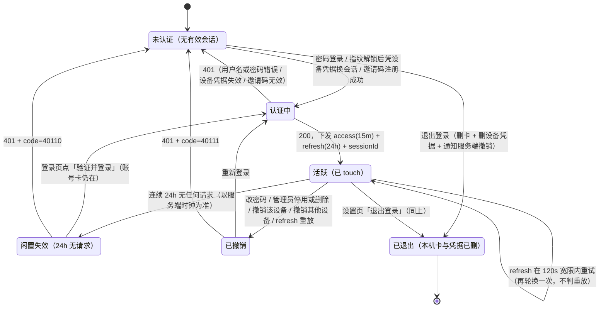
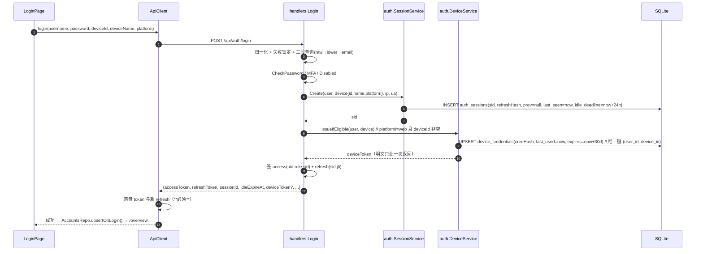
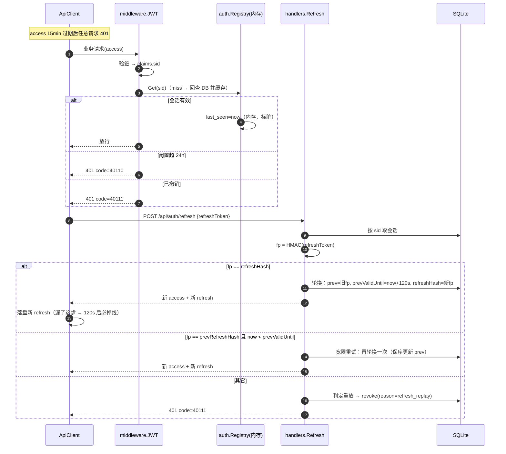
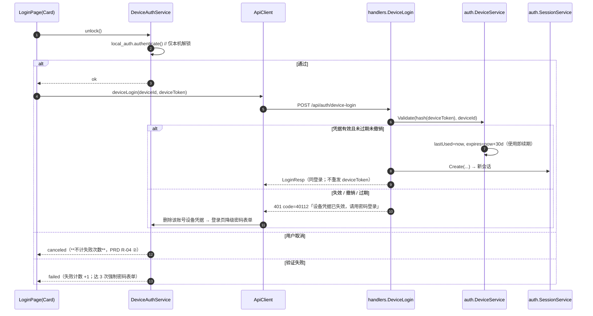
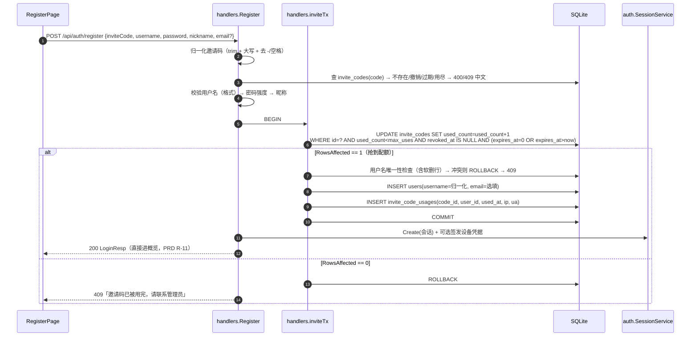
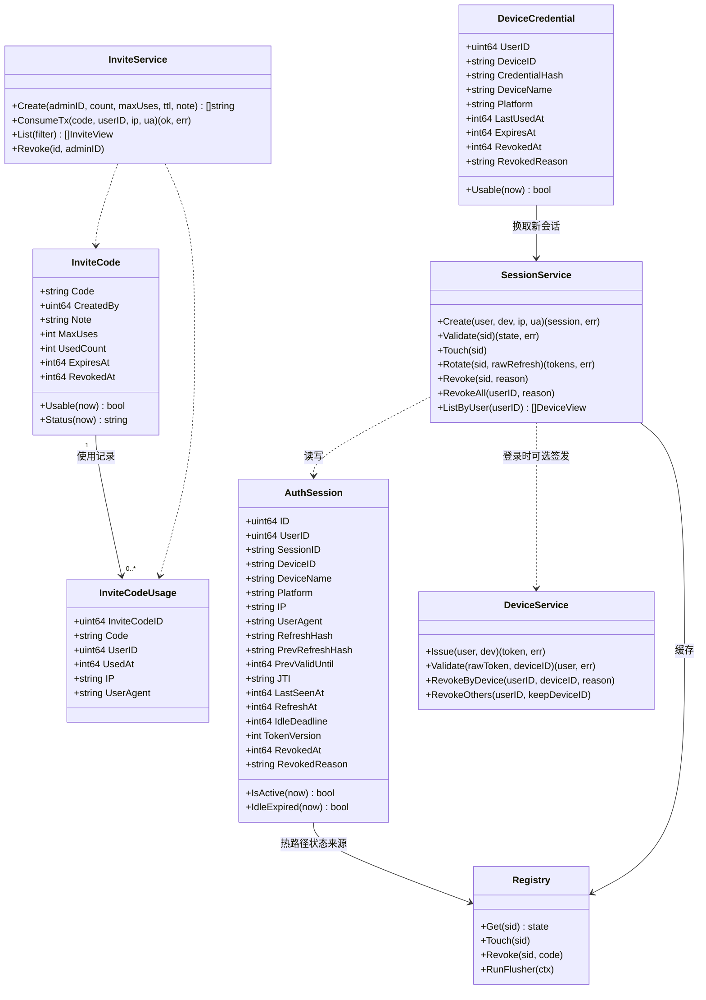
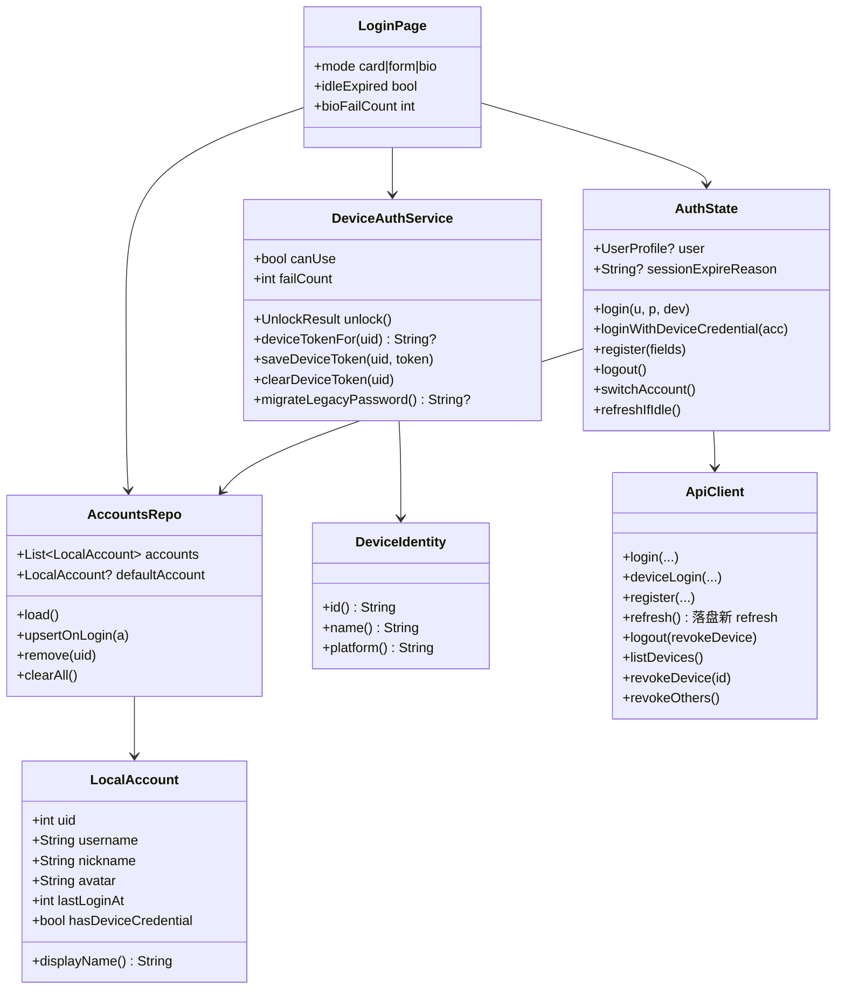
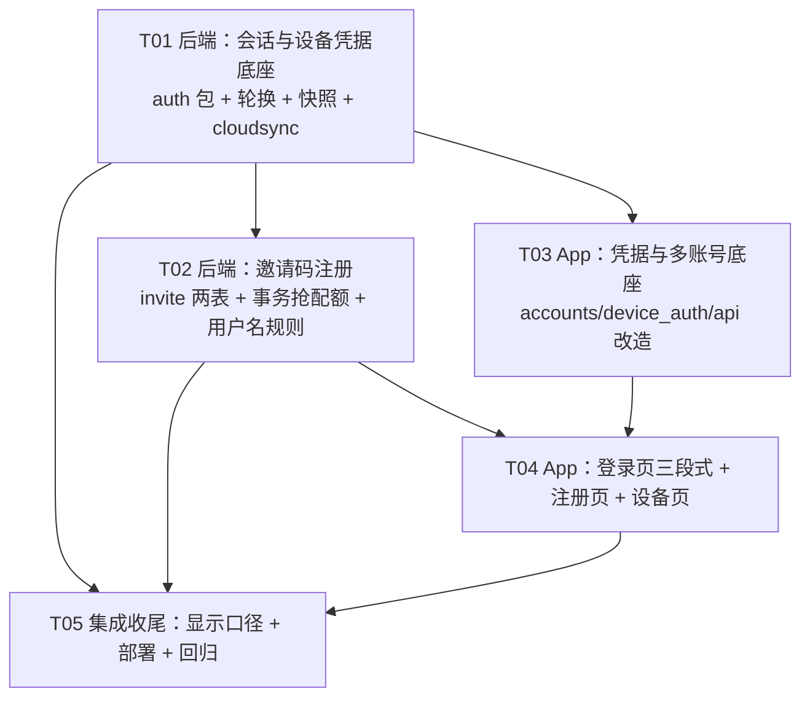

# 系统设计（增量）— 永远富裕 / KeepRich v0.5.0

| 项 | 内容 |
|---|---|
| 文档类型 | 增量设计（只描述 v0.5.0 相对 v0.4.1 的变更，存量设计不重复） |
| 基线 | v0.4.1（0.4.1+6） |
| 目标版本 | v0.5.0（0.5.0+7） |
| 上游文档 | `docs/prd/PRD_v0.5.0_incremental.md`、`docs/design/DESIGN_v0.4.0_incremental.md` |
| 设计者 | 高见远（架构师） |
| 注册方式 | **邀请码**（本版已取消邮箱验证码 + SMTP，见 §0.2 变更记录） |

> 本文件是**唯一交付物**，工程师可照此直接落地。包名、文件路径、结构体字段、接口路径、错误码、状态机分支均已定稿；标「待确认」处已给默认取舍，**不得因此停工**。本版只写设计，不改任何源码；所有密钥只出现「配置项名字」。

---

## 0. 前置说明

### 0.1 已核实的既有事实（已逐个读过源码）

| # | 事实 | 影响设计的地方 |
|---|---|---|
| F1 | `handlers/auth.go::issueTokens()` 用 `config.C.JWT.AccessTTL`(900s) / `RefreshTTL`(604800s) 签发**纯无状态 JWT**，claims 只有 `uid/role/tokenType/tokenVersion`，**没有会话标识** | 必须给 claims 加 `sid`+`jti` 并落会话表；否则「闲置 24h 失效」「按设备撤销」无从判定 |
| F2 | `Refresh()` 只验签 + 查 `tokenVersion`，**不轮换**、不发新 refresh；返回体只有 `{accessToken, expiresIn}` | 轮换是新契约（响应多一个 `refreshToken`，纯增量、老客户端忽略） |
| F3 | `Login()` 只用 `username` / `email` 查库，**不记录设备、不记录最近活跃**；只写 `users.last_login_at` | 隐患 6.2 的落点：登录即建会话行（deviceId/deviceName/platform/ip/ua/last_seen_at） |
| F4 | `middleware/auth.go::JWT()` 只验签、只看 `tokenType`，**不查库** | 要加「会话有效性 + 闲置判定」，但绝不能每请求写库（见 F8） |
| F5 | `models.User.Username` 有 `uniqueIndex`；`Email` 是**普通索引**且历史有大量空串（v0.4.0 设计 F9 已定：唯一性只能由 `Username` 承担） | 用户名归一化小写写入 `username`；**不加 `usernameLower` 列、不给 email 加唯一索引**；登录走「raw → lower → email」三段索引友好查询（§2.D.2） |
| F6 | `handlers/register.go` 当前 `username = email`（v0.4.0「邮箱即用户名」） | 老账号兼容：登录必须保留邮箱兜底；新注册改为 `username = 归一化用户名` |
| F7 | `app/lib/services/biometric.dart`：`_kPassword='biometric_password'` 存在 `flutter_secure_storage`，`authenticate()` 直接把 `{username, password}` 明文交给登录页 | **本版红线**：该键必须消失，只保留「一次性迁移读取」（§2.E.3） |
| F8 | `database_sqlite.go` 设 `MaxOpenConns(1)` | 会话 `last_seen_at` **禁止每请求 UPDATE**（会把所有请求串行化）；改内存注册表 + 60s 合并刷盘（§2.A.4） |
| F9 | `backup/snapshot.go`：`Tables()` 恰好 18 表；`IsBusinessTable()` 把 `users/audit_logs/error_reports` 排除在「业务数据」外；`cloudsync` 的 P6 判定「本地空才允许拉取覆盖」依赖它 | 新表进快照后**必须**同步加进 `IsBusinessTable()` 排除名单，否则「只有会话没有账」的库会被判成有业务数据 → 拒绝拉取云端 → 可能反向覆盖真实账目（§3.5 / R3） |
| F10 | `cloudsync/middleware.go` 规则是「`method != GET && status < 400` → `MarkDirty`」，`/api/auth/*` 都在 `/api` 组内 | 新模型下每 15 分钟静默 refresh = 每天 ~96 次 200KB 全量 PATCH。必须 hard/soft 分流（§2.A.6） |
| F11 | `database/seed.go::SeedAdmin` 用 env `ADMIN_USERNAME`/`ADMIN_PASSWORD`（默认 `admin`/`admin123456`）幂等创建第一个管理员 | **第一个管理员的唯一来源**；邀请码不参与引导，不做「首个邀请码」逻辑 |
| F12 | `routes.go` 的 admin 组是 `middleware.JWT() + middleware.AdminOnly() + middleware.Audit()`，`AdminOnly` 校验 `role != "admin"` 直接 403 | 邀请码管理接口全部挂在该组 → 普通用户**调不动**（403），App 侧再补一层「无入口」 |
| F13 | `utils/code.go::GenerateFamilyCode()` 已是「8 位 + `23456789ABCDEFGHJKLMNPQRSTUVWXYZ`（去 0/O/1/I）+ `crypto/rand`」 | 邀请码字符集与它完全一致 → **泛化成 `GenerateCode(n)` 复用**，零新依赖、零新算法 |
| F14 | App 的 `device_id` 已存在：`services/updater.dart` 里 `prefs.getString('device_id')`，无则生成 `d<ts><rand>` | 设备凭据复用该 ID；把它抽到 `services/device_identity.dart` 共用 |
| F15 | `api.dart::_doRefresh()` 目前**只落盘 accessToken**，忽略响应里的其他字段 | 轮换后必须把新 `refreshToken` 一起落盘，否则宽限 120s 一过必掉线（本版最容易踩的坑） |
| F16 | `ListFamilyMembers` 已同时返回 `username` 与 `nickname` | R-10 ⑤⑥「昵称优先 + 重名补用户名」是**纯客户端展示规则**，后端零改动（§2.E.5） |

### 0.2 变更记录：为什么注册方式从「邮箱验证码」改成「邀请码」

需求方在本轮中途调整口径，本设计已**整体重写**，不留作废章节：

| 项 | 旧口径（已作废） | 新口径（本文档） |
|---|---|---|
| 注册门槛 | 邮箱验证码（真实 SMTP） | **邀请码**（管理员生成，8 位，默认 1 次可用、7 天有效） |
| 新增基础设施 | `net/smtp` 发信模块 + 邮件模板 + SMTP sidecar | 无外部依赖（纯 DB + 现有 `crypto/rand`） |
| 新增表 | `email_verification_codes` | `invite_codes` + `invite_code_usages` |
| 注册字段 | `email + code + username + password + nickname` | `inviteCode + username + password + nickname + email(选填, 不验证)` |
| 频控 | 60s 重发 / 邮箱 5 次每小时 / IP 10 次每小时 / 错 5 次作废 | **仅保留：同 IP 10 次/小时（注册尝试）**；配额由邀请码 `maxUses` 承担 |
| 降级分支 | 「邮件服务不可用 → 验证码发送失败」 | 无（不存在外部依赖，只有「码无效/过期/用完/撤销」） |

被删掉的具体内容清单见 **§8.4**，供主理人逐项核对无残留。

> **主理人拍板（2026-11-09）：邀请码不绑定家庭。** `invite_codes` 不含 `familyId` 字段，注册成功后账号为「无家庭」普通用户；加入家庭仍走既有的「加入申请 → 管理员审批」流程，本版不改动。此项取代 PRD §6 Q2 原建议默认值（已同步修订 PRD）。

### 0.3 与 PRD 的冲突与取代关系（必须知道，避免实现时对不上）

`PRD_v0.5.0_incremental.md` 是按「邮箱验证码」写的，以下条款**由本设计取代**，实现以本文档为准：

| PRD 条款 | 状态 |
|---|---|
| R-08 邮箱验证码注册（含 ①②③④⑤⑥⑦⑧ 全部子项） | **作废**，由 §2.C「邀请码注册」取代（除「已注册邮箱拦下」改为「选填且不验证」） |
| §2 R-08 中的「10s 内收到邮件」「60 秒倒计时」「重新发送」「错 5 次作废」「邮件服务不可用」 | **作废**（无邮件链路） |
| §3.4 注册流程图（第 1 步发码 → 第 2 步填表） | **作废**，改为**单页表单**（§2.E.7） |
| §3.5 注册页线框（含「发送验证码」「下一步」「更换」「60 秒后可重发」） | **作废**，线框见 §2.E.7 |
| §4.2 中「发送验证码 / 重发倒计时 / 未收到？ / 更换 / 邮箱已注册 / 验证码为空 / 不正确 / 过期 / 次数超限 / 57–63 行频控文案 / 邮件服务不可用」 | **作废**，文案表见 §7.3 |
| R-13 ③「SMTP 发送失败时提示…」 | **作废** |
| 其余（R-01~R-07、R-09~R-12、R-14~R-17、§5 兼容与迁移、§3.7 会话策略） | **全部保留不变** |

---

## Part A：系统设计

### 1. 实现方案总览

#### 1.1 核心难点与取舍

| 难点 | 本质 | 本设计解法 |
|---|---|---|
| **D1 会话语义从「用久了过期」改成「闲置才过期」** | JWT 自证，服务端不知道「还活着吗」；refresh 7 天固定过期必然踢人 | `auth_sessions` 表 + claims 塞 `sid`；闲置窗口 24h；任何带鉴权请求都 touch（内存），60s 合并刷盘；refresh 滑动续期 + 轮换 |
| **D2 轮换与弱网重试天然冲突** | 客户端发 refresh 后响应丢了 → 重试同一个 → 服务端判「重放」→ 撤销 → 用户被踢 | 会话行存 `refreshHash` + `prevRefreshHash` + `prevValidUntil`，**旧 refresh 有 120s 宽限**，宽限内重试只再轮换一次不判重放；超宽限才撤销（§2.A.3） |
| **D3 指纹登录不能存明文密码** | 现在本机存的就是密码，指纹只负责「解锁本地字符串」 | 服务端签发**设备授权凭据**（opaque token，只存 HMAC 指纹，绑 user+deviceId，30 天闲置滑动、可按设备撤销），能力**仅限换会话**；指纹只是本机解锁动作（§2.B） |
| **D4 服务重启 = 全员登出？** | 沙箱重启把 SQLite 回滚成「入库快照库」，内存态全丢；会话表不进快照则每次发布全端被踢 | `auth_sessions` / `device_credentials` **进云端快照**（只含 HMAC 指纹与时间戳，与快照里已有的 bcrypt 哈希同风险等级）；`invite_codes` / `invite_code_usages` **也必须进**（否则重启后已用配额归零，一次性码可被重复使用） |
| **D5 会话表写入 × SQLite 单连接** | 每请求 UPDATE `last_seen_at` 会把读请求串行化，首屏变慢 | 内存注册表 `auth.Registry` 承担热路径，后台 60s 批量刷盘；缓存 miss 才回查 DB（§2.A.4） |
| **D6 静默刷新引发 200KB 推送风暴** | refresh 是 POST → `MarkDirty` → 全量快照 PATCH | `cloudsync` 分 hard/soft：`refresh`/`device-login`/`login`/`logout` 走 soft（最多每 600s 推一次）；业务写仍 hard（§2.A.6） |
| **D7 邀请码并发超发** | 「读 `used_count` → 判断 → +1」在并发下会超发（1 次码被两人同时用） | **条件 UPDATE 抢配额**：`UPDATE ... SET used_count=used_count+1 WHERE id=? AND used_count<max_uses AND revoked_at IS NULL AND (expires_at=0 OR expires_at>now)`，`RowsAffected==1` 才算抢到；`抢配额 + 建用户 + 记 usage` 同一事务（§2.C.3） |
| **D8 「登录凭用户名」但不能踢掉老账号** | 存量 5 个账号（含 3 位 `bob`）+ v0.4.0「邮箱即用户名」账号 | 新规则只约束新注册与主动改名；登录三段查询；不回溯校验、不强制补用户名（§2.D） |

#### 1.2 方案总览表（改动点 / 为什么 / 影响面）

| # | 改动点 | 为什么 | 影响面 |
|---|---|---|---|
| 1 | 新增 `auth_sessions`，JWT claims 加 `sid`/`jti` | 闲置 24h + 按设备撤销必须有服务端会话态 | `utils/jwt.go`、`middleware/auth.go`、`handlers/auth.go`、`database/migrate.go`、`backup/snapshot.go` |
| 2 | refresh 滑动续期 + 轮换 + 120s 宽限 | 活跃不掉线；旧 refresh 一次性作废防重放 | App `_doRefresh` 必须落盘新 refresh；老客户端走「无 deviceId → 不轮换」分支 |
| 3 | 新增 `device_credentials` | 指纹登录不再需要本机明文密码 | App `device_auth.dart`（替代 `biometric.dart`）、登录页、设置页 |
| 4 | 新增 `invite_codes` + `invite_code_usages` + 管理端发码接口 | 注册门槛（替代邮箱验证码） | `handlers/invite.go`、`handlers/register.go` 重构、`routes.go`、注册页重构 |
| 5 | 用户名 / 昵称校验 | 「登录用用户名 + 密码」口径；昵称用于 App 内与家庭内显示 | `utils/validate.go`、注册页、显示层 `displayName()` |
| 6 | 登录请求带 `deviceId/deviceName/platform`，响应带 `sessionId/idleExpireAt/deviceToken` | 会话可追到设备 + 首登顺手签发设备凭据 | 纯增量字段，老客户端不受影响 |
| 7 | `/api/auth/refresh` 响应新增 `refreshToken` | 轮换必须把新 refresh 交回客户端 | 老客户端忽略 → 走不轮换分支 |
| 8 | 新增设备管理 / 退出登录接口 | R-14/R-15（P1）与「丢手机自救」 | 设置页新增两个入口 |
| 9 | `config.Auth` 段 + `Validate()` 夹取默认值 | 隐患 6.1：TTL 语义散落且无兜底（配 0 → token 立刻过期） | 时效常量收敛到一处 |
| 10 | `cloudsync` hard/soft dirty | 静默刷新不能触发全量推送 | `cloudsync/middleware.go`、`manager.go` |
| 11 | 快照表清单 18 → 22 表 + `IsBusinessTable` 排除新表 | 重启不踢人、邀请码配额不归零；新表不能污染「本地是否有业务数据」判定 | `backup/snapshot.go`（**唯一触及存量同步语义的改动**，重点回归） |
| 12 | App 本机多账号仓库（≤5，最近使用排序） | 「头像 → 切换用户 → 登录」三段式的前置数据 | 新增 `accounts.dart`；登录页重写 |
| 13 | 昵称显示口径统一 | R-10 ⑤⑥，重名补用户名 | `utils/display_name.dart` + 3 处调用点 |
| 14 | App 侧**不出现任何邀请码入口** | 邀请码是管理员发出去的东西，不是用户功能 | `ApiClient` 不加 invite 方法；页面零入口；接口只在 `/api/admin/**` |

#### 1.3 会话状态机

> 本图描述**会话（服务端）**维度；PRD §3.3 描述**登录页（客户端）**维度，两者是同一件事的两侧，状态名一一对应。



客户端三种表现（PRD §3.3 / §3.7 落地口径）：

| 服务端返回 | 登录页状态 | 账号卡 | 文案 |
|---|---|---|---|
| `code=40110`（闲置） | 状态 C（账号卡 + 黄条） | **保留** | `已超过 24 小时未使用，请重新验证身份` |
| `code=40111`（撤销/改密/停用） | 状态 A/C | **保留** | `登录已失效，请重新登录`（停用走 403：`账号已停用，请联系管理员`） |
| 网络错误 / 超时 | 保持当前态 | 保留 | `网络不可用，请检查网络后重试` + 重试 |

> 铁律：**会话失效 ≠ 退出登录**。前者不删账号卡与设备凭据；后者才删（PRD §3.7 最后一行）。

#### 1.4 框架与库选择

| 用途 | 选择 | 理由 |
|---|---|---|
| 会话 / 凭据指纹 | 标准库 `crypto/hmac` + `crypto/sha256` + `crypto/rand` + `encoding/base64` | 不引任何新依赖；opaque token 只需「不可预测 + 不可逆存储」 |
| 邀请码字符 | 复用现有 `utils/code.go` 的 `crypto/rand` + 自定义字母表（F13） | 与家庭码同一套算法，字符集一致，避免第二套实现漂移 |
| 限流 | 现有 `middleware.Allow()`（内存固定窗口） | 复用既有实现，不引 `golang.org/x/time/rate` |
| 邀请码并发控制 | SQL 条件 UPDATE + `gorm.Expr`（不用应用层锁） | 单实例 + SQLite 下天然串行，条件 UPDATE 在 MySQL 下同样正确；不引分布式锁 |
| App 指纹 | 现有 `local_auth ^2.2.0` | 已在 pubspec，能区分 `authCanceled` 等结果码 |
| App 设备名 | 现有 `device_info_plus ^10.1.2` | 已在 pubspec，零新增依赖 |

**本版不引入任何新的 pub 依赖，也不引入任何新的 Go 依赖。**

#### 1.5 关键时序

**① 密码登录 + 建会话 + 签发设备凭据**



**② 滑动续期 + refresh 轮换（含宽限重试）**



**③ 指纹解锁（设备凭据换会话，本机不再有密码）**



**④ 邀请码注册（单事务抢配额）**



#### 1.6 类图

**后端（新增/变更部分）**



**App（新增/重写部分）**



---

### 2. 模块设计

#### 2.A 会话与滑动续期（`backend/internal/auth`）

##### A.1 目录与职责

```
backend/internal/auth/
    token.go       opaque token 生成（crypto/rand 32B → base64url）+ HMAC-SHA256 指纹
    session.go     SessionService：Create / Validate / Touch / Rotate / Revoke / RevokeAll / ListByUser
    registry.go    Registry：内存会话态（热路径）+ 60s 合并刷盘 + 过期清理
    device.go      DeviceService：签发 / 校验 / 使用即续期 / 按设备撤销 / 聚合列表
```

依赖方向：`auth` → `models` → `database`。**`auth` 不 import `gin`**（与 `internal/backup` 同风格），handler 只做协议转换。

##### A.2 时效参数（全部来自 `config.C.Auth`，不允许散落）

| 参数 | yaml 键 | 默认 | 语义 |
|---|---|---|---|
| 闲置窗口 | `auth.sessionIdleTTL` | `86400`（24h） | 连续无请求超过它 → 会话作废（PRD 硬约束） |
| access TTL | `jwt.accessTTL` | `900` | 保持现状；客户端静默刷新 |
| refresh TTL | `jwt.refreshTTL` | `86400` | **从 604800 改为 86400**：refresh 自然寿命 = 闲置窗口上限，互为兜底 |
| 轮换宽限 | `auth.refreshGraceSec` | `120` | 旧 refresh 可重试窗口 |
| touch 刷盘间隔 | `auth.touchFlushSec` | `60` | 内存 last_seen 落库频率 |
| 设备凭据闲置 | `auth.deviceIdleTTL` | `2592000`（30d） | 使用即续期 |
| 缓存复核周期 | `auth.registryRecheckSec` | `600` | 缓存条目回查 DB 兜底 |
| soft 推送节流 | `auth.softPushMinSec` | `600` | 见 A.6 |
| 注册 IP 限流 | `auth.registerIPLimit` | `10/小时` | 注册尝试（PRD 新口径） |
| 邀请码默认有效期 | `auth.inviteTTLDays` | `7` | 生成时的默认值，可逐个覆盖 |

`config.Validate()` 统一夹取：任一值 `<=0` 或缺失 → 落回默认并打 `[config][WARN]`。**这是隐患 6.1 的解法**（§2.G）。

##### A.3 轮换与宽限（最容易写错的一段）

```go
fp := HmacHex(cfg.JWT.RefreshSecret, rawRefresh)   // 只存指纹，绝不存明文 token
switch {
case fp == s.RefreshHash:
    newRaw, newJTI := newRefresh()
    s.PrevRefreshHash, s.PrevValidUntil = s.RefreshHash, now+grace
    s.RefreshHash, s.JTI, s.RefreshAt = HmacHex(...,newRaw), newJTI, now
    s.LastSeenAt = now
case fp == s.PrevRefreshHash && now < s.PrevValidUntil:
    // 弱网重试：响应丢了，客户端拿老 refresh 重来 → 不判重放，再轮换一次
    newRaw, newJTI = newRefresh()
    s.PrevValidUntil = now + grace   // prev 只保留一层，只续宽限，不累积
    s.RefreshHash, s.JTI, s.RefreshAt = HmacHex(...,newRaw), newJTI, now
    s.LastSeenAt = now
case fp == s.PrevRefreshHash:
    revoke(s, "refresh_replay")      // 超宽限的旧 refresh → 重放
default:
    revoke(s, "refresh_replay")      // 未知指纹同样是重放信号
}
```

**老客户端兼容分支**：`s.DeviceID == ""` 时**不轮换**（v0.4.1 App 的 `_doRefresh` 不保存新 refresh；若对它轮换，宽限 120s 后第二次刷新必被判重放 → 每 30 分钟被踢一次）。此时 `Refresh()` 只回 `accessToken`（保持 v0.4.0 响应形状），refresh 复用至 `exp=+24h` 自然过期。v0.5.0 恒带 `deviceId`，恒走轮换。

##### A.4 Registry（热路径不碰 DB）

```go
type liveSession struct {
    UserID       uint64
    DeviceID     string
    IdleDeadline int64  // last_seen + idleTTL
    Revoked      bool
    RevokedCode  int    // 40110 / 40111
    TokenVersion int
    dirtySeen    int64  // 待刷盘的 last_seen
    loadedAt     int64  // 缓存复核时间
}
```

- `Get(sid)`：命中且未过 `registryRecheckSec` → 直接用；否则回查 DB 一次（查不到 → 视为撤销），写回缓存。
- `Touch(sid)`：只更新内存 `IdleDeadline`/`dirtySeen`，**不写库**。
- 后台 goroutine（`main.go` 启动）：每 `touchFlushSec` 把 `dirtySeen` 有变化的会话**单事务批量 UPDATE**；每 10 分钟清理一次（`idle_deadline < now` 或撤销超 30 天 → 软删）。
- 撤销立即生效：`Revoke()` 同时改 DB 与缓存（单实例，无跨实例一致性问题）。

##### A.5 中间件改造（`middleware/auth.go`）

```text
1. 取 token（X-Finance-Token 优先，保持现状）
2. ParseToken → claims；tokenType 必须是 access
3. sid := claims.SessionID
   ├─ sid == ""  → legacy：只查 users 校验 tokenVersion（v0.4.1 的 access 最多 15 分钟就消失）
   └─ sid != "" → st := auth.Registry.Get(sid)
        ├─ st.Revoked                              → 401 code=40111
        ├─ now > st.IdleDeadline                   → 401 code=40110（并撤销，reason=idle）
        ├─ st.TokenVersion != claims.TokenVersion  → 401 code=40111
        └─ 否则 Touch(sid) 放行
```

新增错误码（`utils/response.go`）：`CodeSessionIdle=40110`、`CodeSessionRevoked=40111`、`CodeDeviceCredentialInvalid=40112`、`CodeInviteInvalid=40010`。
HTTP 状态仍是 401/400/409；响应信封 `{code,message,data}` 不变，App 靠 `code` 选文案。`/ws` 走同一中间件（query token 分支保留）。

##### A.6 cloudsync 的 hard/soft dirty（避免推送风暴）

```go
if c.Request.Method != GET && c.Writer.Status() < 400 {
    switch strings.TrimSuffix(c.Request.URL.Path, "/") {
    case "/api/auth/refresh", "/api/auth/device-login", "/api/auth/login", "/api/auth/logout":
        M().MarkDirtySoft()   // 只影响会话/设备表，最多每 softPushMinSec(600s) 推一次
    default:
        M().MarkDirty()       // 业务写、以及 /api/auth/register（新用户行必须尽快落云）
    }
}
```

- `/api/auth/register` **必须保持 hard**：新用户 + 邀请码 `used_count` 不能只活在内存 10 分钟（否则重启后配额回退 = 邀请码可被复用）。
- 代价：会话 `last_seen` 云端副本最多滞后 10 分钟 → 重启后极端情况（真实闲置 23h50m–24h）会被判闲置，属可接受误差（R4）。

---

#### 2.B 设备授权凭据（指纹登录）

##### B.1 凭据形态

```text
deviceToken    = "dvc_" + base64url(crypto/rand 32B)         // 明文只返回一次，只进设备安全存储
credentialHash = HMAC-SHA256(jwt.accessSecret, deviceToken)  // 入库的只有这个
```

- **不是 JWT，也不能当 token 用**：`middleware.JWT()` 只接受 HS256 JWT，设备凭据天然过不去；只有 `POST /api/auth/device-login` 会做 HMAC 比对。
- 能力边界（写进 handler 注释）：**仅能换会话**。不能改密码、不能改邮箱、不能调任何业务接口。

##### B.2 生命周期

| 事件 | 行为 |
|---|---|
| 密码登录 / 注册成功，且 `deviceId != ""` 且 `platform != "web"` | 签发；同 `(user, deviceId)` 已有则覆盖 hash 并刷新 expires（一行一条） |
| 设备凭据换会话成功 | `last_used_at = now`、`expires_at = now + 30d`（使用即续期，**不轮换**） |
| 30 天未使用 | 过期 → `device-login` 返回 401 `40112` → App 删本机凭据并降级密码 |
| 撤销某设备（设备页 / 退出登录） | 该 `(user, deviceId)` 的**会话与设备凭据一起撤销**（否则指纹会立刻把人登回去） |
| 改密码 / 管理员停用或删除 | 该用户**全部**会话与设备凭据撤销 |
| 卸载重装 | 本机凭据随安全存储消失；服务端残留行由 30 天闲置自动失效 |

**为什么「使用即续期」但不轮换**：轮换能降低长期暴露，但弱网丢响应会让用户永久丢失指纹入口（本机已换、服务端已作废）；30 天闲置 + 可撤销已把暴露面收得足够小。这是有意识的取舍（R6）。

##### B.3 与指纹的关系

指纹**只负责本机解锁**：`local_auth.authenticate()` 通过后，App 才把设备凭据发出去。指纹失败 3 次或设备不支持/未录入 → 直接给密码表单（PRD R-03/R-04）。系统层异常文案绝不能透传（App 按 `PlatformException.code` 映射中文）。

---

#### 2.C 邀请码注册（替代邮箱验证码）

##### C.1 设计取舍：为什么用「独立使用记录表」而不是给 `users` 加 `inviteCodeId`

| 方案 | 结论 | 理由 |
|---|---|---|
| `users` 加 `inviteCodeId` 列 | ❌ | ① 一个码可用多次时只能记「最后一次」，`maxUses>1` 场景失去可追溯性；② `users` 在云端快照里走 `userExportRow`/`userImportRow` **对称类型**（v0.4.0 R5 的坑），改结构要同步改导出/导入两侧，风险远大于收益 |
| 独立 `invite_code_usages` 表 | ✅ | ① 一条记录 = 一次成功注册（谁、何时、哪个码、哪个 IP/UA），撤销/审计可追溯；② `users` 零改动；③ 与 `invite_codes.used_count` 互为校验（`used_count` 与 usage 行数不一致可直接查出来） |

**唯一约束**：`uk_usage_code_user(invite_code_id, user_id)`，防同一用户对同一码重复记账（虽然注册只发生一次，属于防御性约束）。

##### C.2 表结构与规则

**`invite_codes`**（字段级见 §3.2）

| 规则 | 值 |
|---|---|
| 码格式 | 8 位，字母表 `23456789ABCDEFGHJKLMNPQRSTUVWXYZ`（去 0/O/1/I，与 `GenerateFamilyCode` 同款） |
| 归一化 | 输入 `trim` → 去空格/连字符 → `ToUpper()`；库里只存大写 |
| 唯一性 | `code` 唯一索引；批量生成时循环重试（碰撞概率 ~1/1.1e12，最多重试 5 次） |
| 默认配额 | `maxUses = 1`；生成时可指定 1~50 |
| 默认有效期 | `expiresAt = now + 7d`；生成时可指定 1~365 天；`0` = 永不过期（仅运维应急用） |
| 撤销 | `revokedAt` 置位；**已注册用户不受影响**（只影响后续使用） |
| 软删 | 走 `Base.DeletedAt`（撤销与删除语义不同：撤销保留记录可查，删除仅运维用） |

**状态派生**（不存 status 列，避免状态机与时间不一致）：

```
revoked            → revokedAt != nil
expired            → expiresAt > 0 && now > expiresAt
used_up            → usedCount >= maxUses
partial            → 0 < usedCount < maxUses
unused             → usedCount == 0
可用（可注册）      → revokedAt == nil && !expired && usedCount < maxUses
```

##### C.3 并发安全（D7 的正解）

```go
// 必须在事务内，且「校验 → 抢配额 → 建用户 → 记 usage」是一个原子单元
tx := db.Begin()
res := tx.Exec(`UPDATE invite_codes
                   SET used_count = used_count + 1, updated_at = ?
                 WHERE id = ? AND used_count < max_uses AND revoked_at IS NULL
                   AND (expires_at = 0 OR expires_at > ?)`, now, codeID, now)
if res.RowsAffected != 1 {
    tx.Rollback()
    return ErrInviteExhausted      // 409 邀请码已被用完，请联系管理员
}
// 用户名唯一性（含软删行，Unscoped —— 与 v0.4.0 register 一致）
// INSERT users(...)
// INSERT invite_code_usages(...)
tx.Commit()
```

三条铁律：
1. **不允许**「先 SELECT 判可用、再 UPDATE +1」（并发下超发）；
2. 用户名冲突必须 `ROLLBACK`（配额自动归还），不能「先占配额再报 409」；
3. `gorm.Expr("used_count + 1")` 而不是「读到内存 +1 再写回」。

##### C.4 校验顺序与文案（注册接口）

| 顺序 | 检查 | 失败响应 |
|---|---|---|
| 1 | 邀请码非空 | 400 `请输入邀请码` |
| 2 | 邀请码格式（8 位、字符集） | 400 `邀请码格式不正确` |
| 3 | 邀请码存在（`Unscoped` 都不用：删除即视为无效） | 400 `邀请码无效，请向管理员确认` |
| 4 | 未撤销 | 400 `邀请码已被撤销，请向管理员确认` |
| 5 | 未过期 | 400 `邀请码已过期，请向管理员索取新的邀请码` |
| 6 | 未用尽（预检；真正的判定在事务里） | 409 `邀请码已被用完，请联系管理员` |
| 7 | 用户名：`NormalizeUsername` + `ValidateUsername` | 400 对应文案（§7.3） |
| 8 | 密码：`utils.ValidatePasswordStrength` | 400 `密码至少 8 位` / `密码需同时包含字母和数字` |
| 9 | 昵称：`ValidateNickname`（1~16 字，必填） | 400 对应文案 |
| 10 | 邮箱（选填）：留空跳过；非空则格式校验（`IsValidEmail`） | 400 `邮箱格式不正确` |
| 11 | IP 限流 `register-ip` 10 次/小时 | 429 `操作过于频繁，请稍后再试` |
| 12 | 事务：抢配额 + 用户名唯一 + 建用户 + 记 usage | 409 `该用户名已被占用，换一个试试` / 409 `邀请码已被用完，请联系管理员` |

> 邮箱**不验证、不唯一**：PRD 新口径明确「选填、不验证」。副作用是 P2 的「邮箱自助找回密码」在动工前必须先补邮箱验证流程（R9 记录），本版不做。

##### C.5 管理端接口（普通用户不可达）

| 方法 | 路径 | 鉴权 | 说明 |
|---|---|---|---|
| POST | `/api/admin/invite-codes` | JWT + AdminOnly + Audit | 批量生成 1~20 个 |
| GET | `/api/admin/invite-codes` | 同上 | 列表 + 状态筛选 + 分页 |
| POST | `/api/admin/invite-codes/:id/revoke` | 同上 | 撤销（幂等） |

「普通用户看不到、调不动」的三层保证：
1. **路由层**：全部挂在 `admin := api.Group("/admin")` + `middleware.AdminOnly()`，非 admin → 403（F12）；
2. **客户端层**：`app/lib/services/api.dart` **不封装任何 invite 方法**（连方法都不存在，杜绝误用）；`app/lib/pages/**` 零入口、零字符串；
3. **文案层**：App 内不出现「邀请码」三个字（注册页除外，那是注册者必须输入的字段）。

##### C.6 第一个管理员怎么来（不靠邀请码）

沿用现有 `SeedAdmin`（F11）：启动时用 env `ADMIN_USERNAME`（默认 `admin`）/ `ADMIN_PASSWORD`（默认 `admin123456`）幂等创建。**邀请码不会引导任何账号**，也不做「首个邀请码自动生成」逻辑——避免「数据库为空时谁先注册谁是管理员」这类提权面。

发码的最小操作路径（本版先给脚本，管理端 UI 可选）：

```bash
# scripts/invite-codes.sh —— 用 admin token 生成邀请码（不入库任何密钥）
ADMIN_TOKEN=xxx bash scripts/invite-codes.sh -n 5 -u 3 -d 14 -m "家庭邀请-2026-11"
# 内部：curl -s -X POST "$BASE/api/admin/invite-codes" \
#   -H "X-Finance-Token: $ADMIN_TOKEN" -H 'Content-Type: application/json' \
#   -d '{"count":5,"maxUses":3,"expiresInDays":14,"note":"家庭邀请-2026-11"}'
```

> `admin/`（Flutter Web 管理端）的邀请码页面列为 **P1 可选**：接口已就绪，UI 可在 v0.5.1 补，不阻塞发版。

---

#### 2.D 用户名 / 昵称规则与老账号兼容

##### D.1 校验实现（`utils/validate.go` 追加）

```go
// NormalizeUsername 用户名归一化：trim + 全小写（大小写不敏感的唯一性靠这个）
func NormalizeUsername(s string) string

// NormalizeInviteCode 邀请码归一化：trim + 去空白/连字符 + 全大写
func NormalizeInviteCode(s string) string

// ValidateUsername 空串=通过，否则返回可直接展示的中文文案。
//   ^[A-Za-z][A-Za-z0-9_]{3,19}$（4~20 位，字母开头）
//   含中文        → "用户名只能使用英文字母、数字和下划线，不能用中文"
//   其他非法字符  → "用户名只能使用英文字母、数字和下划线"
//   首位非字母    → "用户名必须以英文字母开头"
//   长度不符      → "用户名需要 4 到 20 位"
//   空            → "请输入用户名"
func ValidateUsername(s string) string

// ValidateNickname 1~16 字（rune 计数），必填、不唯一。
//   空 → "请输入昵称"；全空格 → "昵称不能只包含空格"；>16 → "昵称最多 16 个字"
func ValidateNickname(s string) string
```

校验顺序：空 → 长度 → 首字符 → 字符集。**「含中文」必须独立文案**（PRD R-09 ②）。

##### D.2 登录查询：三段索引友好（不改 schema）

```go
err := DB.Where("username = ?", ident).First(&u).Error            // ① 原样
if errors.Is(err, gorm.ErrRecordNotFound) && lower != ident {
    err = DB.Where("username = ?", lower).First(&u).Error          // ② 小写参数
}
if errors.Is(err, gorm.ErrRecordNotFound) {
    err = DB.Where("email = ? AND email <> ''", lower).First(&u).Error  // ③ 邮箱兜底
}
```

三点铁律：**不给列套 `LOWER()`**（会放弃唯一索引）；**不给 email 加唯一索引**（历史空串会炸 AutoMigrate，F5）；**不做回溯校验**（`bob` 3 位照常登录）。

##### D.3 结论：`users` 表**不加任何字段**

| 候选 | 结论 | 理由 |
|---|---|---|
| 加 `usernameLower` + 唯一索引 | ❌ | 需全表回填；老数据含 `bob`、邮箱串等异常值，回填失败会卡上线 |
| 靠 `username` 唯一索引 + 写入时归一化小写 | ✅ | 零迁移；新账号天然小写；老账号异常值完全不碰 |
| 给 `email` 加唯一索引 | ❌ | 历史空串重复（F5） |
| 加 `inviteCodeId` | ❌ | 见 §C.1 |

昵称：`User.Nickname` 现有 `size:64`，**不改列宽**。16 字规则只在注册/改资料时执行；存量 >16 字不截断不报错（PRD §5.3），只在展示侧单行省略。

---

#### 2.E App：多账号仓库 + 登录页三段式 + 指纹改造

##### E.1 新增/重写的服务

| 文件 | 职责 |
|---|---|
| `app/lib/services/device_identity.dart`（新） | `DeviceIdentity.id()`（复用 prefs `device_id`，无则 `d<ts><rand>`，**从 `updater.dart` 抽出**）、`.name()`（`device_info_plus`，失败回退「我的手机」）、`.platform()` |
| `app/lib/services/accounts.dart`（新） | `LocalAccount` + `AccountsRepo`（load / upsertOnLogin / remove / clearAll / defaultAccount） |
| `app/lib/services/device_auth.dart`（新，**取代 `biometric.dart`**） | 生物识别能力探测、`unlock()` 三态、失败计数、设备凭据读写、旧密码一次性迁移 |
| `app/lib/services/biometric.dart` | **删除**（不留薄壳，避免有人再往里写密码） |

##### E.2 本机存储布局（R-07 红线）

| 存储 | 键 | 内容 | 敏感性 |
|---|---|---|---|
| `SharedPreferences` | `accounts_v1` | JSON 数组 `[{uid, username, nickname, avatar, lastLoginAt, hasDeviceCredential}]` | 非敏感（仅展示信息） |
| `SharedPreferences` | `device_id` | 设备标识（已有） | 非敏感 |
| `SharedPreferences` | `biometric_enabled` | 是否开启指纹（已有，沿用） | 非敏感 |
| `flutter_secure_storage` | `device_cred_<uid>` | 设备凭据（每账号一条） | 敏感但可撤销，仅能换会话 |
| `flutter_secure_storage` | `access_token` / `refresh_token` | 会话 token（已有） | 敏感，短寿命 |
| `flutter_secure_storage` | ~~`biometric_password`~~ | **本版必须消失** | 红线 |

规则：
- 最多 5 个账号；`upsertOnLogin` 后按 `lastLoginAt` 倒序，超出 5 个静默淘汰末位并**删除其 `device_cred_<uid>`**（R-06 ②）；只动本机，不动服务端。
- Web：`kIsWeb` 时 `AccountsRepo` 恒空、`DeviceAuthService` 恒不可用 → 登录页直接是纯表单（PRD §0.3 / §3.6）。
- 「退出登录」：删该账号卡 + 删 `device_cred_<uid>` + 调 `POST /api/auth/logout?revokeDevice=true`（**先本地清，再 best-effort 通知服务端**，网络失败不阻塞）。
- 「切换账号」：只清内存 token，不动账号卡与凭据（R-14 ②）。

##### E.3 旧密码凭据的一次性迁移（PRD §5.4 精确落地）

```text
init():
  legacy = secure.read('biometric_password')      // 只读一次，绝不写
  if legacy 非空: legacyPassword = legacy         // 仅内存持有

指纹路径（Card 态点主按钮）:
  1) 有 device_cred            → /api/auth/device-login
  2) 无 device_cred 但有 legacyPassword →
       local_auth 通过 → 用 legacyPassword 调 /api/auth/login（带 deviceId）
         成功 → 拿到 deviceToken → 写 device_cred → secure.delete('biometric_password')
         失败 → 保留（PRD §5.4②：失败直接给密码路径，由密码登录成功后替换）

任意一次登录成功（密码 / 指纹迁移 / 设备凭据）:
  写 device_cred（若响应带 deviceToken）+ **无条件** secure.delete('biometric_password')
```

验收口径（R-07 ①）：**任何一次成功登录之后**，安全存储里不得再存在 `biometric_password`；升级后一直不登录的用户允许保留（PRD §5.4 授权），但代码里除「只读一次」外**不得再写入**。

##### E.4 登录页状态机（PRD §3.3 的实现映射）

```
LoginPageMode { card, form, bio }
card：账号卡（头像 72 + 昵称/用户名 + 主按钮 + 切换用户 + 用密码登录文字链 + 注册入口 + 服务端 chip）
form：用户名 + 密码 + 登录 + 本机已记住的账号头像行（≤5）+ 注册入口 + 服务端 chip
bio ：系统弹窗中（不可交互，loading）
```

| 当前 | 事件 | 下一状态 | 细节 |
|---|---|---|---|
| 加载完成 | 本机有账号卡 | `card` | 首屏 ≤1.5s，纯本地渲染不联网 |
| 加载完成 | 本机无账号卡 | `form` | 去掉「返回」与「已记住的账号」区块 |
| `card` | 主按钮（指纹可用） | `bio` | `idleExpired` 时文案 `验证并登录` |
| `card` | 主按钮（指纹未开通/不支持） | `form` | 用户名预填、焦点在密码框、顶部提示条 |
| `card` | 点「切换用户」 | `form` | 用户名**为空**、焦点在用户名框 |
| `card` | 点「用密码登录」文字链 | `form` | 同切换用户，但保留默认账号 |
| `bio` | 通过 | `/overview` | 清零失败计数 |
| `bio` | 取消 | `card` | `已取消指纹验证`，**不计失败** |
| `bio` | 失败 ×1~2 | `card` | `指纹验证失败，请重试` |
| `bio` | 失败 ×3 | `form` | `指纹连续 3 次未通过，请改用密码登录`，文字链隐藏 |
| `form` | 登录成功 | `/overview` | 该账号 → 默认账号；`loginFails=0` |
| `form` | 校验失败 | `form` | 就地提示，按钮恢复可点 |
| 任意 | `sessionExpired(idle)` | `card` + 黄条 | 账号卡**保留** |

`_idleExpired` 来源：`ApiClient.onSessionExpired(reason)` → `AuthState.sessionExpireReason == 'idle'`。

##### E.5 昵称显示口径（R-10 ⑤⑥）

新增 `app/lib/utils/display_name.dart`：

```dart
String displayName(String nickname, String username) =>
    nickname.trim().isNotEmpty ? nickname.trim() : username;

/// 家庭成员列表：重名时补用户名（duplicated = 同列表出现 >=2 次同一昵称）
String memberLabel(String nickname, String username, {required bool duplicated}) =>
    duplicated ? '${displayName(nickname, username)}（$username）' : displayName(nickname, username);
```

调用点（3 处，替换现有实现）：`bookkeeping_page.dart`（记账人 / 账单归属人）、`settings_page.dart`（家庭成员列表与移除确认）、`security_page.dart`（个人资料回显）。>8 字单行 `overflow: ellipsis`。

##### E.6 静默续期与前台恢复

- 不新增轮询定时器；靠 `ApiClient` 的 401 → refresh 通路（已有，改为落盘新 refresh + 并发共享 Future）。
- 新增：`WidgetsBindingObserver` 在 `resumed` 时调 `AuthState.refreshIfIdle()`（access 剩余 < 5 分钟则主动刷一次），避免回前台第一屏先吃 401。
- 刷新失败（网络错）不清登录态；只有 `40110/40111` 才 `sessionExpired`。

##### E.7 注册页（单页表单，取代 PRD §3.5 的两步式）

```text
┌──────────────────────────────────────────┐
│  ←  注册账号                              │
│              创建你的账本                  │
│        需要管理员提供的邀请码才能注册        │
│                                          │
│  ┌ 邀请码   [ ABCD2345            ] ┐    │
│  │  8 位字母数字，向家庭管理员索取      │    │
│  ┌ 用户名   [ alice_lin            ] ┐    │
│  │  4~20 位，字母开头，只能英文/数字/_  │    │
│  │  ⚠ 登录时使用「用户名 + 密码」，请记牢│    │  ← 常驻金色小字，不得隐藏
│  ┌ 密码     [ ••••••••         👁 ] ┐    │
│  │  至少 8 位，同时含字母和数字         │    │
│  ┌ 确认密码 [ ••••••••         👁 ] ┐    │
│  ┌ 昵称     [ 林小满               ] ┐    │
│  │  昵称会显示在 App 和家庭成员列表里，可用中文│  │
│  ┌ 邮箱（选填）[ you@example.com    ] ┐    │
│  │  仅用于接收通知，不作为登录凭证       │    │
│                                          │
│  ┌──────────── 注册并进入 ────────────┐  │
│         已有账号？返回登录                │
└──────────────────────────────────────────┘
```

- 字段顺序：**邀请码 → 用户名 → 密码 → 确认密码 → 昵称 → 邮箱**（与后端校验顺序一致，错误就近展示）。
- 无「发送验证码 / 下一步 / 更换 / 倒计时」任何元素。
- 成功后直接 `context.go('/overview')`（后端已下发 token，R-11）。

---

#### 2.F 部署与配置

本版**没有**新增外部服务、没有新增 sidecar、没有新增密钥。部署侧只有三点变化：

| # | 变化 | 说明 |
|---|---|---|
| 1 | `config/config.yaml` 追加 `auth` 段 | 纯时效参数，**不含任何密钥**，可入库 |
| 2 | `jwt.refreshTTL: 604800 → 86400` | 与新语义对齐（闲置 24h） |
| 3 | 发版说明补一句 | 「升级后首次打开可能需要重新验证一次身份」（PRD §5.5） |

`cloud/sync.sh` **不需要改**（仍只注入 `cloudsync.local.yaml`）；`.gitignore` **不需要改**。

---

#### 2.G 顺手要修的两个已知隐患

##### G.1 `accessTTL / refreshTTL` 硬编码且无语义兜底

现状核对（读了 `auth.go` 与 `config.go`）：数值确实来自 `config.C.JWT.*`，但存在三处真实隐患：
1. `config.yaml` 的 `refreshTTL: 604800` 与新语义（闲置 24h）**直接冲突**，且**没有任何夹取**——配成 `0` 或删掉该行时 `jwt.NewNumericDate(now+0)` 会让 token 立刻过期，表现为「登录成功但下一次请求 401」；
2. 时效参数散落：`auth.go` 拼 `ExpiresIn`、App 侧 15s/20s 超时、设备 30 天挂在常量里；
3. `ExpiresIn` 由各 handler 自己拼装，注册/登录/设备登录三处容易漂移。

**解法**：全部收敛到 `config.Auth`（§A.2）+ `Validate()` 夹取默认值 + `SessionService.Issue()` 统一返回 `expiresIn / idleExpireAt`，handler 不再自己算。

##### G.2 `/api/auth/login` 不记录设备与最近活跃

**解法**：`Login()` 成功后必定 `SessionService.Create()`，把 `deviceId/deviceName/platform/ip/userAgent/lastSeenAt` 落进 `auth_sessions`；`users.last_login_at` 保留（管理端在用）。`deviceName` 缺失时回退 `platform + " 设备"`（不允许空串，否则设备列表无法辨认）。

---

### 3. 数据模型变更（字段级）

#### 3.1 `auth_sessions`（新增）

| 字段 | 类型 / tag | 说明 |
|---|---|---|
| `ID` | `Base`（含 `deletedAt`） | 主键 |
| `UserID` | `uint64 gorm:"index;not null"` | 归属用户 |
| `SessionID` | `string gorm:"size:48;uniqueIndex;not null"` | 24B base64url（32 字符），进 JWT `sid` |
| `DeviceID` | `string gorm:"size:64;index"` | 客户端 `device_id`；**空 = 老客户端**（不轮换分支） |
| `DeviceName` | `string gorm:"size:64"` | 展示用 |
| `Platform` | `string gorm:"size:16"` | `android/ios/web` |
| `IP` | `string gorm:"size:64"` | 登录时 IP（展示/审计） |
| `UserAgent` | `string gorm:"size:255"` | 可选 |
| `RefreshHash` | `string gorm:"size:64;index"` | 当前 refresh 的 HMAC-SHA256 hex |
| `PrevRefreshHash` | `string gorm:"size:64"` | 上一代 refresh 指纹（宽限用） |
| `PrevValidUntil` | `int64` | 宽限截止（Unix 秒） |
| `JTI` | `string gorm:"size:48"` | 当前 refresh 的 `jti`（日志排查用，非安全依赖） |
| `LastSeenAt` | `int64 gorm:"index;not null"` | 最近一次**任何**带鉴权请求（Unix 秒） |
| `RefreshAt` | `int64` | 最近一次成功轮换时间 |
| `IdleDeadline` | `int64 gorm:"index"` | `LastSeenAt + sessionIdleTTL`（冗余，便于清理与列表） |
| `TokenVersion` | `int gorm:"default:0"` | 建会话时的 `users.token_version` |
| `RevokedAt` | `*int64 gorm:"index"` | nil = 未撤销 |
| `RevokedReason` | `string gorm:"size:32"` | `logout/password_change/admin_disable/admin_delete/device_revoke/revoke_others/idle/refresh_replay` |

索引：`uk_session(session_id)`；`idx_session_user(user_id)`；`idx_session_idle(idle_deadline)`；`idx_session_device(device_id)`。

#### 3.2 `device_credentials`（新增）

| 字段 | 类型 / tag | 说明 |
|---|---|---|
| `UserID` | `uint64 gorm:"not null;uniqueIndex:uk_devcred_user_device,priority:1"` | |
| `DeviceID` | `string gorm:"size:64;not null;uniqueIndex:uk_devcred_user_device,priority:2"` | 同设备可存多账号（各一行） |
| `CredentialHash` | `string gorm:"size:64;uniqueIndex;not null"` | HMAC-SHA256 hex；明文永不入库 |
| `DeviceName` | `string gorm:"size:64"` | |
| `Platform` | `string gorm:"size:16"` | `android/ios`（web 不签发） |
| `LastUsedAt` | `int64 gorm:"index;not null"` | 最近一次换会话成功 |
| `ExpiresAt` | `int64 gorm:"index;not null"` | `LastUsedAt + deviceIdleTTL(30d)` |
| `RevokedAt` | `*int64 gorm:"index"` | |
| `RevokedReason` | `string gorm:"size:32"` | 同会话的 reason 枚举 |

#### 3.3 `invite_codes`（新增）

| 字段 | 类型 / tag | 说明 |
|---|---|---|
| `ID` | `Base` | 主键（撤销接口用的 `:id`） |
| `Code` | `string gorm:"size:16;uniqueIndex;not null"` | 8 位大写；唯一索引承担唯一性 |
| `CreatedBy` | `uint64 gorm:"index;not null"` | 发码管理员 uid |
| `Note` | `string gorm:"size:128"` | 备注（发给谁 / 用途） |
| `MaxUses` | `int gorm:"default:1;not null"` | 1~50 |
| `UsedCount` | `int gorm:"default:0;not null"` | 只在事务里 +1 |
| `ExpiresAt` | `int64 gorm:"index"` | `0` = 永不过期 |
| `RevokedAt` | `*int64 gorm:"index"` | 撤销时间 |
| `RevokedBy` | `*uint64` | 撤销人 |

索引：`uk_invite_code(code)`；`idx_invite_created(created_at)`；`idx_invite_expires(expires_at)`。

#### 3.4 `invite_code_usages`（新增）

| 字段 | 类型 / tag | 说明 |
|---|---|---|
| `InviteCodeID` | `uint64 gorm:"not null;uniqueIndex:uk_usage_code_user,priority:1;index"` | 指向 `invite_codes.id` |
| `Code` | `string gorm:"size:16;index"` | 冗余存码串（码被删也能查历史） |
| `UserID` | `uint64 gorm:"not null;uniqueIndex:uk_usage_code_user,priority:2;index"` | 注册成功的用户 |
| `UsedAt` | `int64 gorm:"index;not null"` | 使用时间（Unix 秒） |
| `IP` | `string gorm:"size:64"` | 注册来源 IP |
| `UserAgent` | `string gorm:"size:255"` | 可选 |

> 不建外键（与现有 18 表风格一致，全部靠应用层维护），但 `uk_usage_code_user` 保证不会重复记账。软删走 `Base.DeletedAt`。

#### 3.5 `users` 表：**不加任何字段**（结论见 §D.3）

唯一的关系变化：`username` 的写入口径从「邮箱串」变为「归一化用户名」；`email` 仍写入、仍只是普通索引（不唯一、不验证）。

#### 3.6 快照表清单：18 → 22（**本版唯一触及同步语义的改动**）

```go
// backup/snapshot.go：在末尾追加（users 已在第一位，顺序即插入顺序）
{"auth_sessions",      &models.AuthSession{}},
{"device_credentials", &models.DeviceCredential{}},
{"invite_codes",       &models.InviteCode{}},
{"invite_code_usages", &models.InviteCodeUsage{}},

// IsBusinessTable：新表必须排除！否则「只有会话/邀请码、没有任何账目」的库
// 会被判成"有业务数据"，cloudsync 的 P6 判定会拒绝拉取云端快照（v0.4.0 附录 A）。
case usersTable, auditLogsTable, errorReportTable,
     sessionsTable, deviceCredentialsTable, inviteCodesTable, inviteUsagesTable:
    return false
```

| 表 | 进快照？ | 理由 |
|---|---|---|
| `auth_sessions` | ✅ | 不进 = 每次沙箱重启/发布全端被踢回登录页，直接违反 R-01 |
| `device_credentials` | ✅ | 不进 = 每次发布指纹登录失效，只有密码能进（用户感知为「坏了」）；内容只有 HMAC 指纹 |
| `invite_codes` | ✅ | 不进 = 每次发布后已发出的邀请码全失效（管理员刚发的码变废纸），且 `used_count` 归零 → **一次性码可被重复使用** |
| `invite_code_usages` | ✅ | 不进 = `used_count` 与 usage 行数不一致，审计断链；且与上表必须同进同出 |

安全边界（与 v0.4.0 R12 同源）：快照里已含 bcrypt 口令哈希；新增四表只含 HMAC 指纹、码串、时间戳与 IP，**不引入新的可直接利用的秘密**。`GET /api/auth/devices`、`GET /api/admin/invite-codes` 只回展示字段，`RefreshHash`/`CredentialHash` 一律 `json:"-"`。

---

### 4. 文件清单

#### 4.1 后端（Go）

| 相对路径 | 新增/改 | 一句话职责 |
|---|---|---|
| `backend/internal/models/authsession.go` | 新增 | `AuthSession` + `IsActive/IdleExpired` |
| `backend/internal/models/devicecredential.go` | 新增 | `DeviceCredential`（哈希、30 天滑动、撤销） |
| `backend/internal/models/invitecode.go` | 新增 | `InviteCode` + `Usable/Status` 派生 |
| `backend/internal/models/inviteusage.go` | 新增 | `InviteCodeUsage`（谁、何时、哪个码、哪个 IP） |
| `backend/internal/auth/token.go` | 新增 | opaque token 生成 + HMAC 指纹（设备凭据 / refresh 共用） |
| `backend/internal/auth/session.go` | 新增 | `SessionService`：Create/Validate/Touch/Rotate/Revoke/RevokeAll/ListByUser |
| `backend/internal/auth/registry.go` | 新增 | 内存会话注册表 + 60s 批量刷盘 + 过期清理 |
| `backend/internal/auth/device.go` | 新增 | `DeviceService`：签发/校验/使用即续期/按设备撤销/聚合列表 |
| `backend/internal/auth/invite.go` | 新增 | `InviteService`：生成（批量）/ 事务占用配额 / 列表 / 撤销 |
| `backend/internal/handlers/devices.go` | 新增 | `POST /auth/logout`、`GET /auth/devices`、`POST /devices/:id/revoke`、`POST /devices/revoke-others` |
| `backend/internal/handlers/invite.go` | 新增 | 管理端三接口：生成 / 列表 / 撤销（AdminOnly） |
| `backend/internal/utils/jwt.go` | 改 | `Claims` 加 `sid`/`jti`；`GenerateToken` 换成 `TokenOpts` 结构体 `Sign()`（4 处调用点同步） |
| `backend/internal/utils/response.go` | 改 | 新错误码 `40110/40111/40112/40010` |
| `backend/internal/utils/code.go` | 改 | `GenerateFamilyCode` 泛化为 `GenerateCode(n)`，家庭码与邀请码共用 |
| `backend/internal/utils/validate.go` | 改 | 追加 `NormalizeUsername`/`ValidateUsername`/`NormalizeInviteCode`/`ValidateNickname` |
| `backend/internal/handlers/auth.go` | 改 | `issueTokens` → 「建会话 + 签发 + 可选设备凭据」；`Refresh` 轮换+宽限+legacy；`Login` 三段查询 + 记录设备 |
| `backend/internal/handlers/register.go` | 改 | 契约改为 `inviteCode+username+password+nickname+email?`；邀请码事务；用户名唯一；建会话 |
| `backend/internal/handlers/user.go` | 改 | 改密 → `RevokeAll(password_change)`；停用 → `RevokeAll + 撤销设备凭据`；`UpdateProfile` 昵称走 `ValidateNickname` |
| `backend/internal/middleware/auth.go` | 改 | 会话有效性 / 闲置 / 撤销 / tokenVersion + Touch |
| `backend/internal/middleware/audit.go` | 改 | 补规则：`auth.logout`、`auth.device_revoke`、`auth.revoke_others`、`admin.invite_create/revoke` |
| `backend/internal/routes/routes.go` | 改 | 新增 7 条路由（3 条 admin invite、4 条 auth） |
| `backend/config/config.go` | 改 | 新增 `AuthConfig`；`Validate()` 夹取默认值 |
| `backend/config/config.yaml` | 改 | `jwt.refreshTTL: 86400`；新增 `auth` 段（纯时效，无密钥） |
| `backend/internal/database/migrate.go` | 改 | `AutoMigrate` 追加 4 张新表 |
| `backend/internal/backup/snapshot.go` | 改 | `Tables()` 22 表；`IsBusinessTable()` 排除 4 张新表 |
| `backend/internal/cloudsync/middleware.go` | 改 | hard/soft dirty 分流 |
| `backend/internal/cloudsync/manager.go` | 改 | `MarkDirtySoft()` + 软推送节流 |
| `backend/main.go` | 改 | 启动 `auth.Registry` 刷盘 goroutine；优雅退出 Flush |
| `backend/go.mod` | 不改 | **不引任何新依赖** |

#### 4.2 App（Flutter）

| 相对路径 | 新增/改 | 一句话职责 |
|---|---|---|
| `app/lib/services/accounts.dart` | 新增 | 本机多账号仓库（≤5、最近使用排序、默认账号、淘汰与移除） |
| `app/lib/services/device_identity.dart` | 新增 | 设备 id/名/平台（从 `updater.dart` 抽出 `device_id`） |
| `app/lib/services/device_auth.dart` | 新增 | 生物识别解锁（三态）+ 设备凭据存取 + 旧密码一次性迁移 |
| `app/lib/utils/display_name.dart` | 新增 | 昵称优先 + 重名补用户名的统一展示规则 |
| `app/lib/widgets/account_avatar.dart` | 新增 | 头像：有图用图，无图取昵称首字（英文首字母大写）金色圆底 |
| `app/lib/widgets/account_card.dart` | 新增 | 账号卡（头像 + 昵称 + 用户名 + 长按移除） |
| `app/lib/pages/devices_page.dart` | 新增 | 已登录设备列表 + 单个撤销 + 撤销其他所有设备 |
| `app/lib/services/biometric.dart` | **删除** | 明文密码存安全存储的旧实现（红线） |
| `app/lib/services/api.dart` | 改 | `sendCode` 全删；新增 `deviceLogin/logout/listDevices/revokeDevice/revokeOthers`；refresh 落盘新 refresh；401 按 `code` 分流；`onSessionExpired(reason)`。**不得新增任何 invite 方法** |
| `app/lib/services/auth.dart` | 改 | `login(带 device)` / `loginWithDeviceCredential` / `register(新字段)` / `logout` / `switchAccount` / `sessionExpireReason` |
| `app/lib/services/updater.dart` | 改 | `_deviceId()` 改调 `DeviceIdentity.id()`（去重复实现） |
| `app/lib/pages/login_page.dart` | 改（重写） | 三段式（card/form/bio）+ 三种主按钮文案 + 失败计数 + 闲置提示条 |
| `app/lib/pages/register_page.dart` | 改（重写） | 单页表单：邀请码 + 用户名 + 密码 + 确认密码 + 昵称 + 邮箱（选填） |
| `app/lib/pages/settings_page.dart` | 改 | 新增「切换账号」（退出登录上方）+「已登录设备」入口；退出登录改为调接口 + 清卡 |
| `app/lib/pages/security_page.dart` | 改 | 昵称 16 字校验；改密成功后主动回登录页（所有会话已撤销） |
| `app/lib/pages/bookkeeping_page.dart` | 改 | 记账人 / 账单归属人改用 `displayName()` |
| `app/lib/main.dart` | 改 | 注入 `AccountsRepo`/`DeviceAuthService`；`/devices` 路由；前台恢复主动刷新；启动时迁移旧凭据 |
| `app/lib/models.dart` | 改 | `LoginResult` 增 `sessionId/idleExpireAt/deviceToken?`；新增 `DeviceSessionItem` |
| `app/lib/config.dart` | 改 | `appVersion` → `0.5.0` |
| `app/pubspec.yaml` | 改 | `version: 0.5.0+7` |

#### 4.3 脚本与文档

| 相对路径 | 新增/改 | 一句话职责 |
|---|---|---|
| `scripts/invite-codes.sh` | 新增 | 管理员用 curl 批量发码 / 查列表 / 撤销（本版无管理端 UI 时的最小可用路径） |
| `docs/RELEASE.md` | 改 | 记录：邀请码发码步骤（含首个管理员来自 `SeedAdmin`）、「升级后首次打开可能需重新验证身份」、回滚注意 |
| `docs/design/DESIGN_v0.5.0_incremental.md` | 新增 | 本文件（含状态机 / 时序 / 类图） |

---

### 5. 接口契约

#### 5.1 新增接口

| 方法 | 路径 | 鉴权 | 请求 | 成功响应 |
|---|---|---|---|---|
| POST | `/api/auth/device-login` | 公开 + `authLimiter` | `{deviceId, deviceToken, deviceName?}` | 200 `LoginResp`（不含新 deviceToken） |
| POST | `/api/auth/logout` | JWT | `?revokeDevice=true|false` | 200 `{ok:true}` |
| GET | `/api/auth/devices` | JWT | — | 200 `{list:[DeviceItem], idleTTL, deviceIdleTTL}` |
| POST | `/api/auth/devices/:id/revoke` | JWT | — | 200 `{revoked:1, deviceCredentialsRevoked:1}` |
| POST | `/api/auth/devices/revoke-others` | JWT | — | 200 `{revoked:N}` |
| POST | `/api/admin/invite-codes` | JWT+Admin | `{count?, maxUses?, expiresInDays?, note?}` | 200 `{codes:[{id,code,maxUses,expiresAt}], count}` |
| GET | `/api/admin/invite-codes` | JWT+Admin | `?status=all|unused|partial|used|expired|revoked&page=1&size=20&keyword=` | 200 `{total, list:[InviteItem]}` |
| POST | `/api/admin/invite-codes/:id/revoke` | JWT+Admin | — | 200 `{ok:true, alreadyRevoked:false}` |

**错误码总表**（全部中文 message，App 直接展示）：

| 场景 | HTTP | code | message |
|---|---|---|---|
| 会话闲置失效 | 401 | `40110` | `已超过 24 小时未使用，请重新验证身份` |
| 会话被撤销 / 改密 / tokenVersion 失效 | 401 | `40111` | `登录已失效，请重新登录` |
| 设备凭据无效/过期/撤销 | 401 | `40112` | `设备凭据已失效，请用密码登录` |
| 邀请码无效/格式/撤销/过期 | 400 | `40010` | 见 §C.4 逐条文案 |
| 邀请码已被用完（含并发） | 409 | `40900` | `邀请码已被用完，请联系管理员` |
| 用户名已被占用 | 409 | `40900` | `该用户名已被占用，换一个试试` |
| 注册 IP 超限 | 429 | `40300` | `操作过于频繁，请稍后再试` |
| 账号已停用 | 403 | `40300` | `账号已停用，请联系管理员` |

#### 5.2 变更接口

| 方法 | 路径 | 变更 | 兼容性 |
|---|---|---|---|
| POST | `/api/auth/login` | 请求**新增可选** `deviceId/deviceName/platform`；响应**新增** `sessionId/idleExpireAt/deviceToken?`；`username` 语义仍为「用户名 或 邮箱」 | ✅ 老客户端不传新字段 → `DeviceID=""` → 走不轮换分支，行为与 v0.4.1 基本一致（仅 24h 闲置语义生效） |
| POST | `/api/auth/refresh` | 响应**新增** `refreshToken`（轮换）；老客户端忽略该字段 | ✅ 老客户端（无 sid 的旧 refresh）继续走旧逻辑；新客户端必须落盘新 refresh |
| POST | `/api/auth/register` | **契约变更**：`{email, password, nickname?}` → `{inviteCode, username, password, nickname, email?}` | ⚠️ 有意不兼容（v0.4.1 客户端注册会 400）。理由：注册口径整体改变，PRD 已确认。旧 APK 的注册失败文案为中文「请输入邀请码」，不致误导 |

#### 5.3 请求 / 响应示例

**登录**

```json
// POST /api/auth/login
{
  "username": "alice_lin",
  "password": "<password>",
  "mfaCode": "",
  "deviceId": "d1762xx81234012",
  "deviceName": "Xiaomi 14",
  "platform": "android"
}
```

```json
// 200
{
  "code": 0, "message": "ok",
  "data": {
    "accessToken": "<jwt>",
    "refreshToken": "<jwt>",
    "expiresIn": 900,
    "sessionId": "s9f2c1a7b3e84d05a6c7b8e9f0a1b2c3",
    "idleExpireAt": 1794300000,
    "deviceToken": "dvc_<43 chars>",
    "uid": 2, "role": "user",
    "nickname": "林小满", "avatar": "", "familyId": 4
  }
}
```

> `deviceToken` 仅当「`platform != web` 且 `deviceId` 非空」时出现；同一 `(user, device)` 重复登录会替换为新值，旧值立即失效。

**刷新（轮换）**

```json
// POST /api/auth/refresh
{ "refreshToken": "<jwt>" }
// 200
{ "code": 0, "message": "ok",
  "data": { "accessToken": "<jwt>", "refreshToken": "<新 jwt>", "expiresIn": 900, "idleExpireAt": 1794300000 } }
```

**设备凭据换会话**

```json
// POST /api/auth/device-login
{ "deviceId": "d1762xx81234012", "deviceToken": "dvc_<43 chars>", "deviceName": "Xiaomi 14" }
// 200：结构同 LoginResp（无 deviceToken）
// 401：{"code":40112,"message":"设备凭据已失效，请用密码登录"}
```

**注册**

```json
// POST /api/auth/register
{
  "inviteCode": "ABCD2345",
  "username": "alice_lin",
  "password": "<password>",
  "nickname": "林小满",
  "email": "you@example.com",
  "deviceId": "d1762xx81234012",
  "deviceName": "Xiaomi 14",
  "platform": "android"
}
// 200：结构同 LoginResp（含 sessionId / deviceToken）
// 400：{"code":40010,"message":"邀请码已过期，请向管理员索取新的邀请码"}
// 409：{"code":40900,"message":"该用户名已被占用，换一个试试"}
```

**发码 / 列表 / 撤销（管理端）**

```json
// POST /api/admin/invite-codes
{ "count": 5, "maxUses": 3, "expiresInDays": 14, "note": "家庭邀请-2026-11" }
// 200
{ "code": 0, "message": "ok",
  "data": { "count": 5, "codes": [
    { "id": 41, "code": "ABCD2345", "maxUses": 3, "usedCount": 0, "expiresAt": 1794900000 }
  ] } }

// GET /api/admin/invite-codes?status=unused&page=1&size=20
{ "code": 0, "message": "ok",
  "data": { "total": 5, "list": [
    { "id": 41, "code": "ABCD2345", "note": "家庭邀请-2026-11", "maxUses": 3,
      "usedCount": 1, "expiresAt": 1794900000, "revokedAt": null,
      "status": "partial", "createdBy": 1, "createdAt": 1794200000,
      "usages": [ { "userId": 7, "username": "alice_lin", "usedAt": 1794210000 } ] }
  ] } }

// POST /api/admin/invite-codes/41/revoke
{ "code": 0, "message": "ok", "data": { "ok": true, "alreadyRevoked": false } }
```

**设备列表**

```json
// GET /api/auth/devices
{ "code": 0, "message": "ok",
  "data": { "idleTTL": 86400, "deviceIdleTTL": 2592000, "list": [
    { "id": 12, "deviceId": "d1762xx81234012", "deviceName": "Xiaomi 14",
      "platform": "android", "lastSeenAt": 1794200000, "current": true,
      "hasDeviceCredential": true }
  ] } }
```

> `id` 是**会话 ID**（撤销粒度 = 会话，同时会撤销该 `deviceId` 的设备凭据）。同一设备多条会话时按 `lastSeenAt` 聚合只返回最新一条。

---

### 6. 任务分解（5 个，按依赖排序）

> 硬约束：≤5 个任务；每个 ≥3 个文件；依赖尽量只指向 T01。**T01 是最大任务**，建议工程师内部按 4 个提交推进（模型与服务 / 中间件与路由 / cloudsync / 设备管理接口）。

#### T01 — 后端：会话与设备凭据底座

| 项 | 内容 |
|---|---|
| **归属** | 后端 |
| **依赖** | 无 |
| **优先级** | P0 |
| **源文件** | `models/authsession.go`(新)、`models/devicecredential.go`(新)、`auth/token.go`(新)、`auth/session.go`(新)、`auth/registry.go`(新)、`auth/device.go`(新)、`handlers/devices.go`(新)、`utils/jwt.go`(改)、`utils/response.go`(改)、`handlers/auth.go`(改)、`handlers/user.go`(改)、`middleware/auth.go`(改)、`middleware/audit.go`(改)、`routes/routes.go`(改)、`config/config.go`(改)、`config/config.yaml`(改)、`database/migrate.go`(改)、`backup/snapshot.go`(改)、`cloudsync/middleware.go`(改)、`cloudsync/manager.go`(改)、`main.go`(改) |
| **范围** | ① 会话表 + Registry（内存热路径 + 60s 刷盘 + 清理）；② claims 加 `sid/jti`，`TokenOpts.Sign`；③ `Login` 建会话 + 记录设备 + 可选签发设备凭据；④ `Refresh` 轮换 + 120s 宽限 + legacy 不轮换分支；⑤ 中间件会话校验（40110/40111）+ Touch；⑥ 设备凭据签发/校验/使用即续期/按设备撤销 + 4 个接口；⑦ 改密/停用撤销全会话与凭据；⑧ `config.Auth` 夹取；⑨ 快照 22 表 + `IsBusinessTable` 排除；⑩ cloudsync hard/soft |
| **验收** | ① 登录后连续 30 分钟每 5 分钟发一次请求（`/api/overview`）→ 全程 200，无一次 401；② 直接改库把 `last_seen_at` 推前 25 小时 → 下一次请求 401 且 `code=40110`；③ 把一个 session 的 `refresh_hash` 手工改掉后用原 refresh 调 `/refresh` → 401 `code=40111` 且该会话 `revoked_reason=refresh_replay`；④ **宽限**：连续用同一个 refresh 调两次（间隔 <120s）→ 两次都 200 且都返回新 refresh；第三次（用第一次返回的那个已作废的）→ 401；⑤ 改密码 → 所有设备的 access 立即 401 `code=40111`，设备凭据同时失效；⑥ 设备列表能显示 deviceName/lastSeenAt，撤销后该设备 access 立即 401、`device-login` 返回 `40112`；⑦ 撤销其他设备 → 当前设备仍 200；⑧ 登录响应带 `sessionId/idleExpireAt`，`deviceToken` 仅在 android+deviceId 时出现；⑨ **清空 `/tmp/finance.db` 重启 → 用重启前的 refresh 仍能换到新 access**（验证会话进快照）；⑩ 连续 100 次 GET 请求后 `SELECT last_seen_at` 只变化数次（批量刷盘生效，验证没退化成每请求写库）；⑪ `bash cloud/sync.sh` → `SYNC_OK`（Go 1.22 编译） |
| **注意** | `auth` 包不 import gin；refresh 指纹只存 HMAC 不存明文；`/api/auth/register` 必须保持 hard dirty；`RefreshHash`/`CredentialHash` 必须 `json:"-"` |

#### T02 — 后端：邀请码注册（邀请码 + 用户名/昵称规则）

| 项 | 内容 |
|---|---|
| **归属** | 后端 |
| **依赖** | T01（注册要建会话；`routes.go`/`migrate.go`/`snapshot.go` 三个文件与 T01 同文件，**串行**追加） |
| **优先级** | P0 |
| **源文件** | `models/invitecode.go`(新)、`models/inviteusage.go`(新)、`auth/invite.go`(新)、`handlers/invite.go`(新)、`handlers/register.go`(改·重写)、`utils/validate.go`(改)、`utils/code.go`(改)、`routes/routes.go`(改·追加)、`database/migrate.go`(改·追加)、`backup/snapshot.go`(改·追加)、`scripts/invite-codes.sh`(新) |
| **范围** | ① 邀请码两表 + 状态派生；② `InviteService`：批量生成（1~20，重试避碰）、事务抢配额、列表筛选、撤销；③ 三个 admin 接口；④ `register.go` 重写（12 步校验顺序 + 事务 + 建会话 + 签发设备凭据）；⑤ `ValidateUsername`/`ValidateNickname`/`NormalizeInviteCode`；⑥ `GenerateCode(n)` 泛化；⑦ IP 注册限流从 20/h 改 10/h；⑧ 发码脚本 |
| **验收** | ① admin 生成 3 个码 → 每个 8 位、字符集正确、无 0/O/1/I；② 用码注册成功 → 200 带 token，`GET /api/auth/me` 正常，`invite_code_usages` 有 1 行、`used_count=1`；③ 同码再用（`maxUses=1`）→ 409 `邀请码已被用完，请联系管理员`；④ **并发 20 个请求抢同一个 `maxUses=1` 的码 → 恰好 1 个 200，其余 409**（`grep -c '"code":0'` == 1）；⑤ 用户名 `alice_01` 注册后，用 `ALICE_01` 登录成功、再注册 `Alice_01` → 409 `该用户名已被占用，换一个试试`；⑥ 用户名 `123abc` → `用户名必须以英文字母开头`；`中文名` → 含中文那条文案；`abc` → `用户名需要 4 到 20 位`；⑦ 昵称留空 → `请输入昵称`，17 字 → `昵称最多 16 个字`；⑧ 撤销的码 → 400 `邀请码已被撤销，请向管理员确认`；过期码 → 400 `邀请码已过期，请向管理员索取新的邀请码`；⑨ 不存在/乱输 → 400 `邀请码无效，请向管理员确认`；⑩ 第 11 次注册尝试（同 IP 1 小时内）→ 429；⑪ **普通用户 token 调 `/api/admin/invite-codes` → 403**；⑫ 清空本地库重启 → 已发出的码仍存在、`used_count` 不回退（快照往返）；⑬ 老账号 `admin/alice/bob/test/webuser` 全部照常登录（`bob` 3 位不报错）；⑭ `bash cloud/sync.sh` → `SYNC_OK` |
| **注意** | 抢配额必须条件 UPDATE + 同一事务；用户名冲突要 ROLLBACK 归还配额；`Unscoped()` 查重（软删用户名不能复用）；邮箱选填**不验证不唯一** |

#### T03 — App：凭据与多账号底座

| 项 | 内容 |
|---|---|
| **归属** | App |
| **依赖** | T01（登录/设备登录接口契约） |
| **优先级** | P0 |
| **源文件** | `services/accounts.dart`(新)、`services/device_identity.dart`(新)、`services/device_auth.dart`(新)、`services/biometric.dart`(**删除**)、`services/api.dart`(改)、`services/auth.dart`(改)、`services/updater.dart`(改)、`models.dart`(改)、`main.dart`(改·注入与迁移) |
| **范围** | ① 多账号仓库（≤5、倒序、默认账号、淘汰删凭据）；② 设备标识统一（复用 prefs `device_id`）；③ `DeviceAuthService`（三态解锁 + 失败计数 + 凭据存取 + 旧密码一次性迁移）；④ `ApiClient` 新接口（**不加 invite 方法**）与 refresh 落盘新 refresh；⑤ `AuthState` 新方法 + `sessionExpireReason`；⑥ 删掉 `biometric.dart` 并改所有 import |
| **验收** | ① 依次登录 6 个账号 → 本机只留 5 个、最久未用的被移除且其 `device_cred_<uid>` 已删；② 关掉 App 再开 → 默认账号 = 最近一次成功登录；③ 点「切换用户」再返回 → 默认账号不变；④ **全量搜 `flutter_secure_storage` 与 SharedPreferences：不存在 `biometric_password`**（首次成功登录后）；⑤ 从 v0.4.1 升级（保留旧密码）→ 首次指纹登录成功 → 旧密码被删、`device_cred` 写入；⑥ 手动破坏 `deviceToken` → `device-login` 返回 40112 → 该账号凭据被删、UI 降级密码表单，不出现英文/异常类名；⑦ token 过期 15 分钟后任意操作 → 自动刷新成功且**新 refresh 已落盘**（杀进程重启仍免登录）；⑧ Web 端不出现账号卡与指纹入口；⑨ `grep -r "biometric.dart" app/lib` 零命中 |
| **注意** | Web 不参与多账号/指纹；`ApiClient` 不得新增 invite 方法；旧密码只读一次绝不回写 |

#### T04 — App：登录页三段式 + 注册页 + 设置页

| 项 | 内容 |
|---|---|
| **归属** | App |
| **依赖** | T03（仓库/服务）、T02（注册契约） |
| **优先级** | P0 |
| **源文件** | `pages/login_page.dart`(改·重写)、`pages/register_page.dart`(改·重写)、`pages/settings_page.dart`(改)、`pages/devices_page.dart`(新)、`widgets/account_card.dart`(新)、`widgets/account_avatar.dart`(新)、`main.dart`(改·路由)、`pubspec.yaml`+`config.dart`(版本) |
| **范围** | ① card/form/bio 三态与 5 种主按钮文案；② 失败 3 次强制降级、取消不计数；③ 闲置黄条；④ 注册页单页表单（6 字段 + 2 条常驻说明）；⑤ 设置页「切换账号」+「已登录设备」；⑥ 设备页撤销（单个/全部）；⑦ 长按移除账号卡；⑧ 版本 0.5.0+7 |
| **验收** | ① 375×667 与 1440×900 两端不溢出；② 本机有卡 → 首屏见头像/昵称/用户名 + 两个按钮，顺序不颠倒；③ 本机无卡 → 纯表单，**无空头像框与切换按钮**；④ 头像无图 → 昵称首字金色圆底（英文首字母大写）；⑤ 指纹连错 3 次 → 自动展开密码表单 + 指定文案，按钮不再调指纹；⑥ 系统弹窗取消 → `已取消指纹验证` 且失败计数不变；⑦ 注册页无「发送验证码/倒计时/更换」任何字样；⑧ 注册成功直接进概览且成为默认账号；⑨ 注册失败时表单内容不丢（验证码已不存在，仅密码框按 PRD 保留）；⑩ 设置页「切换账号」「退出登录」两个入口都在且确认文案不同；⑪ 设备页能撤销其他设备，本机保持登录；⑫ 全屏截图核对：不出现 `Exception/error/Timeout/409/500/验证码/邮件` 字样 |
| **注意** | 主按钮文案三态不可混用；闲置态按钮是「验证并登录」；Web 端登录页保持纯表单 |

#### T05 — 集成收尾：显示口径 + 部署 + 回归

| 项 | 内容 |
|---|---|
| **归属** | App + 后端 + 部署 |
| **依赖** | T01 / T02 / T03 / T04 |
| **优先级** | P1 |
| **源文件** | `app/lib/utils/display_name.dart`(新)、`pages/bookkeeping_page.dart`(改)、`pages/settings_page.dart`(改·成员列表)、`pages/security_page.dart`(改)、`docs/RELEASE.md`(改)、`scripts/invite-codes.sh`(改·联调)，以及全链路回归 |
| **范围** | ① 昵称优先 + 重名补用户名；② 改密后主动回登录页；③ 昵称 16 字校验；④ 发版说明与运维步骤；⑤ 端到端回归（§8.5 清单） |
| **验收** | ① 两个用户同昵称「小满」→ 家庭成员列表显示 `小满（账号A）` / `小满（账号B）`，不重名时不显示用户名；② 无昵称老账号 → 显示用户名、头像取首字母；③ 改密成功 → 回登录页且提示 `登录已失效，请重新登录`；④ 昵称 17 字保存被拦且文案正确；⑤ §8.5 全链路清单逐项通过；⑥ `git status` 只有 docs/scripts/app/backend 预期文件，**无密钥、无 db** |
| **注意** | 存量 >16 字昵称不截断不报错，只在展示侧省略 |

#### 任务依赖图



> 依赖理由：T02 的注册要建会话、且与 T01 共享 `routes.go`/`migrate.go`/`snapshot.go`（串行追加，不能并行改同一文件）；T04 需要 T03 的仓库与 T02 的接口；T05 是端到端收尾。**T01 与 T03 可并行**（一后端一前端，接口契约已在 §5 定稿）。

---

### 7. 共享约定

#### 7.1 命名

| 类别 | 约定 |
|---|---|
| Go 包 | 新增 `internal/auth`；包内不出现 `gin` 依赖 |
| Go 表名 | GORM 默认推导即为 `auth_sessions` / `device_credentials` / `invite_codes` / `invite_code_usages`（不写 `TableName()`） |
| 日志前缀 | `[auth]` / `[invite]` / `[cloudsync]`（与现有 `[db]` / `[seed]` 一致） |
| 撤销原因 | `logout` / `password_change` / `admin_disable` / `admin_delete` / `device_revoke` / `revoke_others` / `idle` / `refresh_replay` |
| 邀请码状态 | `unused` / `partial` / `used` / `expired` / `revoked`（派生，不入库） |
| Dart 文件 | 新 service 一律 `app/lib/services/*.dart`；新 widget 一律 `app/lib/widgets/*.dart` |
| Dart 类 | `AccountsRepo` / `LocalAccount` / `DeviceIdentity` / `DeviceAuthService` |

#### 7.2 时间戳

| 字段 | 类型 | 语义 |
|---|---|---|
| `auth_sessions.last_seen_at / idle_deadline / prev_valid_until` | int64 Unix **秒** | 判定依据，服务端时钟唯一权威 |
| `device_credentials.last_used_at / expires_at` | int64 Unix 秒 | 30 天滑动 |
| `invite_codes.expires_at` | int64 Unix 秒（`0` = 永不过期） | 与 `created_at + ttl` 一致 |
| API 响应 `idleExpireAt` / `lastSeenAt` / `expiresAt` | int64 Unix 秒 | 前端 `DateTime.fromMillisecondsSinceEpoch(x*1000)` |
| App 本地 `lastLoginAt` | int64 Unix 秒 | 排序用，不参与安全判定 |

#### 7.3 文案（App 直接展示，禁止英文/异常类名/HTTP 状态码）

| 场景 | 文案 |
|---|---|
| 主按钮（指纹可用、会话有效 / 已失效） | `登录` / `验证并登录` |
| 主按钮（指纹未开通/不支持） | `输入密码登录` |
| 次按钮 / 文字链 | `切换用户` / `用密码登录` |
| 闲置提示条 | `已超过 24 小时未使用，请重新验证身份` |
| 未录入指纹 / 不支持 | `未开启指纹，请在系统设置中录入指纹后重试` / `当前设备不支持指纹，请用密码登录` |
| 指纹失败 / 取消 / 连错 3 次 | `指纹验证失败，请重试` / `已取消指纹验证` / `指纹连续 3 次未通过，请改用密码登录` |
| 账号或密码错误 | `用户名或密码错误` |
| 登录失败锁定 | `登录失败次数过多，请 N 分钟后再试` |
| 会话失效 / 账号停用 | `登录已失效，请重新登录` / `账号已停用，请联系管理员` |
| 网络 / 超时 | `网络不可用，请检查网络后重试` / `连接超时，请检查网络或服务端地址` |
| 设备凭据失效 | `设备凭据已失效，请用密码登录` |
| 切换用户标题 / 已记住账号区 | `使用账号密码登录` / `本机已记住的账号` |
| 移除账号卡 | 菜单 `从本机移除该账号`；标题 `从本机移除「{昵称或用户名}」？`；正文 `移除后该账号下次登录需要重新输入密码，账本数据不受影响。`；按钮 `移除` / `取消` |
| 注册入口 / 返回 | `还没有账号？立即注册` / `返回` |
| 注册页标题 / 副标题 | `注册账号` / `需要管理员提供的邀请码才能注册` |
| 注册字段说明（常驻） | `8 位字母数字，向家庭管理员索取` / `4~20 位，字母开头，只能是英文字母、数字和下划线` / `登录时使用「用户名 + 密码」，请记牢` / `昵称会显示在 App 和家庭成员列表里，可以用中文` / `仅用于接收通知，不作为登录凭证` |
| 邀请码错误 | `请输入邀请码` / `邀请码格式不正确` / `邀请码无效，请向管理员确认` / `邀请码已被撤销，请向管理员确认` / `邀请码已过期，请向管理员索取新的邀请码` / `邀请码已被用完，请联系管理员` |
| 用户名错误 | `请输入用户名` / `用户名必须以英文字母开头` / `用户名只能使用英文字母、数字和下划线，不能用中文` / `用户名只能使用英文字母、数字和下划线` / `用户名需要 4 到 20 位` / `该用户名已被占用，换一个试试` |
| 密码错误 | `请输入密码` / `密码至少 8 位` / `密码需同时包含字母和数字` / `两次输入的密码不一致` |
| 昵称错误 | `请输入昵称` / `昵称最多 16 个字` / `昵称不能只包含空格` |
| 邮箱错误（选填） | `邮箱格式不正确` |
| 频控 | `操作过于频繁，请稍后再试` |
| 注册按钮 / 返回 | `注册并进入` / `已有账号？返回登录` |
| 注册失败兜底 | `注册失败，请稍后再试` |
| 设置页 | `切换账号` + 说明 `保留已记住的账号，回到登录页选择其他账号`；`退出登录` + 确认 `退出后需要重新输入密码登录，账本数据不受影响。`；`已登录设备`；`撤销其他所有设备` + 确认 `撤销后这些设备需要重新登录，本机保持登录。` |

#### 7.4 失败降级策略（**任何一项失败都不得让服务起不来 / 不得出现无路可走**）

| 失败点 | 降级行为 |
|---|---|
| `config` 时效参数缺失或 <=0 | 夹取默认值 + `[config][WARN]`，服务正常启动 |
| 会话表/邀请码表在快照里缺失（老 payload） | 导入时跳过（0 行），服务正常启动；表现为「需要重新登录一次」「旧邀请码失效」 |
| Registry 空（刚重启） | 首次请求回查 DB 一次后缓存；DB 也查不到 → 401（不 500） |
| 设备凭据失效/过期 | 401 `40112` + App 删本机凭据 → 密码路径，**必有出口** |
| 指纹不可用/未录入/被系统锁定 | 主按钮变「输入密码登录」，不弹系统英文原文 |
| 本机无账号卡 | 登录页退化为纯表单（无空头像框、无切换按钮） |
| 邀请码全部不可用 | 注册页给「请向管理员索取」明确指引；**登录不受影响** |
| cloudsync soft 推送失败 | 只影响会话/设备的云端副本新鲜度，本地照常，60s 兜底 ticker 重试 |

---

### 8. 风险与待确认

#### 8.1 风险清单

| # | 风险 | 概率 | 影响 | 缓解 |
|---|---|---|---|---|
| R1 | **轮换 + 弱网重试导致误踢** | 中 | 用户莫名回登录页 | 120s 宽限 + `prevRefreshHash` 只留一层；验收④专测；客户端必须落盘新 refresh（F15 列为必查项） |
| R2 | **会话/设备/邀请码表进快照 → payload 变大** | 低 | 推送变慢 | 4 张表都是小表（每用户数条），实测 payload 增量应 <5KB；T01 验收记录前后 `payloadBytes` 对比 |
| R3 | **新表污染 `IsBusinessTable`** | **高（不修必踩）** | 本地只有会话时被判「有业务数据」→ 拒绝拉取云端 → 极端情况反向覆盖真实账目 | §3.6 显式排除 4 张新表；T01 验收专测「空账目但已登录 → 重启仍能拉到云端数据」 |
| R4 | **会话 `last_seen` 云端副本滞后 ≤10 分钟** | 中 | 真实闲置 23h50m–24h 的用户在重启后被判闲置 | 可接受（用户只需重新验证一次）；soft 节流值可配，必要时调小 |
| R5 | **老客户端（v0.4.1）不轮换 → refresh 可被重放** | 中 | 24h 窗口内 token 重放风险 | 老客户端 refresh 本就 24h 过期且只在本机存储；升级后自然消失；v0.5.0 全量轮换 |
| R6 | **设备凭据不轮换** | 中 | 长期暴露 | 30 天闲置 + 按设备撤销 + 退出登录即撤销；能力限定「仅换会话」 |
| R7 | **邀请码外泄/转卖** | 中 | 陌生人注册进系统 | 默认 1 次 + 7 天 + 可按 IP/时间审计（usage 表）+ 一键撤销；管理员可设 `maxUses` 控制 |
| R8 | **邀请码并发超发** | 高（不修必踩） | 1 次码被多人使用 | 条件 UPDATE + 事务（§C.3）；验收④用 20 并发抢 1 次码 |
| R9 | **邮箱选填不验证 → P2 找回密码无据** | 确定（设计取舍） | 未来「邮箱找回密码」不可靠 | 记录：动工 R-18 前必须先补「邮箱验证」流程；本版不做 |
| R10 | **改密码后当前设备也被踢** | 确定（PRD R-01④ 要求） | 用户改密后立刻回登录页，观感略突兀 | 设置页在改密成功后主动提示 + 跳登录页（T05），并预填用户名 |
| R11 | **快照 `replace` 会覆盖会话表 → 多端同时在线时的竞态** | 低 | 极端情况下两台设备的会话互相覆盖 | 单实例 + 会话行按主键 upsert；`replace` 仅发生在「本地空」场景（P6），此时本地无会话可冲突 |
| R12 | **Go 1.22 兼容性**：本地 `go.mod` 是 1.26，IDE 放行新 API 但云部署编译失败 | 中 | `sync.sh` 的 `go build` 报 `undefined` | 禁用清单见 §8.3；T01/T02 完成后**必须在部署目录跑一次 `bash cloud/sync.sh`** |
| R13 | **邀请码管理端无 UI（本版只有脚本）** | 确定 | 管理员需要命令行发码 | 提供 `scripts/invite-codes.sh`（含用法注释）；管理端页面列入 v0.5.1；接口已定稿不会返工 |
| R14 | **`bob` 等历史用户名不符合新规则** | 确定（预期） | 无 | 不回溯校验（§D.2），只在新注册/改名时校验 |

#### 8.2 待确认（已给默认取舍，不阻塞开发）

| # | 问题 | 默认取舍 |
|---|---|---|
| Q1 | 邀请码表是否进云端快照 | **进**（4 张表全进）。不进则重启后配额归零 → 一次性码可复用（比 payload 变大严重得多） |
| Q2 | 老客户端 refresh（无 `sid`）是否强制失效 | **不强制**：走 legacy 分支（不轮换、24h 自然过期）。理由：升级期不能把老用户直接踢下线 |
| Q3 | 邮箱是否校验唯一性 | **不校验**（PRD 新口径「选填、不验证」）。若主理人希望避免同邮箱多账号，改一行即可（`email <> '' AND email = ?` → 409），但会挡住已有账号的家人 |
| Q4 | 邀请码管理端 UI 归属 | **v0.5.1**（本版给脚本）。接口已定稿，UI 补上不返工 |
| Q5 | 会话闲置窗口是否留容差 | **0 容差**（严格 24h），便于 QA 可测；靠 soft 节流 ≤10 分钟把误判窗口压到最小 |

#### 8.3 Go 1.22 兼容清单（沿用 v0.4.0 §2.B.1，新增代码同样适用）

| 禁用 | 引入版本 | 替代 |
|---|---|---|
| `for range` 迭代器函数 / `iter` 包 | 1.23 | 普通 `for` |
| `slices.Clone/Concat/Repeat`、`maps.Clone` 以外的新泛型助手 | 1.23+ | 手写 copy |
| `math/rand/v2` | 可用但**不用** | `crypto/rand`（本版需要密码学随机） |
| `sync.WaitGroup.Go` | 1.25 | `wg.Add(1); go func(){ defer wg.Done() }()` |
| `os.Root` / `http.Server.Protocols` / `http.CrossOriginProtection` | 1.24+ | 不用 |
| `unique` / `weak` / `structs` 包 | 1.23+ | 不用 |
| `errors.AsType` | 1.26 | `errors.As` |

唯一强制验证方式：写完 T01/T02 立刻在部署目录验编译（IDE 绿不算）：

```bash
bash cloud/sync.sh     # 内部 set_go.py 降到 1.22 再双架构 go build
# 必须输出 SYNC_OK；失败会直接报 undefined: xxx（那就是用了新 API）
```

#### 8.4 本次变更被删除的内容清单（供主理人核对无残留）

**整块删除（不得出现在代码/文档/文案里）**

| 类别 | 被删项 |
|---|---|
| Go 文件 | `internal/mailer/mailer.go`、`mailer/smtp.go`、`mailer/template.go`（从未创建，设计里已移除） |
| Go 文件 | `internal/handlers/verifycode.go`（`POST /api/auth/send-code` 整个接口） |
| Go 模型 | `models/verifycode.go` + `email_verification_codes` 表（含 4 个字段设计与 3 个索引） |
| Go 配置 | `SMTPConfig` + `smtp.{enabled,host,port,username,password,from,fromName,tlsMode,timeoutSec}` + 8 个 `SMTP_*` 环境变量 + sidecar 合并项 `smtp.local.yaml` |
| Go 文件 | `GET /api/admin/smtp/selftest` 自检接口及相关 audit 规则 |
| 部署 | `cloud/sync.sh` 的 smtp sidecar 注入段与占位符硬校验；`cloud/secrets/smtp.local.yaml(.example)`；`.gitignore` 的 smtp 白名单 |
| 业务规则 | 验证码 6 位 / 10 分钟有效 / 60 秒重发 / 同邮箱 5 次每小时 / 同 IP 10 次每小时（发码维度）/ 错 5 次作废 / 校验通过即作废 / 「已注册邮箱在第 1 步拦下不发信」 |
| 错误码 | `CodeMailUnavailable=50300`；`服务暂时不可用（邮件）` 相关分支 |
| 文案 | `发送验证码`、`60 秒后可重发`、`重新发送`、`没收到？`、`更换`、`下一步`、`请输入验证码`、`验证码不正确`、`验证码已过期，请重新获取`、`验证码不正确，请重新获取`、`发送太频繁，请 60 秒后再试`、`验证码发送次数过多，请 1 小时后再试`、`验证码发送失败，请稍后再试或联系管理员` |
| 页面结构 | 注册页两步式流程（第 1 步邮箱发码 / 第 2 步填表）、`_Step` 状态、倒计时 Timer、验证码输入框 |
| 测试项 | 「10 秒内收到邮件」「倒计时逐秒递减」「SMTP 挂了仍能注册」等全部邮件相关验收 |

**保留不变**：会话 24h 滑动续期、refresh 轮换 + 120s 宽限、设备授权凭据（不存明文密码）、登录页三段式、本机多账号 ≤5、用户名/昵称规则、老账号兼容、昵称显示口径、R-14/R-15 设备管理。

#### 8.5 端到端回归清单（T05 用）

1. 老账号：`admin` / `alice` / `bob` / `test` / `webuser` 全部用「用户名 + 密码」登录成功（含大小写混输）；`bob` 3 位不报错。
2. v0.4.0 邮箱账号：用原邮箱登录成功。
3. 新账号：admin 发码 → 注册成功 → 直接进概览 → 成为默认账号 → 杀进程重启仍免登录。
4. 会话：连续 30 分钟每 5 分钟一次请求不断线；把 `last_seen_at` 推前 25h → 回登录页 + 黄条 + 账号卡仍在。
5. 指纹：连错 3 次 → 密码表单；取消不计数；成功 → 概览。
6. 多账号：6 个账号只留 5 个；切换用户后默认账号变化符合 R-06。
7. 安全：全量检查本机存储无 `biometric_password`；`GET /api/auth/devices` 不回哈希。
8. 权限：普通用户调 `/api/admin/invite-codes` → 403；App 内搜不到「邀请码」以外的管理入口。
9. 持久化：`bash cloud/sync.sh` → 部署 → 重启沙箱 → 账目/家庭/邀请码/会话全在（`alice` 用原口令可登录）。
10. 文案：逐屏截图，无英文/异常类名/状态码。

---

## 附录 A：关键伪码（照抄即可实现）

### A.1 Registry 刷盘

```go
func (r *Registry) RunFlusher(ctx context.Context, every time.Duration) {
    t := time.NewTicker(every)
    defer t.Stop()
    for {
        select {
        case <-ctx.Done():
            r.flush(context.Background()) // 退出前最后刷一次
            return
        case <-t.C:
            r.flush(ctx)
        }
    }
}

func (r *Registry) flush(ctx context.Context) {
    r.mu.Lock()
    batch := make(map[uint64]int64)
    for sid, st := range r.m {
        if st.dirtySeen > 0 {
            batch[st.ID] = st.dirtySeen
            st.dirtySeen = 0
        }
    }
    r.mu.Unlock()
    if len(batch) == 0 { return }
    // 单事务批量 UPDATE（SQLite MaxOpenConns(1) 下不能用 N 次独立写）
    _ = database.DB.Transaction(func(tx *gorm.DB) error {
        for id, seen := range batch {
            if err := tx.Model(&models.AuthSession{}).Where("id = ?", id).
                Updates(map[string]any{
                    "last_seen_at":  seen,
                    "idle_deadline": seen + int64(config.C.Auth.SessionIdleTTL),
                }).Error; err != nil {
                return err
            }
        }
        return nil
    })
}
```

### A.2 邀请码生成（复用字符表）

```go
// utils/code.go
func GenerateCode(length int) (string, error) {
    const alphabet = "23456789ABCDEFGHJKLMNPQRSTUVWXYZ" // 去 0/O/1/I
    out := make([]byte, length)
    for i := range out {
        n, err := rand.Int(rand.Reader, big.NewInt(int64(len(alphabet))))
        if err != nil { return "", err }
        out[i] = alphabet[n.Int64()]
    }
    return string(out), nil
}
func GenerateFamilyCode() (string, error) { return GenerateCode(8) } // 原行为不变
```

### A.3 邀请码使用（事务）

```go
func (s *InviteService) ConsumeTx(code string, fn func(tx *gorm.DB, inv *models.InviteCode) error) error {
    return database.DB.Transaction(func(tx *gorm.DB) error {
        var inv models.InviteCode
        if err := tx.Where("code = ?", code).First(&inv).Error; err != nil {
            return ErrInviteNotFound
        }
        now := time.Now().Unix()
        if inv.RevokedAt != nil { return ErrInviteRevoked }
        if inv.ExpiresAt > 0 && now > inv.ExpiresAt { return ErrInviteExpired }

        res := tx.Exec(`UPDATE invite_codes SET used_count = used_count + 1, updated_at = ?
                         WHERE id = ? AND used_count < max_uses AND revoked_at IS NULL
                           AND (expires_at = 0 OR expires_at > ?)`, now, inv.ID, now)
        if res.Error != nil { return res.Error }
        if res.RowsAffected != 1 { return ErrInviteExhausted }

        return fn(tx, &inv) // fn 内部：查重用户名 → 建用户 → 写 usage
    })
}
```

## 附录 B：工程师落地顺序建议（1 人 / 串行）

1. **T01**（后端会话底座）→ 立刻 `bash cloud/sync.sh` 验 Go 1.22 编译 → 用手工 curl 跑通「登录/刷新/设备登录/撤销」四条链路。
2. **T02**（邀请码注册）→ 用 `scripts/invite-codes.sh` 发码 → 跑并发抢码脚本（验收④）。
3. **T03**（App 底座）→ 只改服务层，保证 `flutter analyze` 通过、旧页面能编译（此阶段登录页仍是旧的，可临时用密码登录验证服务层）。
4. **T04**（App UI）→ 登录页/注册页/设备页。
5. **T05**（显示口径 + 回归）→ 走 §8.5 全清单 → 更新 `docs/RELEASE.md`。

**每完成一个任务的自检命令**

```bash
# 后端
cd backend && go build ./... && go vet ./...
cd /Users/rongsec/Developer/finance && bash cloud/sync.sh    # 必须 SYNC_OK

# App
cd app && flutter analyze && flutter build web --release

# 密钥与数据不入库
git status --porcelain
git check-ignore -v cloud/secrets/*.local.yaml cloud/finance-server/data/finance.db
```
