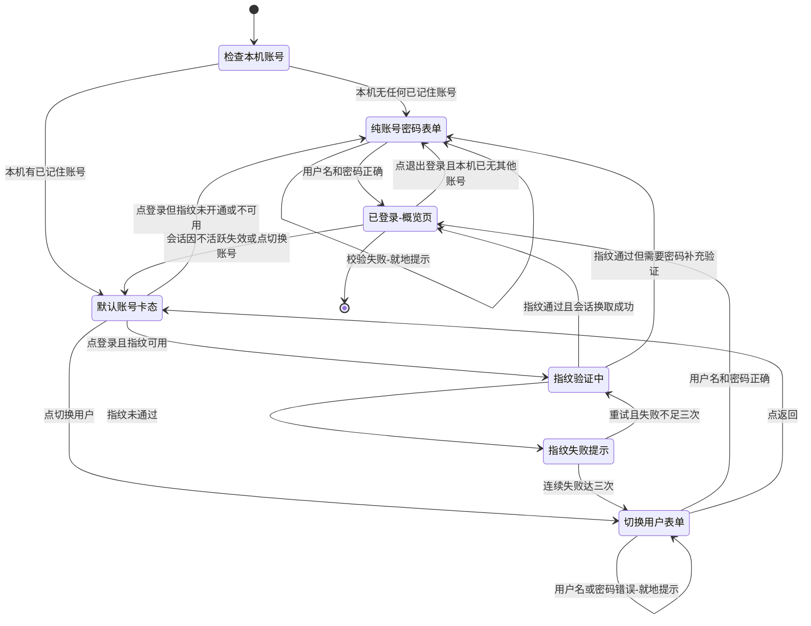
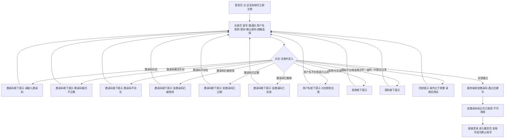

# PRD v0.5.0（增量）— 永远富裕 / KeepRich

| 项 | 内容 |
|---|---|
| 文档类型 | 增量 PRD（只描述本次变更，不重写 v0.4.1 存量功能与全量 PRD） |
| 版本 | v0.5.0（基线 v0.4.1 线上版） |
| 项目名 | keeprich_finance |
| 技术栈 | Flutter（Android + Web）+ Go/Gin + 云端快照（不涉及变更） |
| 上一轮文档 | `docs/prd/PRD_v0.4.0_incremental.md`、`docs/design/DESIGN_v0.4.0_incremental.md` |
| 原始需求 | ① token 过期应指「不活跃」而非「用久了」，一直在用不该登出；② 登录页改为「默认账号头像 + 切换用户 + 登录」三段式，点登录先走指纹，没开通指纹走密码；③ 切换用户走正常账号密码输入；④ 注册要有门槛：改用**邀请码**注册（管理员生成一次性邀请码，默认 7 天有效、可备注、可撤销），必须填英文用户名、必须填昵称（昵称用于 App 内与家庭内显示）；**邮箱改为选填且不做验证，本版不做任何发信/验证码** |

---

## 0. 本版范围（含不做的）

### 0.1 一句话目标

**把「登录」从一次性表单升级为「这台设备认识你」：进登录页先看到自己的头像，点一下（指纹）就进来；只要还在用就永不掉线，连续 24 小时没动静才需要重新验证身份；新用户必须拿到家人给的一次性邀请码才能进来，注册时给自己起一个英文用户名和一个中文昵称。**

### 0.2 本次范围内

| # | 变更 | 归属诉求 |
|---|---|---|
| 1 | 会话以「不活跃 24 小时」为失效条件，活跃期自动续期、用户无感 | ① |
| 2 | 登录页重排：默认账号卡（头像/昵称/用户名）→「登录」主按钮 →「切换用户」次按钮 | ② |
| 3 | 指纹/面容一键登录为主路径，未开通/不可用/连续失败 3 次降级到密码 | ② |
| 4 | 「切换用户」进入纯账号密码表单，且展示本机已记住的其他账号 | ③ |
| 5 | 本机多账号记忆（≤5 个，最近使用排序，默认=最近一次成功登录） | ②③ |
| 6 | 本机凭据安全改版：不再保存明文密码，改用「设备授权凭据」换取会话 | ②（安全底线） |
| 7 | 邀请码注册：管理员在后台生成一次性邀请码（默认 7 天有效、可备注、可撤销），家庭新成员凭码注册；弃用 v0.4.0 的「无门槛邮箱注册」 | ④ |
| 8 | 管理后台新增「邀请码」管理页（生成 / 复制 / 列表含状态与使用者 / 撤销） | ④ |
| 9 | 用户名规则（英文、唯一、大小写不敏感）+ 登录凭证口径明确为「用户名 + 密码」 | ④ |
| 10 | 昵称规则（中英文皆可、1~16 字、不唯一）+ 显示口径（App 内 + 家庭内） | ④ |
| 11 | 老账号（含 v0.4.0 邮箱即用户名账号）平滑过渡 | 兼容 |

### 0.3 明确不做（Out of Scope）

- **不做任何邮件能力**：不发验证邮件、不发通知邮件、不接 SMTP、不做邮件模板。**邮箱在本版只是选填的联系方式字段，不验证、不发信、不参与登录**。
- **不做注册/登录埋点与转化统计**：注册转化率、登录成功率、指纹使用率本版一律不采集、不上报、不做看板。理由：本版要先把体验跑通，埋点会引入额外的接口与字段变更，收益低于成本；等 v0.6 体验稳定后再统一做。
- **不做第三方登录**（微信 / Google / Apple）。
- **不做账号自助注销**。
- **不做 App 内邀请通知 / 入家庭审批流**：邀请码只在管理后台生成，由管理员线下（微信 / 口头）发给家人，家人自助注册。
- **不做邀请码批量导入导出、不做自定义邀请码**（邀请码由服务端生成，避免「88888888」这类弱码）。
- **不做邮箱自助找回密码**（列为 P2：本版邮箱未经验证、不可信，找回必须先补「邮箱验证」环节，成本独立）。
- **不改账务模型、统计口径、报表字段**；除「昵称显示口径」外，概览/记账/计划/家庭/投资等业务页面逻辑不动。
- **不改扫码连接、服务端地址设置**（沿用现有 chip + Web 二维码）。
- **Web 端不做多账号卡**：浏览器上仍是一次一个账号的账号密码表单（本地存储不可信、刷新即忘，做卡片反而是负体验）。指纹登录同理：Web 不支持。
- **不做「图形验证码」**：注册侧靠邀请码 + 同一 IP 每小时 10 次提交限制，登录侧靠现有失败锁定。
- **不改 token 的密码学方案**（不换 JWT 实现、不加设备指纹签名），只调整时效语义与凭据内容。

### 0.4 非功能约束

| 项 | 约束 |
|---|---|
| 兼容性 | 现有 5 个账号（admin / alice / bob / test / webuser）必须继续用「用户名 + 密码」登录成功；v0.4.0 用邮箱注册的账号必须继续可登录（见 §5） |
| 文案 | 所有面向用户的提示一律中文，**禁止**出现英文原句、异常类名、堆栈、HTTP 状态码 |
| 安全 | 本机不得保存明文密码；凭据只进系统安全存储；本机凭据仅在当前设备可用，服务端可撤销；邀请码不得可枚举（服务端生成、8 位、剔除易混字符）、不得在注册接口回显其他信息 |
| 性能 | 登录页冷启动到「默认账号卡」可见 ≤1.5s（不依赖网络，读本地即可渲染）；指纹调起到系统弹窗 ≤500ms |
| 降级 | 指纹不可用、本机无账号、邀请码无效三种情况都必须给出明确的中文去向（「用密码登录」/「向家庭管理员索取」），不能出现「无路可走」的页面 |

---

## 1. 用户故事

| ID | 故事 |
|---|---|
| US-1 | **作为**每天都会打开 App 记账的用户，**我想**只要我还在用就不要莫名其妙被踢回登录页，**这样**我不会在记一笔账的中途被要求重新输密码。 |
| US-2 | **作为**手机上登过两个账号的用户，**我想**一进登录页就看到「我最近用的那个账号」的头像和名字，**这样**我不用每次重新想我用的是哪个账号。 |
| US-3 | **作为**开通了指纹的用户，**我想**点一下「登录」就用指纹进去，**这样**我不用在小键盘上输一长串密码。 |
| US-4 | **作为**要换账号看数据的用户（比如帮家人看账），**我想**点「切换用户」就回到熟悉的账号密码输入，**这样**我不会因为「一键登录」而卡在别人的账号里。 |
| US-5 | **作为**家庭里的新成员，**我想**用管理员给我的一次性邀请码注册，**这样**账本只有家里人能进来，而我也不用去收什么验证邮件。 |
| US-6 | **作为**新用户，**我想**注册时明确知道「登录用的是用户名和密码」，且用户名只能用英文，**这样**我不会第二天想不起来该用什么登录。 |
| US-7 | **作为**家庭成员，**我想**我的中文昵称能显示在 App 里和家庭成员列表里，**这样**老婆孩子看到的是「小满」而不是「xm_2024」。 |
| US-8 | **作为**以前用邮箱注册的老用户，**我想**升级后还能照常登录，**这样**我不用去求管理员重置账号。 |

---

## 2. 需求池（P0 / P1 / P2）

> P0 = 本版不发不行；P1 = 同版尽量带上；P2 = 可延后。
> 验收标准均可由 QA 直接执行，不依赖看代码。

| 编号 | 需求 | 验收标准（可测） | 优先级 |
|---|---|---|---|
| R-01 | **会话以「不活跃」计失效（24h 滑动）**：任何一次成功请求都重置倒计时；连续 24 小时无任何请求才失效 | ① 登录后在 24 小时内持续操作（至少每 12 小时一次）→ 全程不出现登录页，无任何「会话已续期」类提示；② 把设备时钟/服务端判定推过 24 小时无请求后打开 App → 落在登录页且默认账号卡仍在，卡片下方显示「已超过 24 小时未使用，请重新验证身份」；③ 同一账号在手机 A 与平板 B 同时登录，A 退出登录不影响 B；④ 管理员停用账号或用户改密码后，该账号所有设备下次请求即失效并提示「登录已失效，请重新登录」 | P0 |
| R-02 | **登录页三段式信息架构**：默认账号卡（头像 + 昵称 + 用户名）→「登录」主按钮 →「切换用户」次按钮 | ① 本机有已记住账号时，进入登录页首屏即可见头像、昵称、用户名、「登录」「切换用户」两个按钮，顺序自上而下不颠倒；② 本机无任何账号时，登录页退化为纯账号密码表单（用户名 + 密码 + 登录按钮），**不出现**空的头像框与「切换用户」按钮；③ 头像未设置时显示昵称首字（中文取首字、英文取首字母大写）的金色圆底，不显示灰色占位图；④ 页面同时保留「还没有账号？立即注册」入口与服务端地址 chip | P0 |
| R-03 | **指纹/面容一键登录与三条降级路径** | ① 设备已开通指纹 → 主按钮文案「登录」，点击直接调起系统指纹弹窗，通过后进入概览页，全程不需要输入任何字符；② 设备支持但未录入指纹 → 主按钮文案「输入密码登录」，点击后展开账号密码表单且用户名已预填默认账号，光标落在密码框，顶部提示「未开启指纹，请在系统设置中录入指纹后重试」；③ 设备不支持指纹（含 Web）→ 同 ②，提示改为「当前设备不支持指纹，请用密码登录」；④ 三条路径中任意一条都能最终进入概览页（无死路） | P0 |
| R-04 | **指纹失败与强制降级**：验证失败可重试，连续失败 3 次强制走密码 | ① 指纹验证失败 → 停在登录页，提示「指纹验证失败，请重试」，主按钮可再次点击；② 用户主动点系统弹窗的「取消」→ 提示「已取消指纹验证」，且**不**计入失败次数；③ 连续失败第 3 次 → 自动展开账号密码表单，提示「指纹连续 3 次未通过，请改用密码登录」，此时「登录」按钮不再调起指纹；④ 任意一次登录成功后失败计数清零；退出登录后重进登录页计数也清零；⑤ 系统层面指纹不可用（传感器被禁用/连续失败被系统锁定）→ 直接给密码路径，不得把系统英文错误原文弹给用户 | P0 |
| R-05 | **「切换用户」走正常账号密码输入** | ① 点「切换用户」→ 进入账号密码表单，用户名框为空、可输入、可粘贴，标签为「用户名」；② 表单下方展示本机已记住的账号头像行（≤5 个，按最近使用排序），点其中一个即把该账号用户名填入用户框并聚焦密码框；③ 点左上返回/「返回」文字按钮 → 回到默认账号卡状态，默认账号不变；④ 在切换用户态登录成功 → 该账号成为新的默认账号（下次进登录页看到的是它） | P0 |
| R-06 | **本机多账号记忆规则** | ① 最多记住 5 个账号，按「最近一次成功登录时间」倒序；② 第 6 个账号登录成功时，静默移除最久未使用的那个账号卡（不删服务端任何数据，不给用户弹窗打断），被移除者下次登录需重新输入密码；③ 默认账号 = 最近一次**成功登录**的账号（仅点开「切换用户」又退出不算）；④ 长按默认账号卡或已记住账号头像 → 弹出「从本机移除该账号」，确认文案说明「移除后需重新输入密码登录，账本数据不受影响」；⑤ 移除后若本机已无账号 → 直接退化为纯账号密码表单 | P0 |
| R-07 | **本机凭据安全（红线）**：不保存明文密码 | ① 全量检查本机存储（安全存储与普通偏好存储）→ 不存在任何形如用户密码的明文/可逆密文；② 指纹登录成功所需凭据仅存于系统安全存储（Keychain / Keystore），且该凭据只能用于换取登录会话，不能用于改密码、不能用于修改绑定邮箱；③ 卸载重装 App → 已记住账号与凭据全部消失，需重新输入密码；④ 「退出登录」后该账号的本机凭据与账号卡一并删除（服务端账号与数据不动）；⑤ v0.4.1 遗留在本机的旧密码凭据在升级后首次登录成功时被清除 | P0 |
| R-08 | **邀请码注册（校验规则与消耗规则）** | ① 注册页邀请码为必填，填写管理员后台生成的有效邀请码 + 合规用户名/密码/昵称 → 建号成功并直接登录；② 邀请码为 8 位（大写字母 + 数字，已剔除易混字符 `0 O 1 I L`），输入自动去空格与连字符、不区分大小写（`k7qx-9mrt` 与 `K7QX9MRT` 等价）；③ **一次性**：建号成功后立即标记「已使用」，同一码再注册必失败，提示「该邀请码已被使用，请向家庭管理员索取新的邀请码」；④ **有效期**：生成时可选 1 天 / 7 天（默认）/ 30 天，过期后注册失败，提示「该邀请码已过期，请向家庭管理员索取新的邀请码」；⑤ 已撤销的码注册失败，提示「该邀请码已失效，请向家庭管理员索取新的邀请码」；⑥ 不存在的码提示「邀请码不存在，请向家庭管理员索取」；空提示「请输入邀请码」；格式不符（非 8 位字母数字）提示「邀请码格式不正确，请检查后重试」；⑦ 同一 IP 每小时最多 **10 次**注册提交，超出提示「操作过于频繁，请稍后再试」（与邀请码无关，纯防刷）；⑧ 注册失败（用户名占用、密码不合规等）**不消耗**邀请码，只有建号成功才标记为已使用 | P0 |
| R-09 | **管理端邀请码生成与管理** | ① 入口：管理后台 →「邀请码」；列表字段：邀请码（完整可见）、备注、状态（未使用 / 已使用 / 已过期 / 已撤销）、有效期至、使用者（昵称 + 用户名）、生成时间；② 生成：备注选填（≤32 字）、有效期选 1/7/30 天（默认 7 天）、一次可生成 1~5 个，成功后提示「邀请码已生成，请复制后发给家人」；③ 每个码有「复制」按钮，复制成功提示「已复制」；④ 撤销：仅「未使用」可撤销，二次确认后状态变「已撤销」并提示「邀请码已撤销」，已使用/已过期的码不提供撤销按钮；⑤ 生成频控：同一管理员 1 小时内最多生成 20 个，超出提示「生成过于频繁，请稍后再试」；⑥ 列表为空时提示「还没有生成过邀请码」；⑦ 注册接口对无效码**只返回对应错误文案**，不回显任何其他邀请码信息（防枚举） | P0 |
| R-10 | **用户名规则与唯一性** | ① 规则：必须以英文字母开头；仅允许英文字母、数字、下划线；长度 4~20 位；全平台唯一；大小写不敏感（统一按小写归一，注册时 `Alice_01` 与 `alice_01` 视为同一用户名）；② 输入中文 → 就地提示「用户名只能使用英文字母、数字和下划线，不能用中文」；③ 数字或下划线开头 → 「用户名必须以英文字母开头」；④ 长度不符 → 「用户名需要 4 到 20 位」；⑤ 已占用 → 「该用户名已被占用，换一个试试」；⑥ 注册页用户名框下方常驻说明文案「登录时使用「用户名 + 密码」，请记牢」（原文照抄，不得改写）；⑦ 用 `ALICE_01` 登录能与 `alice_01` 账号匹配成功 | P0 |
| R-11 | **昵称规则与显示口径** | ① 规则：1~16 字（中文/英文/数字/空格均可，中文按 1 字算），**不唯一**、允许与他人重复；② 必填，留空提示「请输入昵称」；③ 超过 16 字提示「昵称最多 16 个字」；④ 只有空格提示「昵称不能只包含空格」；⑤ 昵称在 App 内（个人中心、记账人归属）与家庭成员列表、成员选择器、账单归属人显示位置全部生效，显示优先级为「昵称非空用昵称，否则用用户名」；⑥ 两个用户用同一昵称「小满」时，家庭成员列表用「小满（用户名）」区分，用户名只在重名时才出现 | P0 |
| R-12 | **注册成功即登录进概览** | ① 有效邀请码 + 合规用户名/密码/昵称 → 直接进入概览页，不回登录页、不要求再登一次；② 该账号立刻成为本机默认账号；③ 注册完成后登录页的账号卡显示其昵称与头像；④ 注册失败时已填内容不丢失（密码字段除外，需重填） | P0 |
| R-13 | **老账号与 v0.4.0 邮箱注册账号兼容登录** | ① 现有 5 个账号（admin / alice / bob / test / webuser）用「用户名 + 密码」登录成功，不强制改密码、不强制补昵称，**也不需要邀请码**；② v0.4.0 用邮箱注册的账号（用户名为邮箱串）用原邮箱 + 密码登录成功，大小写混输亦可；③ 老账号用户名不符合新规则（字符集或长度）时**不回溯校验、不阻断登录**；④ 用户名含大写时用小写输入也能登录成功；⑤ 老账号无昵称时账号卡显示用户名、头像取用户名首字母 | P0 |
| R-14 | **全中文文案与异常兜底** | ① 断网、服务端 5xx、邀请码无效、用户名占用等场景，页面出现的**全部**是 §4 文案表中的中文句子；② 页面不出现 `Exception`、`error`、`Timeout`、`409`、`500` 等字样（QA 逐屏截图核对）；③ 邀请码无效时按「不存在 / 已被使用 / 已过期 / 已撤销 / 格式不对」分别给不同文案，且「用密码登录」路径不受影响；④ 网络不可用时提示「网络不可用，请检查网络后重试」并提供「重试」按钮 | P0 |
| R-15 | **「退出登录」与「切换用户」语义区分** | ① 设置页「退出登录」→ 清本机该账号凭据与账号卡 + 通知服务端作废该设备会话 → 回登录页（若还有其他账号，显示新的默认账号卡；否则显示纯表单）；② 设置页新增「切换账号」（位于「退出登录」上方）→ 保留全部账号卡与凭据，回登录页；③ 两个入口的二次确认文案不同，不得混用 | P1 |
| R-16 | **已登录设备管理** | ① 设置 → 账号与安全 → 「已登录设备」列出设备名与最近活跃时间；② 可单个撤销，撤销后该设备下次请求提示「登录已失效，请重新登录」；③ 可「撤销其他所有设备」，当前设备保留 | P1 |
| R-17 | **v0.4.0 邮箱注册老账号补设用户名（可跳过）** | ① 此类账号登录成功后弹一次「给自己起个用户名」引导，说明「以后可以用用户名登录，邮箱仍可登录」，可「稍后再说」；② 跳过则不重复打扰（本机记住已提示过）；③ 设置成功后用户名按其规则校验并保证唯一 | P1 |
| R-18 | **账号卡头像与快捷移除** | ① 有 `avatar` 时显示图片，无则显示昵称首字金色圆底；② 长按账号卡弹出「从本机移除该账号」菜单；③ 头像不提供本版上传入口（沿用设置页已有资料编辑） | P1 |
| R-19 | **邮箱自助找回密码（依赖邮箱验证，故延后）** | 先补「邮箱验证」环节，再做验证码/链接重置；重置后强制所有设备重新登录 | P2 |
| R-20 | **账号卡手动排序与记忆数量设置** | 允许用户拖动排序、设置「记住几个账号」（1~5） | P2 |
| R-21 | **登录页「保持登录」开关** | 允许用户关闭指纹免密登录（保留账号卡但每次需输密码） | P2 |

**P0 共 14 条（R-01 ~ R-14），P1 共 4 条（R-15 ~ R-18），P2 共 3 条（R-19 ~ R-21）。**

---

## 3. 交互与状态

### 3.1 登录页线框（状态 A：指纹可用 + 会话有效）

```text
┌──────────────────────────────────────────┐
│                                          │
│              [ App 图标光环 ]             │
│            让财务透明，资产永存            │
│                                          │
│               ╭───────────╮              │
│               │   头像 72  │              │  ← 圆形，金色描边
│               ╰───────────╯              │
│                 林小满                    │  ← 昵称（16px，金色）
│                alice_lin                  │  ← 用户名（12px，灰）
│                                          │
│       ┌────────────────────────┐         │
│       │        登  录          │         │  ← 主按钮（实心金），高 50
│       └────────────────────────┘         │
│       ┌────────────────────────┐         │
│       │      切换用户           │         │  ← 次按钮（描边），高 44
│       └────────────────────────┘         │
│                                          │
│           还没有账号？立即注册             │
│           [ 服务端地址 chip ]              │
└──────────────────────────────────────────┘
```

> 头像与账号卡整体可长按（移除该账号），单击无动作（不跳转、不误触登录）。

### 3.2 登录页线框（状态 B：切换用户 / 无账号）

```text
┌──────────────────────────────────────────┐
│  ←  返回                                 │
│              [ App 图标光环 ]             │
│             使用账号密码登录               │
│                                          │
│  ┌────────────────────────────────────┐  │
│  │ 用户名  [ alice_lin            ]   │  │
│  └────────────────────────────────────┘  │
│  ┌────────────────────────────────────┐  │
│  │ 密码    [ ••••••••         👁 ]    │  │
│  └────────────────────────────────────┘  │
│  ┌────────────────────────────────────┐  │
│  │            登  录                  │  │
│  └────────────────────────────────────┘  │
│                                          │
│   本机已记住的账号                        │
│    ( 张 )  ( 王 )  ( 李 )                │  ← 头像行，点击即预填用户名
│                                          │
│           还没有账号？立即注册             │
└──────────────────────────────────────────┘
```

- 本机无任何账号时，页面直接呈现本线框，**去掉**左上「返回」与「本机已记住的账号」区块。
- 进入本线框的两条路径差异：① 点「切换用户」进入 → 用户名框**为空**、自动聚焦用户名框；② 点「输入密码登录」（指纹未开通/不可用）进入 → 用户名框**已预填默认账号**、自动聚焦密码框、顶部带提示条。
- 用户名框标签由 v0.4.1 的「邮箱」改为「用户名」，键盘为默认文本键盘、不自动大写、不自动纠正。

### 3.3 登录页状态机



**会话失效时的登录页（状态 C）**：仍显示默认账号卡，卡片下方增加一条黄色提示条「已超过 24 小时未使用，请重新验证身份」；主按钮文案由「登录」改为「验证并登录」（指纹可用）或「输入密码登录」（指纹不可用）。验证方式与平时完全一致。

### 3.4 注册流程（邀请码单步完成，无任何「等待邮件」分支）



- 校验顺序（对用户可见的优先级）：邀请码 → 用户名 → 昵称 → 密码/确认密码。一次只提示一个字段的错误，不叠加红字。
- 邀请码校验通过但后续字段不合法时，**不消耗**邀请码，用户改完字段再提交仍用同一个码。
- 页面上**不存在**「发送验证码」「重新发送」「验证码」等任何字样（QA 逐屏核对）。

### 3.5 注册页线框（单页，无分步）

```text
┌──────────────────────────────────────────┐
│  ←  注册账号                              │
│              创建你的账本                  │
│         邀请码由家庭管理员提供             │
│                                          │
│  ┌────────────────────────────────────┐  │
│  │ 邀请码  [ K7QX-9MRT            ]   │  │  ← 自动大写、允许 - 分组
│  └────────────────────────────────────┘  │
│   没有邀请码？请向家庭管理员索取            │
│  ┌────────────────────────────────────┐  │
│  │ 用户名  [ alice_lin            ]   │  │
│  └────────────────────────────────────┘  │
│   4~20 位，字母开头，只能是英文字母/数字/_ │
│   ⚠ 登录时使用「用户名 + 密码」，请记牢    │  ← 常驻金色小字，不得隐藏
│  ┌────────────────────────────────────┐  │
│  │ 昵称    [ 林小满               ]   │  │
│  └────────────────────────────────────┘  │
│   昵称会显示在 App 和家庭成员列表里，可用中文│
│  ┌────────────────────────────────────┐  │
│  │ 密码    [ ••••••••         👁 ]    │  │
│  └────────────────────────────────────┘  │
│   至少 8 位，同时含字母和数字             │
│  ┌────────────────────────────────────┐  │
│  │ 确认密码 [ ••••••••         👁 ]   │  │
│  └────────────────────────────────────┘  │
│  ┌────────────────────────────────────┐  │
│  │ 邮箱（选填）[ you@example.com  ]   │  │
│  └────────────────────────────────────┘  │
│   仅作联系方式，不会发送验证邮件           │
│  ┌────────────────────────────────────┐  │
│  │          注册并进入                │  │
│  └────────────────────────────────────┘  │
│         已有账号？返回登录                │
└──────────────────────────────────────────┘
```

- 字段顺序固定：邀请码 → 用户名 → 昵称 → 密码 → 确认密码 → 邮箱（选填）。邀请码在最上，体现「这是门槛」。
- 页面底部保留服务端地址入口（与登录页同一对话框）。

### 3.6 管理端邀请码页（新增，Web/Pad 管理后台）

```text
┌──────────────────────────────────────────────────────────┐
│  邀请码                              [ + 生成邀请码 ]     │
│──────────────────────────────────────────────────────────│
│  K7QX-9MRT   [复制]   备注: 给爸爸    有效期至 11-02 20:00│
│      状态: 未使用                              [撤销]     │
│  M3FN-7BQP   [复制]   备注: —         有效期至 10-30 20:00│
│      状态: 已使用    使用者: 林小满 (alice_lin)          │
│  8ZTR-4KWM           备注: 给妈       有效期至 10-20 20:00│
│      状态: 已撤销                                        │
│  ────────────────────────────────────────────────────    │
│  （空列表时展示）还没有生成过邀请码                       │
└──────────────────────────────────────────────────────────┘
```

生成弹窗：备注（选填）/ 有效期（1 天 · 7 天（默认）· 30 天）/ 数量（1~5）→ 主按钮「生成」。

### 3.7 本机多账号与存储规则

| 项 | 规则 |
|---|---|
| 记住哪些账号 | 最近成功登录过的账号，最多 **5** 个，按最近成功登录时间倒序 |
| 默认账号 | **最近一次成功登录**的账号（点开「切换用户」又返回不改变默认） |
| 卡上显示什么 | 头像（无则昵称首字）+ 昵称（空则用户名）+ 用户名 |
| 本机存什么 | ① 账号标识（UID + 归一化用户名）；② 展示用的昵称与头像；③ 最近使用时间；④ 指纹可用时额外存一份**设备授权凭据**（只能用于换取登录会话） |
| 本机绝不存什么 | 明文密码、密码的可逆加密结果、密码哈希 |
| 移除方式 | 长按账号卡 →「从本机移除该账号」→ 二次确认；或「退出登录」清当前账号 |
| 切换账号时旧账号是否保留 | **保留**。切号只是把另一个账号设为默认，旧账号卡与凭据不动 |
| 容量满了 | 登录第 6 个账号时静默移除最久未使用的账号卡（不打断、不弹窗） |
| 清空条件 | 卸载重装 / 「退出登录」逐个清 / 设置页「清除本机所有账号」 |
| Web 端 | **不做**多账号卡与指纹，保持一次性账号密码表单 |

### 3.8 会话策略（产品口径，不含实现）

| 场景 | 用户看到什么 |
|---|---|
| 24 小时内用过 | 打开 App 直接进概览页，看不到登录页 |
| 正在使用中 | 永不因「用久了」掉线；续期过程用户完全无感（不弹提示、不闪屏、不打断正在填的表单） |
| 连续 24 小时没有任何请求（含 App 挂在后台一直没切回来） | 下次操作时回登录页，默认账号卡保留 + 提示「已超过 24 小时未使用，请重新验证身份」，用指纹或密码都能重新进入 |
| 断网超过 24 小时后恢复 | 按不活跃处理，需重新验证身份 |
| 多设备 | 各设备独立计时、互不影响；手机退出登录不会踢掉平板 |
| 改密码 / 被管理员停用 | 该账号所有设备立即失效，提示「登录已失效，请重新登录」 |
| 未开通指纹 | 24 小时不活跃后需要输入「用户名 + 密码」 |
| 会话失效 ≠ 退出登录 | 失效只是要求重新验证身份，**不删除**账号卡；「退出登录」才删卡与凭据 |

> 实现口径（供架构师参考，不作为 PRD 约束）：访问凭据短期有效（建议 15 分钟，沿用现状）+ 使用即自动续期；「24 小时不活跃」是服务端与设备凭据共同判定的滑动窗口。**唯一硬约束：活跃不掉线、闲置 24 小时必失效、本机不存明文密码。**

---

## 4. 文案表（可原样抄进代码）

### 4.1 登录页

| 场景 | 文案 |
|---|---|
| 主按钮（指纹可用、会话有效） | `登录` |
| 主按钮（指纹可用、会话已失效） | `验证并登录` |
| 主按钮（指纹未开通/不支持） | `输入密码登录` |
| 次按钮 | `切换用户` |
| 指纹态的密码兜底文字链 | `用密码登录` |
| 会话失效提示条 | `已超过 24 小时未使用，请重新验证身份` |
| 未录入指纹 | `未开启指纹，请在系统设置中录入指纹后重试` |
| 设备不支持指纹 | `当前设备不支持指纹，请用密码登录` |
| 指纹验证失败 | `指纹验证失败，请重试` |
| 用户取消指纹 | `已取消指纹验证` |
| 连续失败 3 次 | `指纹连续 3 次未通过，请改用密码登录` |
| 账号或密码错误 | `用户名或密码错误` |
| 登录尝试过多 | `登录失败次数过多，请 N 分钟后再试`（N 为服务端给的剩余分钟） |
| 网络不可用 | `网络不可用，请检查网络后重试` |
| 请求超时 | `连接超时，请检查网络或服务端地址` |
| 会话被服务端作废 | `登录已失效，请重新登录` |
| 账号被停用 | `账号已停用，请联系管理员` |
| 切换用户表单标题 | `使用账号密码登录` |
| 已记住账号区标题 | `本机已记住的账号` |
| 长按账号卡菜单项 | `从本机移除该账号` |
| 移除确认标题 | `从本机移除「{昵称或用户名}」？` |
| 移除确认正文 | `移除后该账号下次登录需要重新输入密码，账本数据不受影响。` |
| 移除确认按钮 | `移除` / `取消` |
| 注册入口 | `还没有账号？立即注册` |
| 返回账号卡 | `返回` |

### 4.2 注册页

| 场景 | 文案 |
|---|---|
| 页面标题 | `注册账号` |
| 页面副标题 | `邀请码由家庭管理员提供` |
| 邀请码说明（常驻） | `没有邀请码？请向家庭管理员索取` |
| 用户名说明（常驻） | `4~20 位，字母开头，只能是英文字母、数字和下划线` |
| 用户名用途说明（常驻，不得折叠） | `登录时使用「用户名 + 密码」，请记牢` |
| 昵称说明（常驻） | `昵称会显示在 App 和家庭成员列表里，可以用中文` |
| 邮箱说明（常驻） | `仅作联系方式，不会发送验证邮件` |
| 主按钮 | `注册并进入` |
| 返回 | `已有账号？返回登录` |
| 邀请码为空 | `请输入邀请码` |
| 邀请码格式不对 | `邀请码格式不正确，请检查后重试` |
| 邀请码不存在 | `邀请码不存在，请向家庭管理员索取` |
| 邀请码已被使用 | `该邀请码已被使用，请向家庭管理员索取新的邀请码` |
| 邀请码已过期 | `该邀请码已过期，请向家庭管理员索取新的邀请码` |
| 邀请码已撤销 | `该邀请码已失效，请向家庭管理员索取新的邀请码` |
| 同一 IP 提交过多 | `操作过于频繁，请稍后再试` |
| 用户名为空 | `请输入用户名` |
| 用户名非字母开头 | `用户名必须以英文字母开头` |
| 用户名含中文 | `用户名只能使用英文字母、数字和下划线，不能用中文` |
| 用户名含其他符号 | `用户名只能使用英文字母、数字和下划线` |
| 用户名长度不符 | `用户名需要 4 到 20 位` |
| 用户名已占用 | `该用户名已被占用，换一个试试` |
| 昵称为空 | `请输入昵称` |
| 昵称超长 | `昵称最多 16 个字` |
| 昵称全空格 | `昵称不能只包含空格` |
| 密码为空 | `请输入密码` |
| 密码过短 | `密码至少 8 位` |
| 密码强度不足 | `密码需同时包含字母和数字` |
| 确认密码不一致 | `两次输入的密码不一致` |
| 邮箱格式错（选填但有值时校验） | `邮箱格式不正确` |
| 邮箱过长（选填但有值时校验） | `邮箱长度不能超过 128 个字符` |
| 注册成功 | `注册成功，正在进入` |
| 未知失败 | `注册失败，请稍后再试` |
| 网络不可用 | `网络不可用，请检查网络后重试` |

### 4.3 管理端邀请码页

| 场景 | 文案 |
|---|---|
| 页面标题 | `邀请码` |
| 生成按钮 | `生成邀请码` |
| 生成弹窗标题 | `生成邀请码` |
| 备注字段 | `备注（选填）` |
| 备注过长 | `备注最多 32 个字` |
| 有效期字段 | `有效期` |
| 有效期选项 | `1 天` / `7 天` / `30 天`（默认 `7 天`） |
| 数量字段 | `生成数量` |
| 数量范围 | `一次最多生成 5 个` |
| 生成弹窗主按钮 | `生成` |
| 生成成功 | `邀请码已生成，请复制后发给家人` |
| 生成频控 | `生成过于频繁，请稍后再试` |
| 复制按钮 | `复制` |
| 复制成功 | `已复制` |
| 状态：未使用 | `未使用` |
| 状态：已使用 | `已使用` |
| 状态：已过期 | `已过期` |
| 状态：已撤销 | `已撤销` |
| 使用者 | `使用者：{昵称}（{用户名}）` |
| 撤销按钮 | `撤销` |
| 撤销确认 | `撤销后该邀请码不能再用于注册，确定撤销？` |
| 撤销成功 | `邀请码已撤销` |
| 空列表 | `还没有生成过邀请码` |

### 4.4 设置页（相关）

| 场景 | 文案 |
|---|---|
| 切换账号入口 | `切换账号` |
| 切换账号说明 | `保留已记住的账号，回到登录页选择其他账号` |
| 退出登录入口 | `退出登录` |
| 退出登录确认 | `退出后需要重新输入密码登录，账本数据不受影响。` |
| 退出登录按钮 | `退出登录` / `取消` |
| 已登录设备 | `已登录设备` |
| 撤销其他设备 | `撤销其他所有设备` |
| 撤销确认 | `撤销后这些设备需要重新登录，本机保持登录。` |

---

## 5. 兼容与迁移

### 5.1 现有 5 个账号（admin / alice / bob / test / webuser）

- 继续用「用户名 + 密码」登录，**不受新规则影响**；不强制改密码、不强制补昵称、不强制补用户名、**不需要邀请码**。
- 无昵称的老账号：登录页账号卡显示用户名，头像取用户名首字母大写；App 内显示沿用现状（昵称空则回退用户名，与现有逻辑一致）。
- 这 5 个账号里存在**不符合新用户名规则**的历史用户名（例如 `bob` 只有 3 位、`admin`/`alice`/`test`/`webuser` 长度合规）——一律**不回溯校验、不阻断登录、不强制改名**；用户名新规则**只约束新注册与主动修改用户名**。

### 5.2 v0.4.0「邮箱即用户名」账号

| 项 | 处理 |
|---|---|
| 能否继续登录 | **能**。登录框标签虽然叫「用户名」，但服务端仍接受「用户名 或 邮箱」两种输入（大小写不敏感），此类账号输入原邮箱即可登录；登录页不为此加额外说明，避免主路径复杂化 |
| 是否强制补设用户名 | **不强制**（已成定论，不再讨论）。登录成功后一次性引导「给自己起个用户名」，可「稍后再说」（R-17，P1） |
| 补设后 | 用户名可用于登录；原邮箱作为兼容通道继续可用 |
| 邮箱占用与唯一性 | 邀请码时代**不再做邮箱占用判断**，也不再校验两账号邮箱是否重复：邮箱选填、不验证、不唯一（同一邮箱出现在多个账号上是允许的）。v0.4.0 已存在的邮箱账号不受影响 |

### 5.3 昵称长度由 32 字收窄为 16 字

- 老数据中已超过 16 字的昵称：**不截断、不报错、不强制用户改**；仅在「编辑资料」提交时按 16 字校验。
- 显示侧超长昵称（>8 字）在登录页与家庭成员列表单行省略（`…`），不换行撑破布局。

### 5.4 本机凭据迁移（v0.4.1 → v0.5.0）

| 情况 | 处理 |
|---|---|
| 升级后首次打开 | 若本机存有 v0.4.1 的旧凭据（形如「用户名 + 密码」），页面仍提供指纹入口，但**首次指纹登录成功后立刻用设备授权凭据替换旧数据并删除本地密码** |
| 首次指纹登录失败 | 直接给密码路径，密码登录成功后完成替换；不提示技术原因 |
| 用户升级后一直不登录 | 旧凭据保持原样不做后台迁移（避免无凭据时误删导致必须重输密码） |
| 迁移完成后 | 本机不再存在任何密码形态数据（R-07 ① 验收） |

### 5.5 会话时效变化带来的首次影响

- v0.4.1 的续期凭据有效期较长，升级后按「24 小时不活跃」重新计算：若用户在升级前已超过 24 小时未活跃，升级后第一次打开会落回登录页——**属预期**，需在发版说明里写一句「升级后首次打开可能需要重新验证一次身份」。
- 升级不回滚：v0.5.0 写入的设备授权凭据在旧版本 App 上无法识别，回退版本的用户需重新输密码登录一次。

### 5.6 接口与展示口径

- 登录接口的入参语义扩展为「用户名 或 邮箱」，老客户端（v0.4.1）不受影响。
- 注册接口不再接受「邮箱 + 密码」自助开通：**没有有效邀请码就无法建号**。v0.4.1 老客户端若仍调用旧的「仅邮箱注册」路径，必须被拒绝并提示「请升级到最新版本后使用邀请码注册」。
- 「登录凭证 = 用户名 + 密码」；邮箱仅作联系方式，不参与登录（老账号兼容除外）。
- 家庭成员列表、记账人归属、账单归属人一律按「昵称优先」显示（R-11 ⑤⑥）。

### 5.7 邀请码上线注意事项

| 项 | 说明 |
|---|---|
| 上线即断流风险 | 新注册从此必须有码。**发布前管理员需先生成一批邀请码备用**（验收时至少生成 2 个走通全流程），否则新用户完全无法注册 |
| 老用户零影响 | 已存在的账号（5 个内置账号 + v0.4.0 邮箱账号）登录不需要邀请码，也不会被要求补码 |
| 已发出去但没用完的码 | 邀请码是 v0.5.0 新概念，上线前不存在历史码，无需迁移 |
| 撤销与误操作 | 已使用的码不可撤销（否则会出现「谁注册的」对不上的情况）；误撤销的码无法恢复，只能重新生成 |
| 家庭归属 | **用户已拍板：邀请码不绑定家庭**。注册出的账号默认是「无家庭」普通用户，加入家庭仍走既有的「加入申请 → 管理员审批」流程；邀请码不携带也不推导任何 familyId |

---

## 6. 待确认问题（不阻塞开发，附建议默认值）

| # | 问题 | 建议默认值（按此实现即可，用户后续可改） |
|---|---|---|
| Q1 | 指纹可用时，是否在登录页额外给一个「用密码登录」的文字链？会不会破坏用户要求的「头像 → 切换用户 → 登录」三段式？ | **保留**。理由：指纹传感器被系统临时禁用、手指潮湿破皮等情况下没有文字链就是死路；形态上做成 12px 低调文字链放在主按钮下方，视觉重量远低于两个正式按钮，不破坏三段式观感。连续失败 3 次后自动展开密码表单，文字链同时隐藏 |
| Q2 | 邀请码注册出的账号是否自动加入「生成该码的管理员」所在家庭？ | **否（用户 2026-11-09 拍板，取代原「是」的建议）**。邀请码不携带 familyId，注册成功后账号无家庭；加入家庭沿用既有的「加入申请 → 管理员审批」流程，本版不改动该流程。理由：避免绕过审批、也避免管理员属于多家庭时归属含糊 |
| Q3 | 设备授权凭据的生效期限与撤销粒度？ | **30 天不活跃失效、每次使用自动续期**；设置页「已登录设备」可按设备逐个撤销或一键撤销其他设备（R-16）。理由：30 天覆盖「偶尔记账」的轻度用户，同时把长期不用设备的暴露面收窄；撤销入口保证丢失手机时可自救 |

> 说明：本版验收以 §2 需求池每条的可测标准为准（登录页 5 种状态、会话 24 小时窗口、邀请码注册与消耗规则、本机无明文密码、老账号兼容），逐屏文案核对以 §4 为准。本版**不存在**任何邮件发信、验证码、等待激活的环节。
